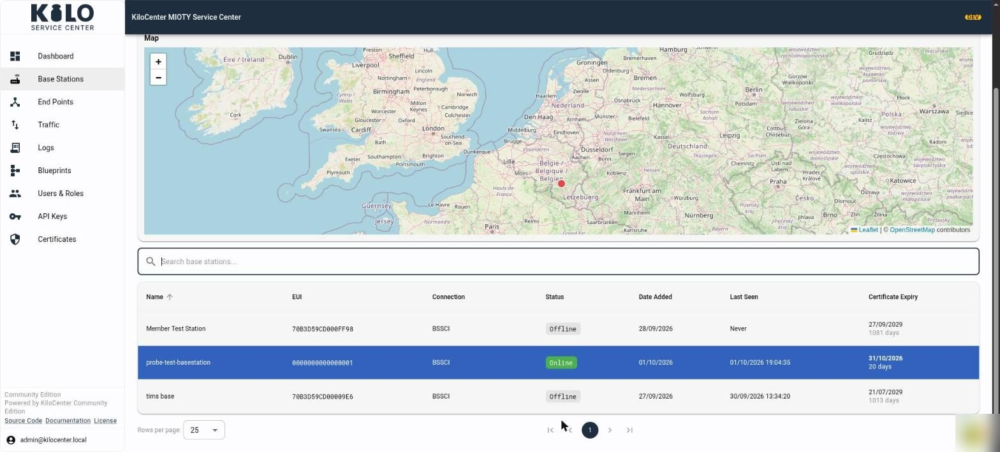
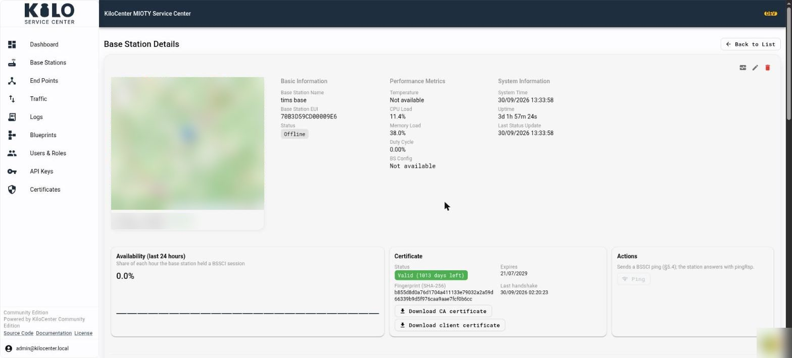

# Connect a Base Station

A MIOTY base station is the radio gateway between endpoints and Kilo Center. Connecting it to your open-source service-center installation establishes the path that brings radio messages into the network; you can then register endpoints and verify their traffic.

### Goal

Connect a MIOTY base station to your local KiloCenter instance and confirm it is online.

### Prerequisites

* KC-Core, KC-Gateway, and KC-Web running (see Installation)
* TLS certificates generated (see the certificate bootstrap step in your installation guide)
* BSSCI reachable on port `5000`
* `protocol.bsci_external_url` (environment variable `KILOCENTER_PROTOCOL_BSCI_EXTERNAL_URL`) set to the address base stations should connect to, for example `tls://bssci.example.com:5000`. If it names `localhost` or a wildcard address, the service center cannot hand out a URL and the **Add Base Station** result shows a warning.
* A user with the **Base Station Manager** role or **Admin** (see [User Roles and Permissions](../security/users-and-roles.md))

### Step 1: How do I add a base station in KiloCenter?

Before the hardware can connect, the base station must exist in KiloCenter. The **Add Base Station** wizard creates it and issues its certificates in one pass.

1. Open KC-Web at `http://localhost/` (container) or `http://localhost:5173` (source dev).
2. Select **Base Stations** in the sidebar. The page shows the station counts, a map and a table of every station.
3. Click **Add Base Station** at the top right. The **Add Base Station** dialog opens.
4. Fill in the fields:
   * **Base Station Name** (required): "A friendly name for this base station."
   * **Base Station EUI** (required): the 8-byte EUI as 16 hex digits, for example `0123456789ABCDEF`. Spaces and dashes are tolerated while you type. An invalid value shows "Invalid Base Station EUI format. Enter 16 hex digits."; an EUI that is already registered shows "A base station with this EUI already exists."
   * **Location (optional)**: **Latitude** (-90 to 90), **Longitude** (-180 to 180) and **Altitude** (meters above sea level). Fill both coordinates or neither, otherwise the dialog says "Both latitude and longitude are required, or leave both empty". **Pick on Map** opens **Select Location** ("Click on the map to place a marker"); click the map, then **Confirm** to copy the coordinates into the form.
5. Click **Next**. The button stays disabled until the name and EUI are filled in and shows **Creating...** while the station is created.

The dialog then moves to **Base Station Ready**:

* A green banner reads "Base station added successfully! Download the certificates below to complete setup."
* A summary shows the **Name**, the **Base Station EUI** and the **Service Center URL**, each with a copy button.
* If the service center holds no reachable URL, a warning names `protocol.bsci_external_url` and `KILOCENTER_PROTOCOL_BSCI_EXTERNAL_URL` instead of showing a URL.
* **Download CA Certificate**, **Download TLS Certificate** and **Download TLS Key (One-time)** save the three files. "Links expire in 15 minutes. Private key can only be downloaded once." Save all three before you close the dialog.
* **Next Steps** lists what to enter on the base station: the Service Center URL, `kilocenter-ca-certificate.crt`, `basestation-<EUI>-client-certificate.crt` and `basestation-<EUI>-private-key.key`, then save and restart the station.
* **Continue** closes the dialog and returns to the list.

If certificate generation fails, the dialog shows **Certificate Generation Failed** with the message "Base station created, but certificate generation failed. Use the retry button to generate certificates." The station already exists. Click **Retry Certificate Generation** (it reads **Generating Certificates...** while it works) or **Continue**, and issue new files later from the station's **Edit** dialog with **Regenerate Certificates**. See [How do I regenerate a base station certificate?](../security/certificate-renewal.md)

### Step 2: Configure Base Station Hardware

Point the base station firmware to your KiloCenter host:

* **Service Center address**: the Service Center URL from the wizard (your KC-Core host name or IP)
* **Service Center port**: `5000` (BSSCI)
* **Protocol**: TLS (required)

For AVA base stations, the factory login is `ubuntu` / `123456`. Change these credentials after initial access.

### Step 3: Install the Certificates on the Base Station

The base station must trust KiloCenter's CA certificate for TLS to succeed and present its own client certificate.

1. Take the three files you downloaded in the wizard: the CA certificate, the TLS (client) certificate and the TLS key.
2. Import them through the base station's configuration interface: the CA into its TLS trust store, and the client certificate and key as its identity.

Each base station gets its own client certificate, bound to its EUI. The service center refuses a station that presents anyone else's certificate.

### Step 4: Verify Connection

#### In KC-Web

Open **Base Stations**. The connected base station should show an **Online** status in the table, next to its **Connection**, **Date Added** and **Last Seen**.

<figure><figcaption></figcaption></figure>

Select its row to open **Base Station Details**. The **Certificate** panel shows the client certificate, and **Ping** checks the BSSCI session.

<figure><figcaption></figcaption></figure>

Its **Activity** tab lists the station's events (it coming online, going offline) and the uplinks it hears, in the same columns as the Events Log. Administrators also see warnings and errors on the dashboard's **Alerts** card, which links to the full history in **Logs** > **Events Log**.

If the base station has a location, entered when you added it or reported by its GPS, administrators also see it as a pin on the map at the top of the **Base Stations** page, above the search field. The pin turns from the error color to the success color when the station comes online, without a page reload. Click the pin to open the base station.

#### In Logs

```bash
tail -f kilocenter-modules/logs/runtime/kc-core.log
```

A successful connection produces log entries showing:

* **Version negotiation** -- KC-Core and the base station agree on BSSCI protocol version
* **Attach operations** -- the base station registers its endpoints with KC-Core

Look for entries containing `versionNeg` and `attach` with no error messages.

#### Common Connection Failures

| Symptom | Likely Cause |
|---------|-------------|
| No connection attempt in logs | Base station not pointing to correct host/port |
| TLS handshake error | CA certificate not imported or certificate mismatch |
| Connection drops immediately | Base station EUI not registered in KC-Web |
| Version negotiation fails | Firmware version incompatible with KC-Core BSSCI implementation |

### How do I delete a base station that still holds downlinks?

Deleting a base station closes its session and ends every downlink it held, queued at it, reserved for it or being revoked, as `expired`; the downlinks are not sent again through another station. A deleted station never connects again, so it cannot report what it did with them, but a station that is still powered may transmit them after it was deleted. Power the station off, or wait until no downlink is queued at it, before you delete it.
