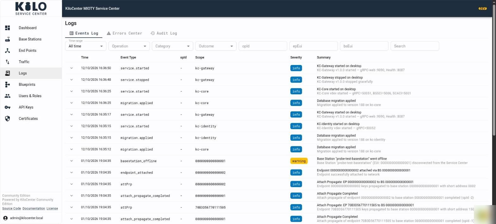
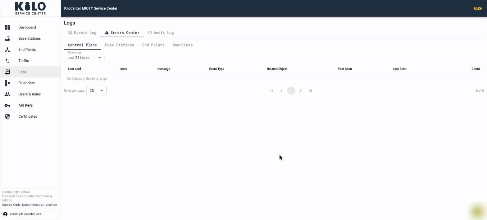
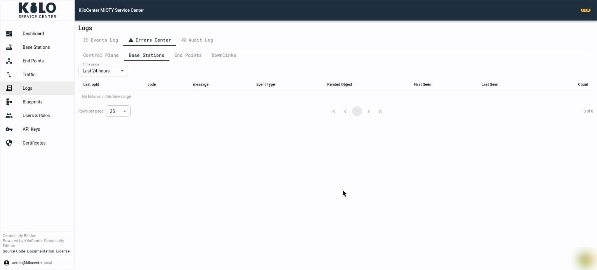
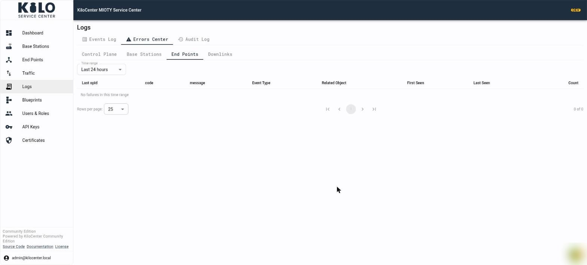
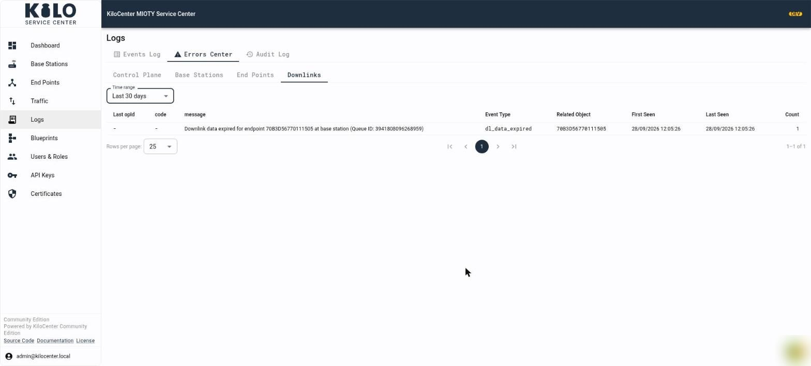
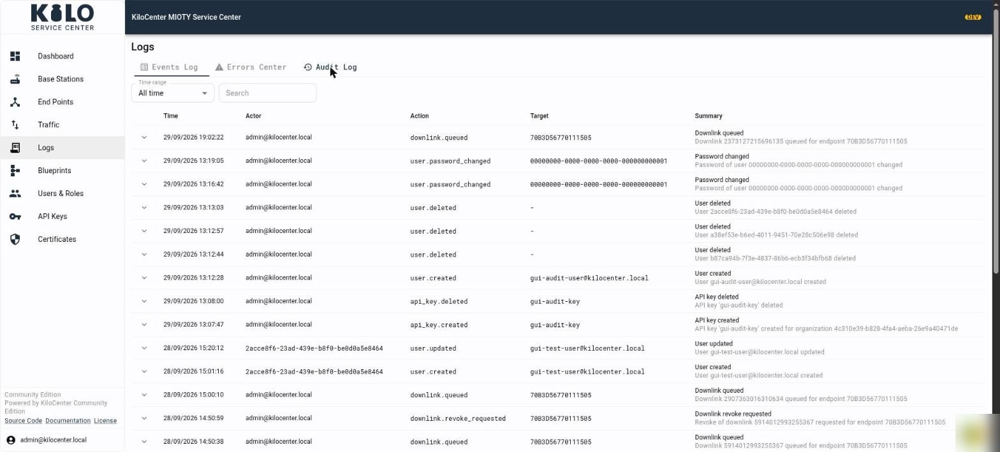

# How do I use the Audit Log and Errors Center?

Open **Logs** in the left menu to see everything KiloCenter records about itself. The page has three tabs, **Events Log**, **Errors Center** and **Audit Log**, and each tab answers a different question: what happened, what keeps failing, and who changed something.

<figure><figcaption></figcaption></figure>

## Who can see which Logs tab?

| Tab | Who sees it | What they see |
|---|---|---|
| Events Log | Admins, Base Station Managers and Endpoint Managers | Only the event categories their roles cover |
| Errors Center | Admins, Base Station Managers and Endpoint Managers | Each sub-tab only when their roles cover every category it groups (see below) |
| Audit Log | Admins only | Every audit event of the installation |

A user whose roles do not cover a tab sees "No access to this view". A role change applies within `grpc.rbac_role_cache_ttl_seconds`, 30 seconds by default, without signing in again. [User Roles and Permissions](../security/users-and-roles.md) lists which roles see which event categories.

## What does the Events Log show?

The **Events Log** lists everything that happened, newest first. Each row has a time, an event type, the `opId` of the operation, a scope (the base station, end point or service involved), a severity and a summary. Select the arrow at the start of a row to expand its data.

Filter the list with the controls above the table:

- **Time range** limits the rows to the last hour, day, week or month, or shows all time.
- **Operation**, **Category** and **Outcome** narrow the list to one kind of event.
- **opId**, **epEui** and **bsEui** follow a single operation, end point or base station.
- **Search** looks through the event text.

The Events Log updates by itself, so a service start, a base station going offline or an attach appears within about a second.

## What does the Errors Center show?

The **Errors Center** shows failures only, and it groups repeats so that a problem that happens a hundred times appears as one row with a count.

<figure><figcaption></figcaption></figure>

Choose one of four sub-tabs. Each groups failures from specific event categories, and you can open a sub-tab only when your roles cover all of its categories:

| Sub-tab | What it groups | Who can open it |
|---|---|---|
| **Control Plane** | Errors and critical events from the Application Center connection (SCACI), sessions, protocol, security and system events, plus failed SCACI operations | Admins |
| **Base Stations** | Errors and critical events from base stations and the BSSCI protocol, such as refused connections and protocol errors | Admins and Base Station Managers |
| **End Points** | Errors and critical events about end points, such as a failed attach or detach | Admins and Endpoint Managers |
| **Downlinks** | Warnings, errors and critical events about downlinks: expired, refused, failed or undeliverable ones | Admins and Endpoint Managers |

<figure><figcaption></figcaption></figure>

<figure><figcaption></figcaption></figure>

Every sub-tab has a **Time range** dropdown with **Last hour**, **Last 24 hours**, **Last 7 days** and **Last 30 days**. It starts at the last 24 hours, and each sub-tab keeps its own range, so set it again after you switch sub-tabs. The Errors Center always looks back a fixed window; it has no "all time" option.

Each row of the table is one group of identical failures:

| Column | Meaning |
|---|---|
| **Last opId** | The operation id of the most recent failure, or `-` when the failure has none |
| **code** | The error code, or `-` |
| **message** | What failed, for example which end point and which queue id |
| **Event Type** | The kind of event, such as `dl_data_expired` |
| **Related Object** | The end point, base station or service the failure belongs to |
| **First Seen** and **Last Seen** | When the failure first and last happened inside the range |
| **Count** | How many times it happened |

<figure><figcaption></figcaption></figure>

An empty table with "No failures in this time range" is good news. A group on the **Downlinks** sub-tab with `dl_data_expired` means a downlink waited for its end point's downlink window until its lifetime ran out and was reported as expired; see [How do I verify the first downlink?](../onboarding/verify-the-first-downlink.md).

## What does the Audit Log record?

The **Audit Log** records the actions of people and API keys, so you can answer who did what and when. Only administrators can open it, because the entries cover the whole installation.

<figure><figcaption></figcaption></figure>

Each row has a **Time**, the **Actor** (the user's email, or the user id when the account no longer exists), the **Action**, the **Target** the action touched and a **Summary**. Select the arrow at the start of a row to expand its data. Use **Time range** to limit the list and **Search** to find an actor, action or target.

The audit events include:

| Action | Recorded when |
|---|---|
| `user.created`, `user.updated`, `user.deleted` | An administrator adds, changes or removes a user |
| `user.registered` | Someone creates their own account; no credential enters the entry |
| `user.password_changed` | A user changes their own password or an administrator resets it |
| `api_key.created`, `api_key.deleted` | An API key is created or deleted |
| `endpoint.keys_revealed` | Someone reveals an end point's network session key or application key |
| `endpoint.keys_removed` | Someone removes a stored application key |
| `certificate.private_key_downloaded` | Someone downloads a base station's private key |
| `downlink.queued`, `downlink.updated`, `downlink.revoke_requested` | An operator queues a downlink, edits a pending one, or asks a base station to revoke one, from the web interface or the API |
| `organization.created`, `organization.updated`, `organization.deleted` | An organization is added, changed or removed (Enterprise edition) |
| `organization.member_added`, `organization.member_updated`, `organization.member_removed` | A user joins an organization, has a role or permission changed, or leaves it (Enterprise edition) |
| `integration.created`, `integration.updated`, `integration.deleted` | An integration is added, changed or removed |
| `certificate.server_generated`, `certificate.server_renewed` | The server certificate is generated for the first time or renewed |

Entries about keys name who acted and which key of which end point or station, and never contain the key. KiloCenter writes the audit entry before it hands out a secret. If the event store cannot take the record, the request fails and the secret stays protected, so there is no unrecorded reveal or download.

## Where do I find the same information for one device?

Open the base station or end point and select its **Activity** tab. It uses the same columns as the Events Log, filtered to that device, and it applies the same role rules. See [What can I do in the KiloCenter web interface?](../web-interface.md).

## What should I do when the Audit Log or an event list will not load?

If a tab shows "Could not load this list", check that KC-Core and the event store (PostgreSQL) are healthy on the Dashboard under **Service Center Status**, then read the KC-Core log. The checks are in [Operations and Troubleshooting](operations-and-troubleshooting.md).
