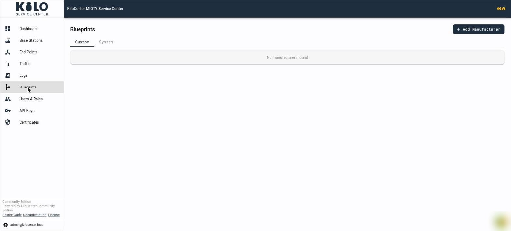

# How do blueprints and decoders work in KiloCenter?

A **blueprint** tells KiloCenter how to read the payload of a MIOTY end point: which bytes are the temperature, which are the battery level, and in what unit. With a blueprint assigned, every uplink in the **Activity** tab shows decoded values next to its raw payload. This page covers the **Blueprints** page of KC-Web: the catalog, every dialog, testing a decode and sharing a blueprint. To assign a blueprint to an end point, see [How Do I Decode an Endpoint's Uplinks with a Blueprint?](../onboarding/register-an-endpoint.md#how-do-i-decode-an-endpoints-uplinks-with-a-blueprint)

You need the **Endpoint Manager** role or **Admin** to open **Blueprints**. Entries in the **System** catalog can be created, edited and deleted only by an **Admin**; for everyone else those buttons are hidden. The role matrix is in [User Roles and Permissions](../security/users-and-roles.md).

<figure><figcaption></figcaption></figure>

## What is in the Custom and System catalogs?

The catalog is a tree: a **manufacturer** has **models** and a model has **blueprints**, each with a version.

* **Custom** holds the entries of your organization.
* **System** holds the entries shared with every organization on this service center. It contains only what an administrator adds, plus entries imported from a blueprint registry when one is configured.

A notice above the list says which catalog the next entry goes to: "Adds to your organization's Custom catalog." or "Adds to the System catalog, shared with every organization on this service center." When a catalog is empty the page says "No manufacturers found", "No device models found" or "No blueprints found".

## How do I add a manufacturer, a model and a decoder?

1. Open **Blueprints**, pick the **Custom** or **System** tab, and click **Add Manufacturer**.
2. In **Add Manufacturer**, fill in **Name** (required, "Name is required"), **Website** and **Description**, then save. The toast reads "Manufacturer created". The table shows each manufacturer with its **Models**, **Blueprints** and **Created** counts and **Actions**.
3. Open the manufacturer and click **Add Model**. The **Add Model** page asks for:
   * **Manufacturer** (required),
   * **Name** (required),
   * **Version** (required),
   * **Blueprint Specification (JSON)**, the blueprint itself: "Blueprint JSON per MIOTY Application Layer Specification". Invalid JSON shows "Invalid JSON format", an empty field "Blueprint specification is required".
   * The toast reads "Device model created".
4. To add another decoder version to an existing model, open the model and click **Add Decoder**. It takes a **Version** and the specification JSON ("Blueprint created").
5. To change or remove an entry, use the edit and delete icons in **Actions**:
   * **Edit Manufacturer** and **Edit Device Model** change the name, website and description.
   * **Delete Manufacturer** asks "Delete this manufacturer? All device models and blueprints will also be deleted." and **Delete Device Model** asks "Delete this device model? All blueprints will also be deleted."

## What does the blueprint page show?

Click a blueprint to open it. The header reads "Blueprint v" with the version, with **Back to Blueprints** at the top and these badges:

* **Default**: the blueprint new devices of this model use.
* **System**: it lives in the System catalog.
* **Verified**: it came from the registry and has been checked.

**Blueprint Information** shows when it was **Created** and **Updated**. The specification card shows the JSON. Click **Edit** to change it; **Save** stores it ("Blueprint saved") and **Cancel** discards your changes. **Default for new devices** makes this blueprint the model's default ("Blueprint set as the model default").

## How do I test a blueprint before I use it?

On the blueprint page, the **Test Decode** card decodes a sample without touching any end point:

1. Paste a hex payload into **Test Payload (hex)** ("Hex-encoded payload to test decoding").
2. Enter the **Format ID** the device uses (the user data format of the uplink).
3. Click **Test Decode** (disabled until you enter a payload). The result reads **Decoded successfully** with the values, or **Decode failed** with a `Code:` and message. Before you run it, the card says "No decode result".

## How do I move existing devices to a new blueprint?

When you publish a better decoder, **Migrate Devices** applies it to end points that already use the model:

1. Open the blueprint (or the model) and click **Migrate Devices**.
2. **Migrate Devices to This Blueprint** tells you how many device snapshots it will change ("This will re-materialize N device snapshot(s) onto this blueprint.") or "No device snapshots reference this model — nothing to migrate."
3. Tick **Also set as default for new devices** if the blueprint should become the default.
4. Click **Migrate**. The toast reads "Devices migrated: N device snapshot(s) now use this blueprint".

Earlier uplinks keep the decode status they were stored with.

## How do I submit a blueprint to the registry?

A blueprint registry is a GitHub repository where blueprints are shared. When the service center is connected to one, the blueprint page shows **Submit to Registry** (hidden for blueprints that are already **Verified**).

1. Click **Submit to Registry**. The dialog **Submit to Registry** asks for **Contributor Name** and **Contributor Email** (both required) and a description ("Describe the changes or purpose of this blueprint...").
2. Submit. KiloCenter opens a pull request in the registry repository and reports "Blueprint submitted to registry successfully", "Pull request created", the branch and commit, and a **View Pull Request** link.

If no registry is connected, the **System** tab says "The blueprint registry is not configured on this service center" and **Submit to Registry** is disabled with the note "Submission is unavailable: the blueprint registry is not configured on this service center." Connect one with the `registry_provider` settings:

| Setting | Environment variable | Purpose |
|---|---|---|
| `registry_provider.enabled` | | Turns registry submission on. Default `false`. |
| `registry_provider.auth_mode` | | `token` (a personal access token) or `github-app`. |
| `registry_provider.api_url` | | API base URL. Default `https://api.github.com` in the sample file. |
| `registry_provider.token` | `KILOCENTER_REGISTRY_PROVIDER_TOKEN` | Personal access token, for `token` mode. |
| `registry_provider.owner` | `KILOCENTER_REGISTRY_PROVIDER_OWNER` | Repository owner. |
| `registry_provider.repo` | `KILOCENTER_REGISTRY_PROVIDER_REPO` | Repository name. |
| `registry_provider.base_branch` | | Branch the pull request targets. Default `main`. |
| `registry_provider.branch_prefix` | | Prefix for new branches. Default `blueprint/`. |
| `registry_provider.blueprint_path` | `KILOCENTER_REGISTRY_PROVIDER_BLUEPRINT_PATH` | Folder for blueprint files in the repository. |
| `registry_provider.file_extension` | | File extension. Default `.json`. |
| `registry_provider.http_timeout` | | Request timeout in seconds. Default `30`. |
| `registry_provider.github_app_id`, `registry_provider.github_app_installation_id`, `registry_provider.github_app_private_key` | `KILOCENTER_REGISTRY_PROVIDER_GITHUB_APP_ID`, `KILOCENTER_REGISTRY_PROVIDER_GITHUB_APP_INSTALLATION_ID`, `KILOCENTER_REGISTRY_PROVIDER_GITHUB_APP_PRIVATE_KEY` | GitHub App credentials, for `github-app` mode. |

Keep tokens and private keys in environment variables or a secret store, not in the configuration file you commit.

## Where do blueprints fit in the platform?

In Kilo Cloud, MIOTY decoding for the platform's own devices is described in [MIOTY blueprints](../../../kilo-iot-server/devices/mioty-blueprints.md). The Community edition's **Blueprints** page is for the service center itself, and its decoded values reach your application in uplink messages and over MQTT.
