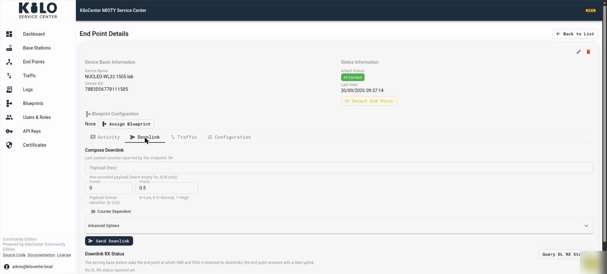
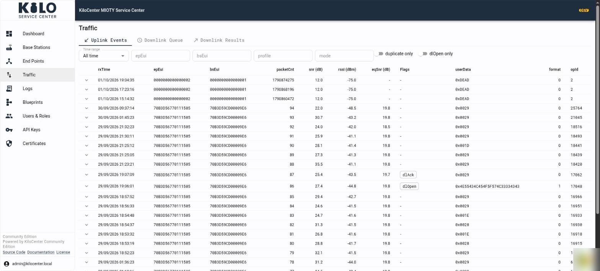
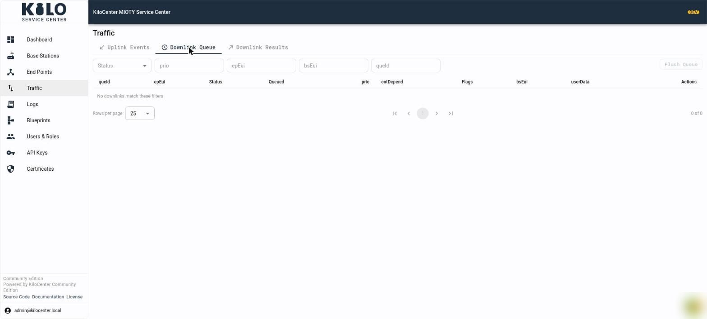
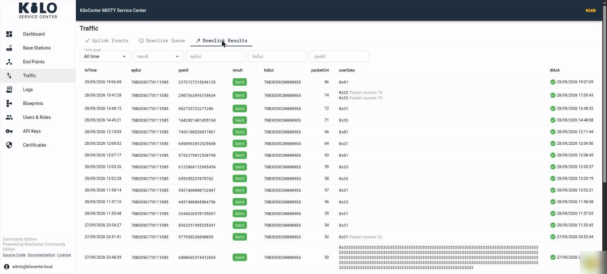

# How do I send a downlink and follow it in KiloCenter?

Everything about radio traffic lives in two places in KC-Web: the **Downlink** tab of an end point, where you compose a downlink, and the **Traffic** page, where you watch uplinks arrive, see downlinks wait for a transmission window and read what happened to each one. This page describes every field, filter and button. For a first guided run, see [Verify the First Downlink](../onboarding/verify-the-first-downlink.md).

You need the **Endpoint Manager** role or **Admin** for the end point's Downlink tab and for the downlink views of Traffic. The uplink view of a base station's own **Traffic** tab needs the **Base Station Manager** role. See [User Roles and Permissions](../security/users-and-roles.md).

## How do I compose a downlink?

1. Open **End Points**, select the end point and open its **Downlink** tab. The end point must be registered with **Bidirectional (BiDi)** on.
2. Under **Compose Downlink**, read the line "Last packet counter reported by the endpoint:" (it says "none yet" until the end point has been heard).
3. Fill in the fields:
   * **Payload (hex)**: the user data as hex, for example `01020304`. Leave it empty to send an acknowledgement only ("Hex-encoded payload (leave empty for ACK-only)"). Invalid input shows "Invalid hex string format".
   * **Format**: the payload format identifier, 0 to 255 ("Must be 0-255").
   * **Priority**: a number where 0 is low, 0.5 is normal and 1 is high ("Must be a number").
   * **Counter Dependent**: "Payloads are tied to specific packet counters". When it is on, the single payload box becomes a list of rows. Each row has a **Payload (hex)** and a **Packet counter** (a whole number from 0 to 4294967295). **Add Payload** adds a row and **Remove** deletes one: "Each payload requires a matching packet counter". Each payload is valid for its own packet counter, and the number of payloads must match the number of counters.
4. Open **Advanced Options** to set the optional flags. All five are off by default:
   * **Response Expected** asks the end point to respond to the downlink (`responseExp`).
   * **Response Priority** asks for a priority response from the end point (`responsePrio`).
   * **DL Window Required** asks for a further downlink window from the end point (`dlWindReq`).
   * **Expedited Only** sends the downlink only when the end point expects a response (`expOnly`).
   * **DL RX Status Query** asks the end point to report at which SNR and RSSI it received its downlinks (`dlRxStatQry`).
5. Click **Send Downlink**. It reads **Sending...** while it works, stays disabled while a field is invalid, and an error appears beside it when the service center refuses the downlink.

<figure><figcaption></figcaption></figure>

Acceptance into the queue is not delivery. The downlink goes out in the end point's next downlink window, from the base station that last heard it.

## How do I check the downlink reception quality of an end point?

Below **Compose Downlink**, the **Downlink RX Status** section asks the end point at which signal quality it received its downlinks. Click **Query DL RX Status** (**Querying...** while it works). The serving base station asks the end point, and the end point answers with a later uplink.

* The **Downlink RX Status** table lists each answer with **Reported** (time), **Packet Counter**, **DL RX SNR (dB)**, **DL RX RSSI (dBm)** and the `bsEui` that heard it. It reads "No DL RX status reported yet" until the first answer.
* **Pending queries** lists queries still waiting for an answer, with **Requested** time, and reads "No pending queries" when none is open.
* If the query cannot be sent, the page shows "The DL RX status query could not be sent".

## What does the Traffic page show?

Select **Traffic** in the left menu. The page has three tabs: **Uplink Events**, **Downlink Queue** and **Downlink Results**. The same three views appear inside an end point (its **Traffic** tab, limited to that end point) and a base station (its **Traffic** tab, limited to that station). Above them, those detail tabs show a **Traffic Summary** card with **Uplinks**, **End Points Heard**, **Today**, **This Week**, **This Month**, **Active Days**, **Average RSSI (dBm)**, **Average SNR (dB)**, **First Uplink** and **Last Uplink**.

### Uplink Events

<figure><figcaption></figcaption></figure>

Filters: **Time range**, `epEui`, `bsEui`, `profile`, `mode`, and the switches **duplicate only** (uplinks that several base stations received) and **dlOpen only** (uplinks that opened a downlink window). The EUI filters want 16 hex digits.

The table shows `rxTime`, `epEui`, `bsEui`, `packetCnt`, `snr (dB)`, `rssi (dBm)`, `eqSnr (dB)`, **Flags**, `userData`, `format` and `opId`. A `dlOpen` chip means the uplink opened a downlink window, `dlAck` means the end point acknowledged a downlink, and `responseExp` means it expects a response. Expand a row with its arrow to see:

* **Decoded payload**, **Payload (hex)** and **Decode status**, which says whether a blueprint decoded the payload and why not when it did not.
* A table of every receiving base station with `rxDuration (ns)`, `snr`, `rssi`, `eqSnr`, `dlRxSnr`, `dlRxRssi`, `profile` and `mode`, and the subpackets (`#`, `frequency (Hz)`, `snr`, `rssi`, `phase (°)`). Empty parts read "No subpacket data reported" and "No reception data stored for this uplink".

### Downlink Queue

<figure><figcaption></figcaption></figure>

Unfiltered, the queue lists only the downlinks still in flight. A downlink moves through these states:

| Status | Meaning |
|---|---|
| **Pending** | Waiting for the scheduler. No base station has it yet. |
| **Scheduled** | The scheduler selected it for transmission. |
| **Reserved** | Reserved for dispatch to a base station. |
| **Queued** | Sent to a base station, which holds it until the end point's downlink window. |
| **Revoking** | Its lifetime ended while a base station held it; the station was asked to drop it. |
| **Transmitted** | The base station reported that it transmitted the downlink. |
| **Delivered** | The downlink is recorded as delivered to the end point. |
| **Acknowledged** | The end point confirmed it: an uplink with the `dlAck` flag acknowledged the downlink sent in its previous window. |
| **Failed** | The base station reported a transmission failure. |
| **Expired** | The validity period ended before transmission. |
| **Revoked** | It was taken back before transmission. |

Filters: **Status** (leave it on **In flight**, or choose Pending, Scheduled, Reserved, Queued, Revoking, Transmitted, Delivered, Failed, Expired, Revoked or Acknowledged), `prio`, `epEui`, `bsEui` and `queId`.

Columns: `queId`, `epEui`, **Status**, **Queued** (time), `prio`, `cntDepend`, **Flags** (the five advanced options that were set), `bsEui` (the station holding the downlink, or "Awaiting acceptance" until one accepts it, with the time it accepted), `userData` (one line per payload, with its packet counter for counter-dependent downlinks) and **Actions**. The empty message is "No downlinks match these filters".

Actions:

* **Edit pending downlink** (pencil) appears only while the status is **Pending**, before the scheduler has picked the downlink up. The dialog **Edit pending downlink** `<queId>` shows the same fields as Compose Downlink; **Save** replaces the downlink ("Downlink updated").
* **Revoke** (trash) appears for **Pending**, **Scheduled**, **Reserved**, **Queued** and **Revoking** downlinks. It asks "Revoke this queued downlink message?" and takes it back. A downlink a base station already holds when its deadline passes shows **Revoking** until the station answers; see [What bugs were fixed in KiloCenter 2.0?](../whats-fixed-in-2-0.md).
* **Flush Queue** revokes every revocable downlink the current filters match, not the whole queue. It asks "Revoke every pending downlink message these filters match?" and is disabled when the list is empty or the status filter shows a state that cannot be revoked. The result toast reads "Revoked N queued downlink(s)", "No queued downlink was left to revoke" or "Revoked N…; M could not be revoked".

### Downlink Results

<figure><figcaption></figcaption></figure>

Filters: **Time range**, `result` (**Sent**, **Expired**, **Invalid** or **Revoked**), `epEui`, `bsEui` and `queId`. Columns: `txTime`, `epEui`, `queId`, **result**, `bsEui` (the station that transmitted it), `packetCnt`, `userData` and `dlAck` (a tick with the time the end point acknowledged the downlink in its next uplink, labeled **Acknowledged by device**). The empty message is "No downlink results match these filters".

## How do I follow a downlink from queue to acknowledgement?

1. Send the downlink from the end point's **Downlink** tab.
2. Open the end point's **Traffic** tab and **Downlink Queue**. The downlink starts as **Pending**, then moves through **Scheduled** and **Reserved** to **Queued** once a base station holds it.
3. When it is transmitted, it leaves the queue and appears in **Downlink Results** as **Sent** with the transmitting station and time.
4. The next uplink from the end point carries the acknowledgement. The `dlAck` chip appears on that uplink in **Uplink Events** and the tick appears in **Downlink Results**.
5. A downlink that never found a window shows **Expired**; the lifetime is `protocol.downlink_expiry.lifetime`, and a command can carry its own deadline. See [How do I configure KiloCenter?](../getting-started/configuration-basics.md).

The same states reach your application over MQTT; see [MQTT First Steps](../integrations/mqtt-first-steps.md).
