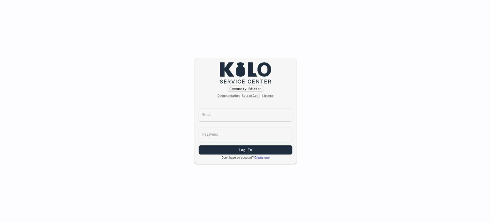
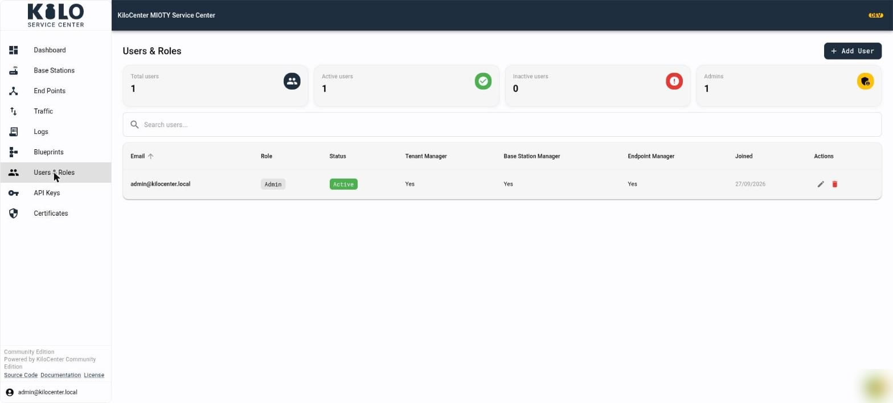
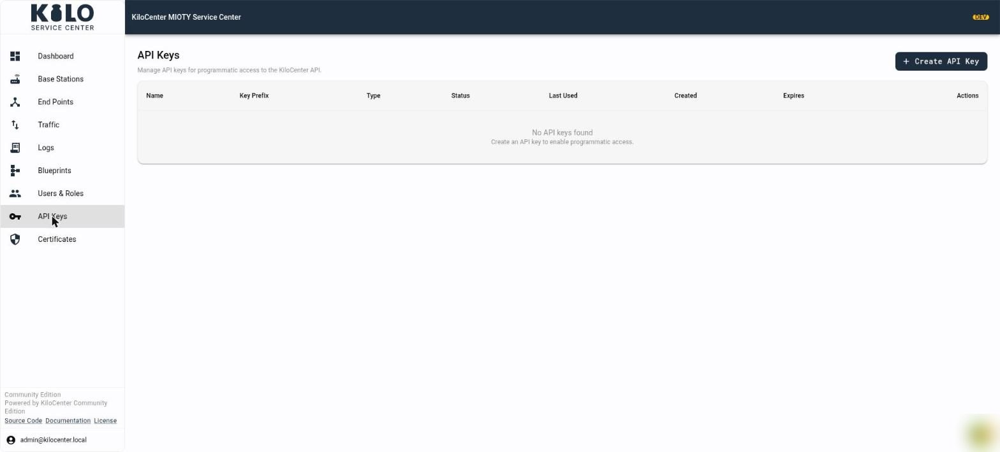

# How do I manage users, API keys and sign-in in KiloCenter?

This page covers everything around accounts in KC-Web: signing in and out, registering, the password rules, the navigation and user menu, the **Users & Roles** page, and the **API Keys** page. What each role may do is in [User Roles and Permissions](users-and-roles.md).

## How do I sign in, register and change my password?

* **Log In**: enter **Email** and **Password**. A wrong pair shows "Invalid email or password." When the installation uses an external identity provider, a **Sign in with** button for each provider appears as well.
* **Create one** opens the registration form with **First Name**, **Last Name**, **Email**, **Password** and **Confirm Password**. The Enterprise edition also asks for a **Company Name**, which names the new organization. **Create Account** signs you in. **Already have an account?** returns to the sign-in form. Registration works only while `auth.registration_enabled` is on; see [What does a new account see after self-registration?](users-and-roles.md#what-does-a-new-account-see-after-self-registration)
* An account with no roles shows **You don't have access yet** on every page except **Change password**, and the page updates on its own once an administrator grants a role.
* **Change Password** (user menu): enter **Current Password**, **New Password** and **Confirm Password**, then **Save Password**. KiloCenter signs you out and asks you to sign in with the new password ("Password changed. Sign in with your new password."). Accounts that sign in through an external identity provider have no password here, so the menu entry is hidden for them.

Every new password must be 8 to 128 characters long and contain a letter and a digit. The form states the rule and shows "Passwords do not match" when the two entries differ.

<figure><figcaption></figcaption></figure>

## What do the navigation, the user menu and the footer show?

The left navigation shows only what your roles and the edition allow:

| Entry | Who sees it |
|---|---|
| **Dashboard** | Anyone with a role |
| **Base Stations**, **Certificates** | Base Station Manager and Admin |
| **End Points**, **Traffic**, **Blueprints** | Endpoint Manager and Admin |
| **Logs** | Base Station Manager, Endpoint Manager and Admin |
| **Users & Roles** | Admin in the Community edition; Tenant Manager and Admin in the Enterprise edition |
| **API Keys** | Admin |
| **Organizations** | Admin, Enterprise edition only |

In the Enterprise edition an **Organization** badge in the header names the organization you act in, or reads **No organization** when none is selected. The Community edition has a single organization and shows no badge.

A banner reads **Realtime connection reconnecting...** or **Realtime connection offline** while the live stream is down; pages update again when it recovers.

At the bottom of the navigation, the footer names the running edition and links to **Source Code**, **Documentation** and **License**.

Click your email address in the header to open the user menu:

* a version row; hover it for **Build**, **Commit**, **Branch** and **Schema**, which helps when you report a problem,
* **Light Mode** or **Dark Mode** to switch the theme,
* **Change Password**,
* **Logout**.

## How do I add and edit users?

Open **Users & Roles**. The Community edition shows one list of the installation's users. The Enterprise edition shows two tabs: **System Users** (administrators only) and **Organization Users** (the members of your organization). A tenant manager sees only the organization view.

<figure><figcaption></figcaption></figure>

The cards count **Total users**, **Active users**, **Inactive users** and **Admins**. Search with **Search users...**; the table shows each user's email, role, status, the **Tenant Manager**, **Base Station Manager** and **Endpoint Manager** roles and the date they were created. The pencil and trash icons in **Actions** edit or delete a user. Deleting asks "Are you sure you want to delete this user? This action cannot be undone."

**Add User** opens a dialog with:

* **Email** (required) and **Password** with **Confirm password** (required; the rule above applies),
* **Optional notes**,
* switches **Is active**, **Is admin**, **Is tenant manager**, **Is base station manager** and **Is endpoint manager**,
* in the Enterprise edition, **Organizations** to assign the new user to one or more organizations after creation ("User created but failed to add to some organizations" means a membership failed). In the Community edition a note says every user of this installation belongs to its organization.

Select **Submit** to create the account. Open a user to see **User Details**: the same fields under **Edit User**, an **Info** card with **Created** and **Updated** and a **Change Password** button for an administrator to set a new password, and in the Enterprise edition **Organization Memberships** with **Add to Organization**, a role selector and a remove action ("User added to organization", "User removed from organization").

In the Enterprise edition **Organization Users** is called **Organization Members**. It shows **Total Members**, the columns **Email**, **Role** (**Owner**, **Admin** or **Member**), **Status** (**Active**, **Invited** or **Removed**), the three manager roles and **Joined**. **Add Member** picks a **User**, a **Status** and the manager switches ("Can manage organization settings and members", "Can manage base stations for this organization", "Can manage endpoints for this organization"). KiloCenter refuses to remove the last owner ("Cannot remove the last owner of an organization") or yourself ("You cannot remove yourself from the organization").

**Organizations** (Enterprise edition, administrators) lists organizations with **Name**, **Description**, **State** (**Active**, **Suspended** or **Archived**), **Created** and **Actions**. **Add Organization** takes a **Name** (required), an optional **Description**, a **State** and **Tags**; **View Members** opens the members of an organization.

## How do I create an API key?

Open **API Keys** (administrators only). The table lists **Name**, **Key Prefix**, **Type**, **Status** (**Active**, **Inactive** or **Expired**), **Last Used** (**Never** until first use), **Created**, **Expires** (**No expiry** if none) and **Actions**. An empty list says "No API keys found. Create an API key to enable programmatic access."

<figure><figcaption></figcaption></figure>

1. Click **Create API Key**.
2. Enter a **Key Name**, for example "Billing export".
3. Pick the **Key Type**: **User** (acts with the roles of your user) or **Service Account** (acts as a Base Station Manager and Endpoint Manager in its organization; see [Do API keys have roles?](users-and-roles.md#do-api-keys-have-roles)).
4. Optionally enter **Expires On** as a date. "The key stops working at the end of this day." A date that is not valid shows an error.
5. Click **Create**. The **API Key Created** dialog shows the key once: "Copy your API key now. You will not be able to see it again." Click **Copy to Clipboard** ("API key copied to clipboard"), then **Close**.

Send the key as a bearer token in the `authorization` header; see [gRPC First Steps](../integrations/grpc-first-steps.md). To end a key's access, select **Delete** in **Actions** and confirm "Are you sure you want to delete this API key? This action cannot be undone." If the Audit Log cannot record the creation, KiloCenter refuses the key instead of creating one nobody can trace.
