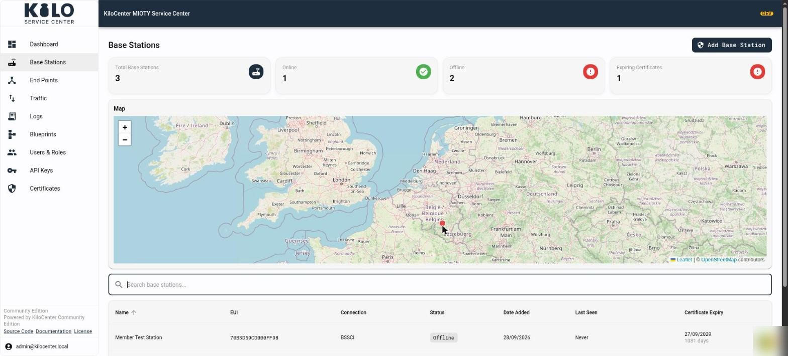
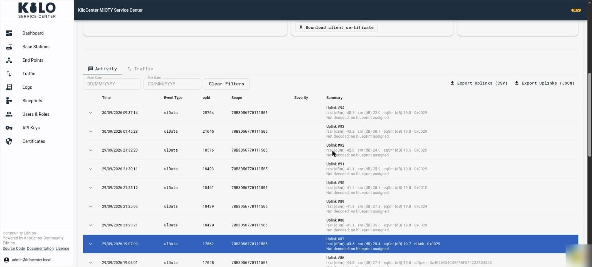
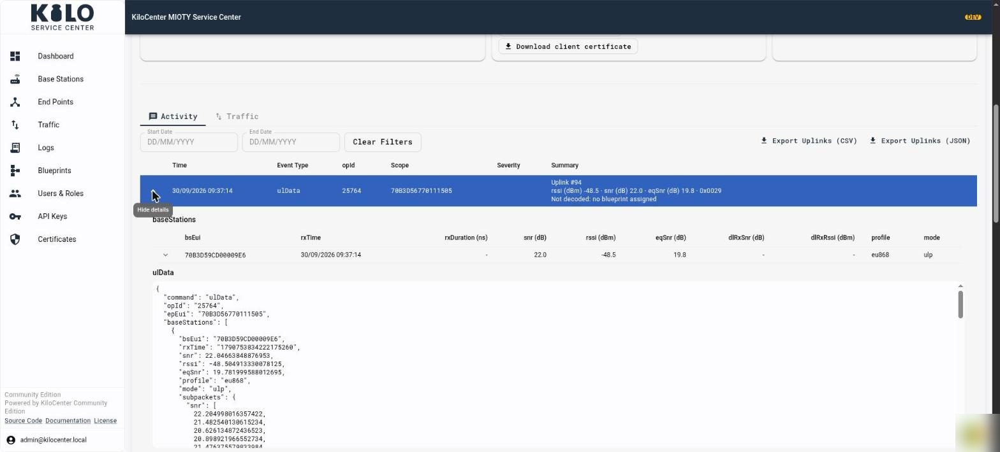
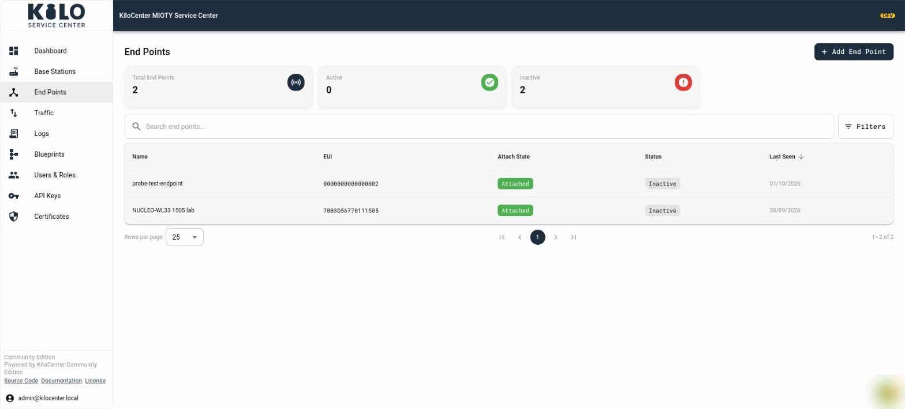
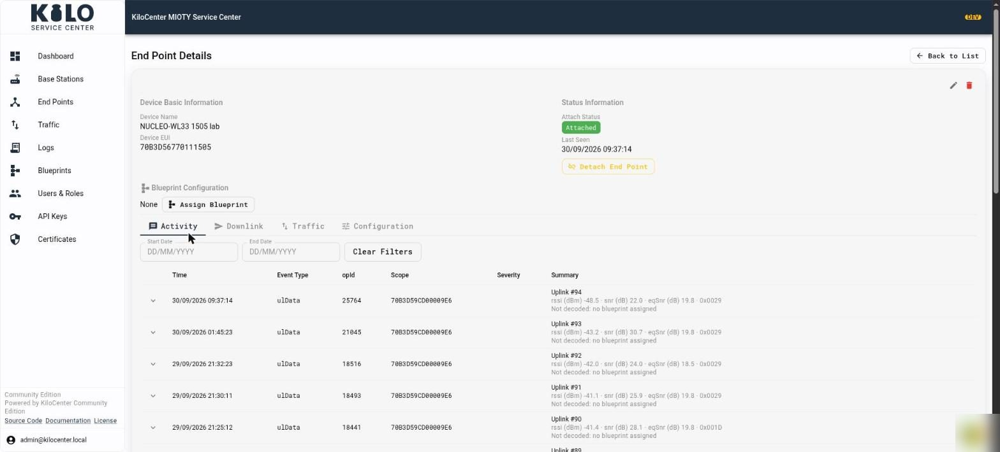
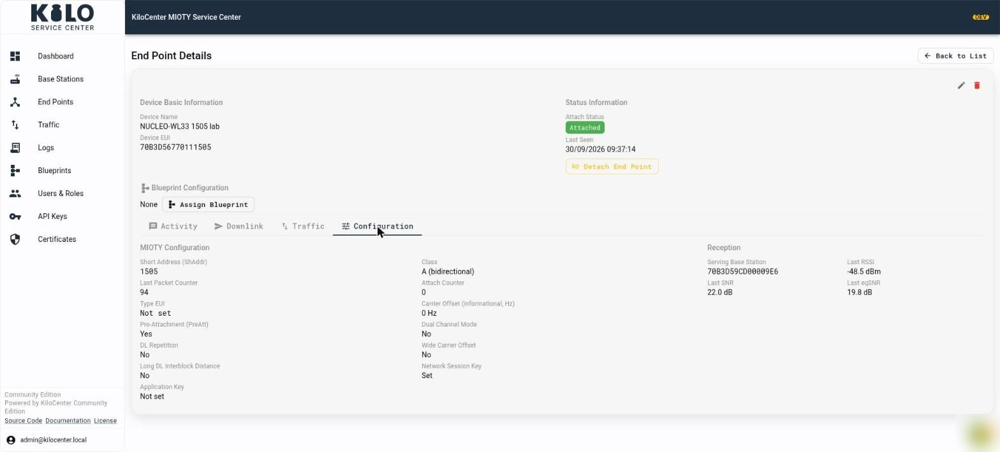
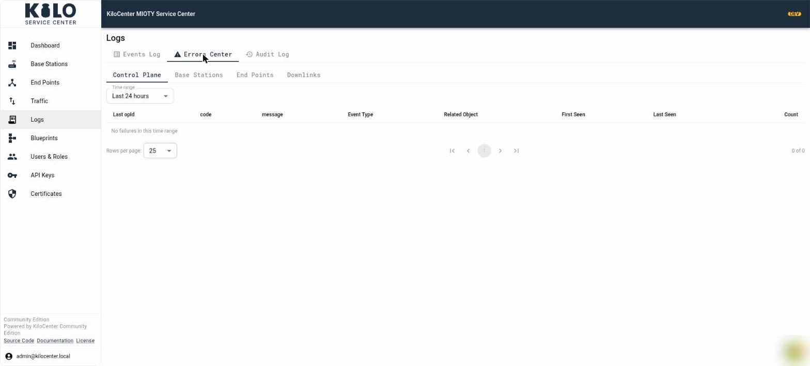
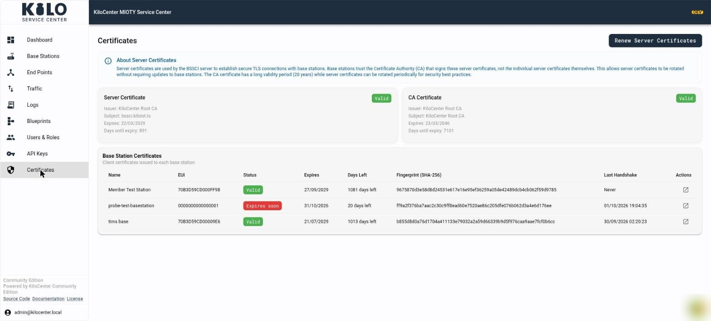

# What can I do in the KiloCenter web interface?

The KiloCenter web interface (KC-Web) is where you run the network day to day: see which base stations are online, watch uplinks arrive with their radio metrics, queue a downlink and follow it to delivery, and manage who may do what. Since version 2.0 it updates live, so a new message or a status change appears within about a second without reloading the page.

The left navigation lists **Dashboard**, **Base Stations**, **End Points**, **Traffic**, **Logs**, **Blueprints**, **Users & Roles**, **API Keys** and **Certificates**. It shows only the pages your roles allow: an Admin sees all of them, a Base Station Manager sees **Base Stations**, **Certificates** and **Logs**, and an Endpoint Manager sees **End Points**, **Traffic**, **Blueprints** and **Logs**. **Users & Roles** is for Admins (and, in the Enterprise edition, Tenant Managers). The full list is in [User Roles and Permissions](security/users-and-roles.md), and the navigation, user menu and edition footer are described in [How do I manage users, API keys and sign-in?](security/users-api-keys-and-sign-in.md)

## How do I sign in to KiloCenter?

Open the web address of your installation. The sign-in page asks for your **Email** and **Password**; select **Log In**. A new person selects **Create one** under the button, fills in **First Name**, **Last Name**, **Email**, **Password** and **Confirm Password** (the Enterprise edition also asks for a **Company Name**), and selects **Create Account**. A new account has no roles yet, so an administrator must grant it access in **Users & Roles** before any page opens; until then every page shows "You don't have access yet". Passwords are 8 to 128 characters with a letter and a digit. More in [How do I manage users, API keys and sign-in?](security/users-api-keys-and-sign-in.md)

<figure><figcaption></figcaption></figure>

## What does the dashboard show?

**Dashboard** opens on **Network Overview**, a live summary of network health:

- Three cards count **Base Stations Online** (the caption reads "All online", or how many are offline), **End Points Attached** (with how many are **registered**) and **Messages Received** in the **Last 24 hours**. The first two also say how many were "added in the last 7 days" and open **Base Stations** or **End Points** when clicked. Each card appears only if your roles cover it: Base Station Managers see the first, Endpoint Managers the second, and everyone sees the message count.
- **SC-AC Control Plane** (Endpoint Managers and Admins) shows the session between the service center and the application center: its state, version, the two EUIs, the last connection and ping, the round-trip time and the missed heartbeats.
- **Alerts** (Admins only) counts open `critical`, `error` and `warning` events. Select **All**, **critical**, **error** or **warning** to filter the table of time, scope, severity and summary, and select **Open Events Log** for the full history. A badge beside it reads **Live** while updates stream and **Reconnecting** while the connection recovers.
- **Service Center Status** (everyone) lists Archival, SCACI, gRPC (internal), BSSCI, PostgreSQL, KC-Core and KC-Identity with a status mark and latency, and the time of the last check.

<figure><figcaption></figcaption></figure>

## How do I see what a base station is doing?

Open **Base Stations**. Four cards count the total, online and offline stations and the certificates that are about to expire. Below them a **map** shows every station that has a location, with a pin per station, and a search box filters the table. The table lists **Name**, **EUI**, **Connection**, **Status**, **Date Added**, **Last Seen** and **Certificate Expiry**. The cards double as sort buttons, and the map is shown to Admins only. Select **Add Base Station** at the top right to register one; the steps are in [How do I connect a base station?](onboarding/connect-a-base-station.md). Cards, map, the Edit dialog and certificate regeneration are described in [How do I manage base stations and end points?](operations/base-stations-and-end-points.md).

<figure><figcaption></figcaption></figure>
<figure><figcaption></figcaption></figure>

Select a row to open **Base Station Details**. At the top right, **Back to List** returns to the table, and the pencil and trash icons edit or delete the station.

- **Basic Information** shows the name, EUI and status. **Performance Metrics** shows what the station last reported, such as temperature, CPU load, memory load and duty cycle. **System Information** shows its system time, uptime and the time of its last status update.
- A small map shows the station's position with its latitude and longitude. A tag beside them reads **Manual** when the position was entered by hand and **GPS** when the station reported it.
- **Availability (last 24 hours)** charts the share of each hour in which the station held a BSSCI session.
- **Certificate** shows whether the station's client certificate is valid and for how many days, when it expires, its SHA-256 fingerprint and the time of the last TLS handshake. **Download CA certificate** and **Download client certificate** save the files. If the service center holds no copy of the client certificate, the page tells you to use **Regenerate Certificates** in the Edit dialog to issue new ones.
- **Actions** has **Ping**, which sends a BSSCI ping; the station answers with `pingRsp`. It is available while the station is online. **Request station status** asks the station to report its metrics now.

<figure><figcaption></figcaption></figure>

Under these panels the **Activity** tab lists every event and uplink the station handled, newest first, in the columns **Time**, **Event Type**, **opId**, **Scope**, **Severity** and **Summary**. Pick a **Start Date** and **End Date** to narrow the list, select **Clear Filters** to reset it, and use **Export Uplinks (CSV)** or **Export Uplinks (JSON)** to take the uplinks away. An uplink row's summary reads like "Uplink #94" with its `rssi`, `snr` and `eqSnr`, any `dlOpen` or `dlAck` flag, and whether a blueprint decoded it. The **Traffic** tab beside Activity shows the station's uplinks and downlinks.

<figure><figcaption></figcaption></figure>

Select the arrow at the start of an uplink to expand it. You see a **baseStations** table with every station that received the uplink (`bsEui`, `rxTime`, `snr`, `rssi`, `eqSnr`, `profile` and `mode`) and the raw `ulData` message as JSON, including the subpacket values.

<figure><figcaption></figcaption></figure>

## How do I see what an end point is sending?

Open **End Points**. Three cards count the total, **Active** and **Inactive** end points, a search box and **Filters** (by attach state and activity) narrow the list, and the table shows **Name**, **EUI**, **Attach State**, **Status** and **Last Seen**. **Add End Point** registers a new one; the steps are in [Register an Endpoint](onboarding/register-an-endpoint.md).

<figure><figcaption></figcaption></figure>

Select a row to open **End Point Details**. The top shows **Device Basic Information** (name and EUI) and **Status Information**: the attach status, the time it was last seen and a **Detach End Point** button. **Blueprint Configuration** shows the assigned blueprint, or **None** with an **Assign Blueprint** button. Four tabs follow:

- **Activity** is the same table as on a base station. When a [blueprint](../../kilo-iot-server/connectors/mioty-connector/README.md) is assigned, uplinks show decoded values, such as `temperature`; otherwise each row says why it was not decoded.
- **Downlink** composes a downlink, described below.
- **Traffic** shows the end point's uplinks and downlinks.
- **Configuration** shows the settings the service center holds for the end point.

<figure><figcaption></figcaption></figure>

The **Configuration** tab lists the **MIOTY Configuration**: **Short Address (ShAddr)**, **Class**, **Last Packet Counter**, **Attach Counter**, **Type EUI**, **Carrier Offset**, **Pre-Attachment (PreAtt)**, **Dual Channel Mode**, **DL Repetition**, **Wide Carrier Offset** and **Long DL Interblock Distance**. The **Network Session Key** and **Application Key** are never shown; the page says only **Set** or **Not set**. A **Reception** panel names the serving base station and the last RSSI, SNR and eqSNR it reported.

<figure><figcaption></figcaption></figure>

## How do I add or edit an end point and handle its keys?

On **End Points**, select **Add End Point** to register a device, or open an end point and select the pencil icon to edit it. The dialog (**Edit End Point**, "Update MIOTY end point configuration") holds the same MIOTY settings as the **Configuration** tab. Turn on **Pre-Attachment (PreAtt)** to send a new end point to every connected base station as soon as you create it. Select **Create End Point**, or **Save Changes** when editing.

Keys are never shown by default:

- A stored key appears hidden, with the hint "Stored and hidden. Reveal it, or enter a new key to replace it". Select **Reveal key (recorded in the Audit Log)** to fetch it. Only Endpoint Managers and Admins can, and every reveal is written to the [Audit Log](operations/audit-log-and-errors-center.md). **Copy key** works once the key is revealed or you typed a new one.
- Leave a key field empty to keep the stored key. Type a new key to replace it.
- To delete a stored **Application Key**, select **Remove key** and confirm "Remove Application Key". The key is deleted when you save, the removal is recorded in the Audit Log, and a removed key cannot be recovered. The network session key is mandatory, so you can replace it but not remove it.

When you change a setting that base stations already hold for an attached end point, the dialog asks "Re-attach Endpoint?" and lists the changed settings. Select **Re-Attach Now** to push the update, or **Later** to keep the end point marked **Configuration pending re-attach** until it is attached again. The mark appears on the end point's detail page.

## How do I queue and follow a downlink?

Queue the downlink from the end point; [How do I send a downlink and follow it?](operations/downlinks-and-traffic.md) describes every field, filter and action. Open its **Downlink** tab. **Compose Downlink** shows the last packet counter the end point reported. Enter the **Payload (hex)**, or leave it empty to send an acknowledgement only, then set the **Format** (0 to 255) and the **Priority** (0 is low, 0.5 normal, 1 high). Turn on **Counter Dependent** to bind the downlink to a packet counter, open **Advanced Options** for the response and window flags, and select **Send Downlink**. **Query DL RX Status** asks the end point at which SNR and RSSI it received its downlinks; it answers with a later uplink.

<figure><figcaption></figcaption></figure>

Then follow it on **Traffic**, which has three tabs:

- **Uplink Events** lists every uplink with `rxTime`, `epEui`, `bsEui`, `packetCnt`, `snr`, `rssi`, `eqSnr`, `userData`, `format` and `opId`. Filter by time range, `epEui`, `bsEui`, `profile` and `mode`, or switch on **duplicate only** or **dlOpen only**. A `dlOpen` or `dlAck` chip in the **Flags** column marks an uplink that opened a downlink window or acknowledged a downlink.
- **Downlink Queue** lists downlinks that wait for a transmission window, with `queId`, **Status**, the time **Queued**, `prio`, `cntDepend`, **Flags**, `bsEui` and `userData`. Filter by status, `prio`, `epEui`, `bsEui` and `queId`. The **Actions** column edits a **Pending** downlink or revokes a waiting one, and **Flush Queue** revokes every revocable downlink the current filters match. A downlink that a base station already holds when its deadline passes shows as **Revoking** until the station answers.
- **Downlink Results** lists what happened to each downlink: `txTime`, `epEui`, `queId`, the **result** (`sent`, `expired`, `invalid` or `revoked`), the transmitting `bsEui`, `packetCnt`, `userData` and, when the end point acknowledged it in its next uplink, the `dlAck` time.

The same states reach your application over MQTT; see [MQTT First Steps](integrations/mqtt-first-steps.md).

<figure><figcaption></figcaption></figure>
<figure><figcaption></figcaption></figure>
<figure><figcaption></figcaption></figure>

## Where do I find errors and events?

Open **Logs**. It has three tabs, and each user sees only the event categories their roles cover.

- **Events Log** lists everything that happened, newest first: service starts, database migrations, base stations going online or offline, attaches and detaches. Filter by time range, operation, category, outcome, `opId`, `epEui` and `bsEui`, or search the text. Expand a row for its details.
- **Errors Center** groups failures. Choose **Control Plane**, **Base Stations**, **End Points** or **Downlinks**, pick a time range, and each failure appears once with its code, message, related object, first and last time seen and how many times it occurred.
- **Audit Log** is for administrators; it records who did what, such as revealing a key, creating a user or queueing a downlink.

Each Errors Center sub-tab opens only for the roles that cover its event categories, and its time range resets when you switch sub-tabs. [How do I use the Audit Log and Errors Center?](operations/audit-log-and-errors-center.md) explains every filter, column and role rule.

<figure><figcaption></figcaption></figure>
<figure><figcaption></figcaption></figure>

## How do I assign a blueprint to decode uplinks?

**Blueprints** holds the decoders. The **Custom** tab lists the manufacturers you added, with **Add Manufacturer** at the top right; the **System** tab lists entries shared with every organization, which only an Admin can change. Assign a model's blueprint to an end point from the end point's page; see [Register an Endpoint](onboarding/register-an-endpoint.md). Adding models and decoders, **Test Decode**, **Migrate Devices** and **Submit to Registry** are described in [How do blueprints and decoders work?](operations/blueprints-and-decoders.md)

<figure><figcaption></figcaption></figure>

## How do I manage users and API keys?

- **Users & Roles** counts total, active and inactive users and admins, and lists each user's email, role, status, the **Tenant Manager**, **Base Station Manager** and **Endpoint Manager** roles, and the date they were created. **Add User** creates an account, and the pencil and trash icons in **Actions** edit or delete one. A refused password shows the reason.
- **API Keys** (Admins) creates keys for software that calls the API. The table shows each key's name, prefix, type, status, last use, creation date and expiry; a new key is shown once. API keys can now be created in the Community edition.
- **Organizations** and organization members exist in the Enterprise edition only.

Every field and dialog is described in [How do I manage users, API keys and sign-in?](security/users-api-keys-and-sign-in.md)

<figure><figcaption></figcaption></figure>
<figure><figcaption></figcaption></figure>

## How do I check and renew certificates?

**Certificates** explains how the BSSCI server certificate works and shows the **Server Certificate** and the **CA Certificate**, each with its issuer, subject, expiry date and days until expiry. **Base Station Certificates** lists each station's client certificate with its status (**Valid**, **Expiring**, **Expires soon**, **Expired**, **Not issued** or **Expiry not recorded**), expiry, days left, fingerprint and last handshake, and a link to the station. **Renew Server Certificates** (**Generate Server Certificates** while none exists) is shown to Admins and asks you to confirm the names for the new certificate; it is signed by the same CA, connected stations keep their session, and a station that connects by a name missing from the list fails hostname verification. For the operator procedure, see [Renew a server certificate](security/certificate-renewal.md).

<figure><figcaption></figcaption></figure>

## What replaced the old System screen?

The old System screen and the WebSocket connection are removed in 2.0. Service health lives on the Dashboard, and live updates use gRPC-web server streams through KC-Gateway.

Not hosting it yourself? In Kilo Cloud the Enterprise edition of the service center is built in, and base stations and endpoints appear in the platform's own pages, which look different from the screens above. See [MIOTY on Kilo Cloud](../../kilo-iot-server/connectors/mioty-connector/README.md).
