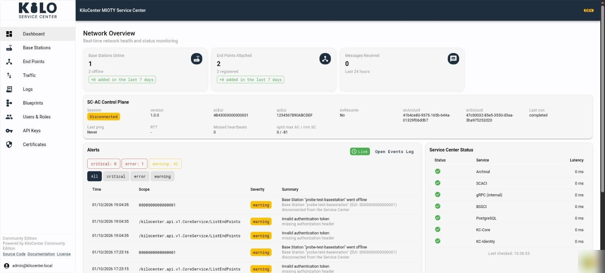

# What's new in KiloCenter 2.0?

KiloCenter 2.0 is the release that turns the open-source MIOTY service center from a working prototype into something you can run for a team. Every stored key is encrypted, every call checks the caller's role, the web interface updates live, and uplinks and downlinks follow the MIOTY BSSCI and SCACI specifications from end to end.

It is a major release because upgrading from 1.x needs a few manual steps. Read [How do I migrate KiloCenter key material to 2.0?](operations/key-material-migration.md) before you upgrade, and take a database backup first.

## Why is 2.0 more than a feature release?

The code underneath was cleaned up as well. Dead code, unused settings and unused declarations are removed, large components are split into smaller, focused parts, and hard-coded values moved into shared catalogs and configuration. More than fifty bugs across uplinks, downlinks, sessions, certificates and the web interface are fixed, so 2.0 is also simply a steadier base than 1.x.

We tested it end to end with our MIOTY developer kit: real uplinks and downlinks, including acknowledged and revoked downlinks, and every screen of the web interface. The screenshots in this documentation come from that run.

[What bugs were fixed in KiloCenter 2.0?](whats-fixed-in-2-0.md) groups the fixes by what you notice and says where to look in the web interface.

## Which edition does 2.0 apply to?

This release is the open-source Community Edition. It stays self-hosted and comes as is; the [edition comparison](README.md#which-edition-should-i-choose) shows when to ask Kilo for the Enterprise edition on your premises or to move to Kilo Cloud, where the platform around the network adds rules, dashboards and alerting.

## What do I have to change before upgrading from 1.x?

| Change | What you do |
|---|---|
| Master key | Set `KILOCENTER_MASTER_KEY`. It encrypts your endpoint and base station keys at rest, and the services do not start without it. |
| Internal secret | When KC-Gateway, KC-Core and KC-Identity run on separate hosts or containers, also set `KILOCENTER_INTERNAL_AUTH_PEER_SECRET` to a shared value of at least 32 characters. The Docker Compose stack always needs it, and reads it from `KILOCENTER_INTERNAL_PEER_SECRET` in `.env`. |
| Upgrade order | Upgrade KC-Core and KC-Identity together. |
| Stored keys | The upgrade re-encrypts every stored key under the master key with the `rekey` command. After that, the database can no longer be used with a 1.x release. |

## Which API changes can break my integration?

- The organization quota fields `can_have_base_stations`, `max_base_station_count` and `max_endpoint_count` are gone from the organization requests and from `Organization`.
- Endpoint keys are masked on every read. Revealing a key is a separate, audited action.
- Every call checks the user's role and answers `PERMISSION_DENIED` when the role does not cover it. See [User Roles and Permissions](security/users-and-roles.md).
- The web interface no longer uses a WebSocket. It follows gRPC-web server streams instead.

## What is new in the web interface?

The [web interface](web-interface.md) shows changes within about a second of a message arriving: dashboards, lists and activity refresh without a manual reload. It adds an activity table on every base station and endpoint, a Traffic page for uplinks and downlinks, blueprint assignment from the endpoint page, an error center and event log, a base station map with certificate status, and a role-aware Users & Roles page.
<figure><figcaption></figcaption></figure>

## What is new in the service center itself?

- **Protocol conformance.** Uplinks, downlinks, attach and detach follow BSSCI v1.0.0 and SCACI v1.0.0 end to end.
- **Sessions.** Base station and Application Center sessions survive a restart and resume.
- **Uplinks.** One uplink that several base stations receive is delivered once, and it lists every receiving station.
- **Downlinks.** Downlinks are queued, revoked, expired and reported to the Application Center that queued them. See [How do I verify the first downlink?](onboarding/verify-the-first-downlink.md).
- **Tenant isolation and security.** Roles are enforced on every call, secrets are audited before they are handed out, base station certificates are bound to their station, SCACI sessions, queue ids and results stay within their organization, and calls between the services are authenticated.
- **New API fields.** The endpoint's latest RSSI, SNR and equivalent SNR, the downlink accept and acknowledge times, the base station certificate expiry, and a password policy.
- **New MQTT fields and events.** `dlOpen`, `responseExp` and `dlAck` on uplinks, delivery details on downlink results, more `command/down` options, and `event/downlink_queued`. See [MQTT First Steps](integrations/mqtt-first-steps.md).

## What changed for MQTT downlink commands?

- A `command/down` message can carry an `expiresAt` deadline in RFC 3339 format. A command whose deadline has already passed queues nothing and is refused on `event/downlink_rejected` with `mqtt.command.expired`.
- A command's `ref` is accepted once. Publishing the same command again queues and publishes nothing, so a client can safely resend a command it is not sure arrived.
- A downlink that a base station holds when its deadline passes becomes **Revoking** first. KiloCenter reports `expired` only after the station confirms that it dropped the downlink, says it does not hold it, or reconnects with a new session.
- Deleting a base station ends every downlink it held as `expired`. Power the station off or let its queue empty first, because a deleted station that is still powered may still transmit them.

If you upgrade a database that already holds repeated refs, the earliest downlink keeps its `ref` and the later ones lose it.

## Which container images does the Helm chart use now?

The Helm chart and `docker-compose.prod.yml` pull the published images `ghcr.io/kiloiot/kc-core`, `kc-gateway`, `kc-identity` and `kc-web`, including the certificate generator and the `rekey` upgrade hook. An installation that overrides the repository keeps its override.

Running MIOTY inside Kilo Cloud instead? The Enterprise edition of this service center is built in and managed for you. See [MIOTY on Kilo Cloud](../../kilo-iot-server/connectors/mioty-connector/README.md).
