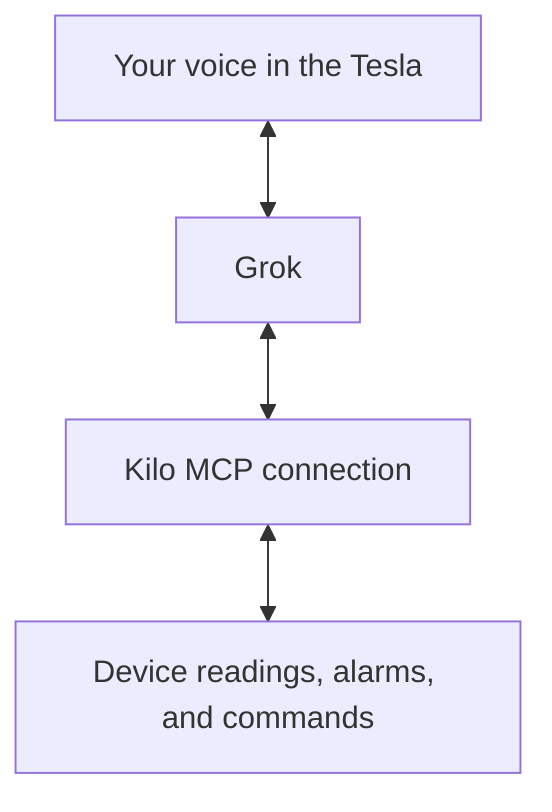

# Use Kilo in Your Tesla

Ask Grok where a truck last reported, check a building's alarms between site visits, or switch off office lights from your Tesla. Connect Grok to Kilo through **MCP (Model Context Protocol)**, the connection that lets an AI assistant read platform data and run available actions with your account's permissions.

<figure><figcaption>
Grok on a Tesla touchscreen. Connect your Kilo account from your phone or computer before using it in the car.
</figcaption></figure>

Kilo supplies the device readings, alarms, and configured commands. Grok carries the conversation, including voice requests in the vehicle. You can use the same connection in Grok on your phone or computer.

## Requests for fleet and facilities teams

| Ask Grok | What the deployment needs |
| --- | --- |
| “Where is truck number eighteen? Include when it last reported.” | A registered tracker named **Truck 18**, with its latest location available in Kilo. Grok can retrieve its latest reported position and timestamp. See [Tracker Connector](../connectors/tracker-connector.md). |
| “What is the temperature in the office right now?” | A reporting temperature sensor named for its room, with readings visible in Kilo. Ask for the reading's timestamp when freshness matters. |
| “Are the lights in my office on or off? Please turn them off.” | A connected lighting controller or relay reporting its state, with a saved **Turn off** command and permission for your account to execute it. |
| “Check the building. Are there any urgent notifications, such as leaks or smoke?” | Configured sensors, rules, and [alarms](../alarm/README.md). Grok can summarize active alarm events, with severity, source device, and location where available. |

Use site and room names when several devices could match. An alarm summary reflects the monitoring configured in Kilo; it is a useful starting point for deciding which incident needs attention.

## Prepare Kilo and the car

Connect your equipment to Kilo and check that the readings you want to ask about are visible. For actions, save the device's supported commands in **Commands & States** before requesting them through Grok. Follow [Creating Commands](../devices/commands/creating-commands.md); MCP executes saved commands and does not author new command definitions.

<figure><figcaption>
Configure actions in Kilo first. This command-editor example uses an emulated relay; the payload for real equipment depends on its protocol and model.
</figcaption></figure>

For connectors in the car, Tesla requires an **AMD processor**, software **2026.26 or later**, and **Premium Connectivity or Wi-Fi**. You also need a signed-in Grok account. See [Tesla's Grok requirements](https://www.tesla.com/support/grok).

## Connect once, then use your voice

1. On your phone or computer, follow [Connect Grok](../api/mcp-server.md#how-do-i-connect-grok-to-kilo) and confirm that Grok can list devices in the intended Kilo organization.
2. In the car, open **App Launcher → Grok**, select **Sign In**, and finish on your phone using that same Grok account. Its connectors become available in the vehicle.
3. Start a conversation by holding the steering-wheel microphone button. To use **“Hey Grok,”** enable voice activation under **Controls → Audio → Grok Settings**. [Tesla documents these controls](https://www.tesla.com/support/grok).
4. Ask Grok to use Kilo, naming the site or device: *“Using Kilo, what is the latest temperature in the Berlin office?”*

If you work across several organizations, consider [pinning the MCP connection](../api/mcp-server.md#how-do-i-choose-which-organization-the-mcp-server-uses) to the organization you operate from the car. The default connection uses the organization selected in Kilo.

## Ask, act, and check the result

You might ask: *“Are the office lights still on?”* After Grok reports the controller's state, continue with *“Run the Office Lights turn-off command, then check the result.”* Grok sends the saved command through Kilo and can retrieve its execution status.

Configure Grok to request approval for consequential actions where its controls support that option. Confirmation wording is managed by Grok; Kilo continues to enforce your device and organization permissions. See [MCP security and permissions](../api/mcp-server.md#is-the-kilo-mcp-server-secure).

Commands run asynchronously. If a request is accepted or queued, ask for its status and the latest device feedback. [Command Verification](../devices/commands/verification.md) explains how delivery and reported equipment state are checked.

## If something is missing

- **The car cannot use the connection:** check the vehicle requirements, internet connection, and that it uses the same Grok account as the computer or phone where you added Kilo.
- **Grok lists the wrong devices:** ask which Kilo organization it is using and review the default or pinned endpoint.
- **A reading is old or a command is unavailable:** check the device's latest readings, connection, saved commands, and your permissions. The [MCP connection guide](../api/mcp-server.md) explains account access and organization selection.
