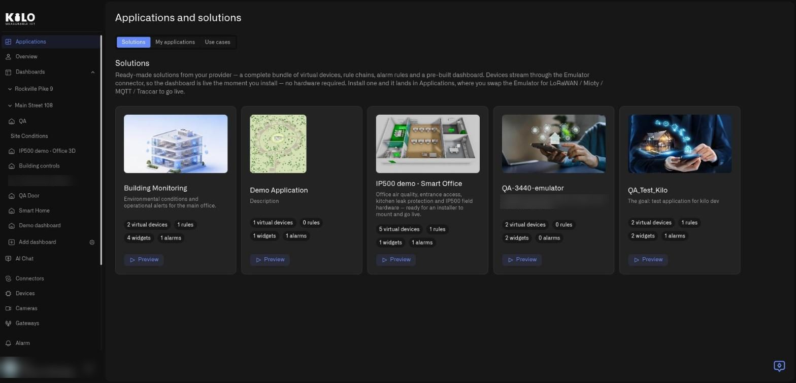
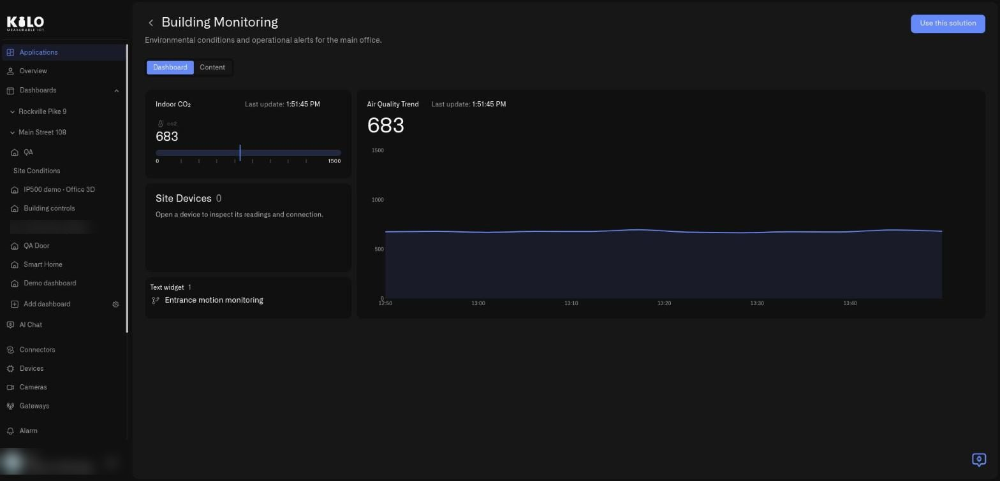
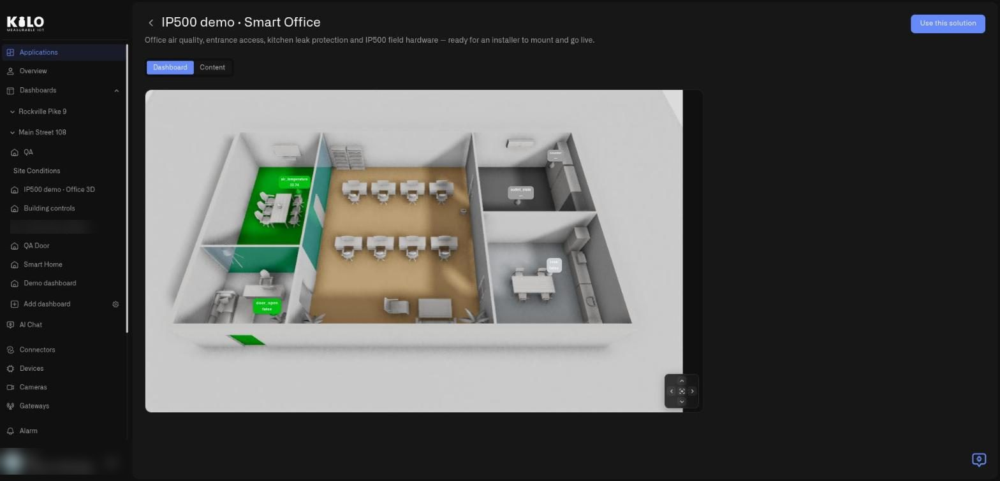
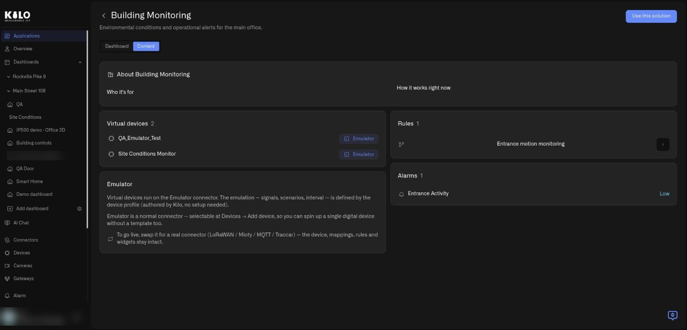
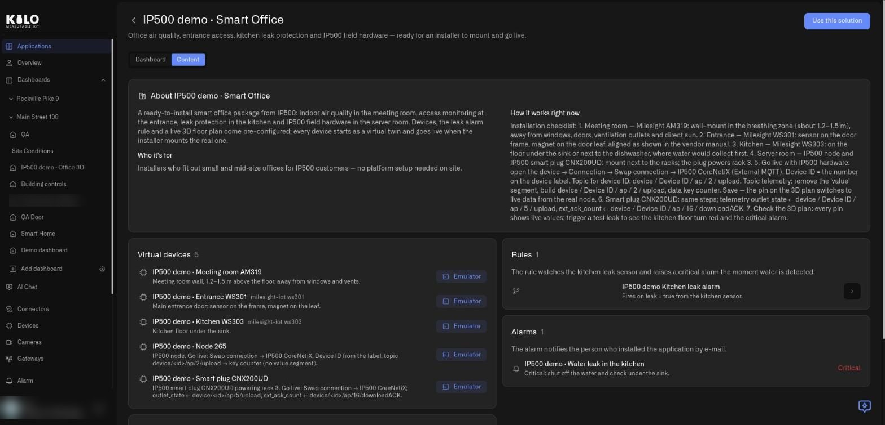

# How do I browse and preview solutions?

A solution is a complete answer to one problem. Before you install anything, Kilo lets you walk through it: you see what it contains, you watch its dashboard with live data, and you read the dealer's own explanation. This guide shows each screen in the order you meet it.

## How do I open the Solutions tab?

1. In the left sidebar, select **Applications**.
2. Under the page title **Applications and solutions**, select the **Solutions** tab (it is the first tab).

The tab opens with a heading, **Solutions**, and an introduction: ready-made solutions from your provider, each a complete bundle of virtual devices, rule chains, alarm rules, and a pre-built dashboard. Devices stream through the Emulator connector, so the dashboard is live the moment you install, with no hardware required. Installed solutions land in **Applications**, where you swap the Emulator for LoRaWAN, MIOTY, MQTT, or Traccar to go live.

<figure><figcaption>
The Solutions tab of a demo organization. Several of these cards are test solutions created while building the feature.
</figcaption></figure>

## What is on a solution card?

Every card has the same parts, so you can compare solutions at a glance:

* **Photo.** The picture the dealer chose for the solution.
* **Name and description.** The name is the problem or setting the solution addresses. The description is the dealer's one-line pitch.
* **Four counters.** **Virtual devices**, **rules**, **widgets**, and **alarms**. They tell you how big the install will be before you open anything.
* **Preview.** The button at the bottom of the card. It opens the solution without installing anything.

If your provider has not published anything yet, the tab says **Your provider has not published any solutions yet**. If the catalog cannot be loaded, you see **Couldn't load the solution catalog**.

## How do I preview a solution?

Select **Preview** on a card. The preview page has a header and two tabs.

The header contains a back arrow (it returns you to the catalog), the solution name with its description, and a **Use this solution** button on the right. That button continues to [the install screen](installing-a-solution.md); previewing never creates anything.

### What does the Dashboard tab show?

**Dashboard** is the first tab. It shows the solution's pre-built dashboard with live data. This is not a screenshot: the virtual devices are running, so the gauges move and the charts draw.

<figure><figcaption>
The Dashboard tab of the Building Monitoring preview, with live values from a virtual device.
</figcaption></figure>

Some solutions use the Digital Building Twin. This smart-office preview is a 3D floor plan with live labels placed on the rooms, and a small navigation pad in the lower-right corner of the view lets you pan around the plan.

<figure><figcaption>
A solution can include a 3D floor plan with live readings. In this demo, some labels have values and others show a dash until their device reports.
</figcaption></figure>

### What does the Content tab show?

**Content** explains the solution in words and lists every part of it. Read it from top to bottom:

* **About.** A card with the solution name and the dealer's text. It has two columns: **Who it's for** and **How it works right now**.
* **Virtual devices.** Each device with its name, an optional model, and an **Emulator** badge that marks it as emulated.
* **Rules.** The processing logic the solution deploys, with a one-line explanation of each rule.
* **Alarms.** The notification recipes, each with a severity label such as **Critical** or **Low**.
* **Emulator.** A card that explains how virtual devices run on the Emulator connector, and how to swap to a real connector later.

<figure><figcaption>
The Content tab of the Building Monitoring preview. In this demo the About text is empty, which a dealer would normally fill in.
</figcaption></figure>

A well-prepared solution fills these cards in. Here is a smart-office demo whose dealer wrote an installation checklist in **How it works right now**:

<figure><figcaption>
A solution whose dealer wrote the About text and a mounting checklist for each real sensor.
</figcaption></figure>

That checklist is the knowledge an installer would normally carry in their head: where to mount each real sensor and how to connect it. Read it before you swap anything to real hardware.

## What if the preview does not load?

* **Preview is unavailable right now.** The preview could not be loaded. Try again in a moment.
* **This solution has no dashboards to preview.** The dealer did not include a dashboard. The Content tab still works.
* **Solution not found.** The dealer may have unpublished it since you opened the catalog. See [How do I publish a solution?](publishing-a-solution.md).

When you are happy with what you see, select **Use this solution** and continue with [How do I install a solution?](installing-a-solution.md)
