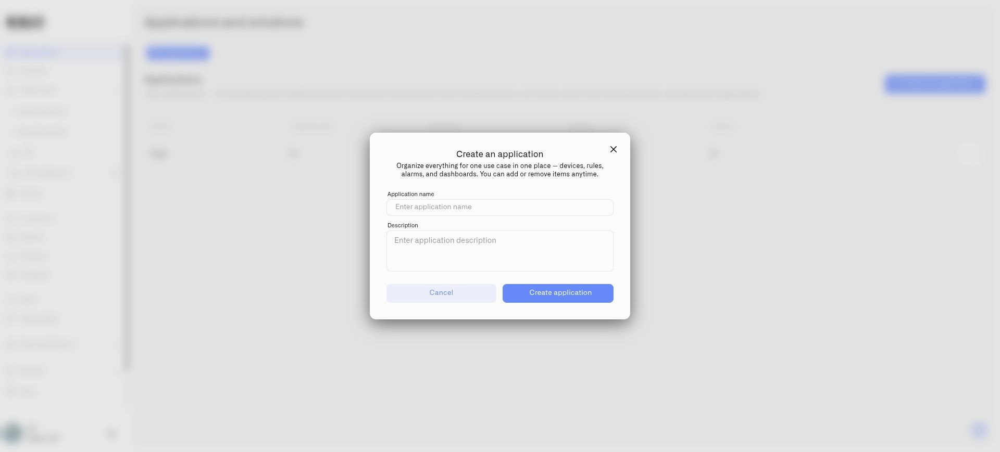

# How do I create an application in Kilo?

Create an application to keep everything for one job in one place. A new application is empty until you add things to it. This guide covers building the application yourself: you create its name and description, then add your devices, dashboards, rules, and alarms. That takes more work than installing a solution. If you would rather start from a finished setup, [install a solution](installing-a-solution.md) instead; the result is an application just like this one, already filled in. Choose a name that tells your team what the application does, such as **Building Monitoring**.

You must be a member of the current organization. Applications have no separate management permission; viewing or editing their devices, dashboards, rules, and alarms still requires the matching permissions. Check the organization selector before creating the application, particularly if you manage several customers or sites.

<figure><figcaption>
Give the application a recognizable name and describe its purpose.
</figcaption></figure>

## How do I create an application?

1. Open **Applications** and select **My applications**.
2. Select **Create an application**.
3. Enter **Application name**, for example `Building Monitoring`.
4. Add an optional **Description**, such as `Environmental conditions and operational alerts for the main office.`
5. Select **Create application**.
6. The new application is not opened automatically. Find its row in **My applications**, select it to open it, and then select the **Content** tab.

The name is required. The description gives colleagues context but does not configure devices or automation. A newly created application is empty until you add things to it.

## How do I update an application's details?

Open the application and use its edit action to change **Application name** or **Description**, then save. Choose distinct names even though names are not required to be unique; identical names make assignment selectors harder to use.

You can also create an application from an **Application** selector using **Add new application** while setting up a device, dashboard, rule, or alarm. Save that item after choosing the new application.

Next, [add your devices, dashboards, rules, and alarms](organizing-content.md).

For a tour of every element of the My applications list and of the application page, see [How do I use the My applications tab?](my-applications-tab.md).
