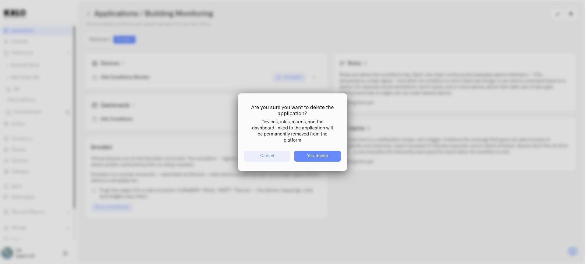

# What happens when I delete an application?

Deleting an application removes your copy and what is inside it. Decide what should happen to the items listed in **Content** first.


Deleting an application permanently deletes associated devices and dashboards, removes associated alarm definitions, and stops associated rules and moves them to Trash. The confirmation dialog says the rules are "permanently removed", but they can still be restored from Trash (the place where deleted rules wait). Move anything you need to keep to another application or **Default** before deleting.


An application installed from a solution is an ordinary application. Deleting it removes only your copy. It does not touch the solution in the catalog or other organizations' copies.

<figure><figcaption>
Review the consequences before confirming application deletion.
</figcaption></figure>

## What should I review before deleting an application?

1. Open the application and select **Content**.
2. Inspect **Devices**, **Dashboards**, **Rules**, and **Alarms**.
3. Open each item you want to keep and change its **Application** assignment.
4. Save the change, then return to Content to check that the item is no longer listed.
5. Check running rules and dashboards that other parts of your setup depend on before you remove them.

## How do I delete the application?

On the application's page, select the trash icon in the top-right corner and read the confirmation. Confirm with **Yes, delete** only when what is left inside can be removed. Return to **My applications** and check the result.

If deletion reports a failure, inspect the application and what is inside it before retrying. Removal may have partly completed. A rule being edited can also prevent the operation; have its editor finish and close the editing session, then retry.

Trash brings back rules only. It does not restore deleted devices, dashboards, or alarm definitions. See [Trash and Recovery](../rules-engine/trash-and-recovery.md) to restore rules.

## What access does deleting an application need?

Deleting needs **Read** access (you can see the items) to devices, dashboards, rules, and alarms, plus **Write** access (you can change them) to each kind that has items in this application. Your access depends on your role; ask your organization admin if the message names a missing permission. Nothing is removed when access is refused.

When all removed dashboards share one parent folder and that folder becomes empty, the folder is removed too. A folder that still contains other items remains, and dashboards spread across different parent folders do not cause those folders to be deleted. Move any dashboard you want to keep before confirming deletion.

To see where the trash icon and the confirmation dialog appear, see [How do I use the My applications tab?](my-applications-tab.md).
