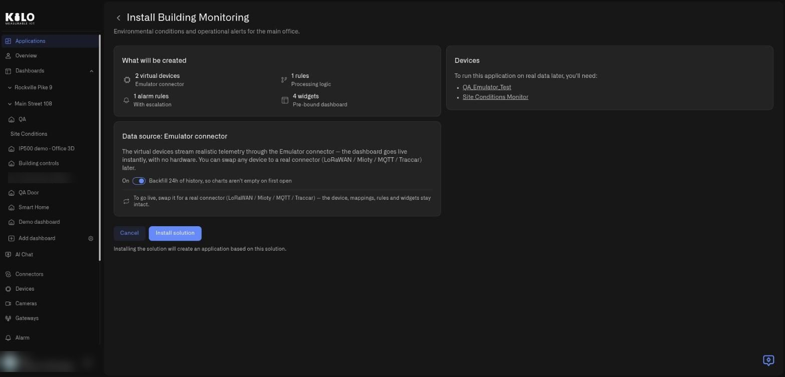
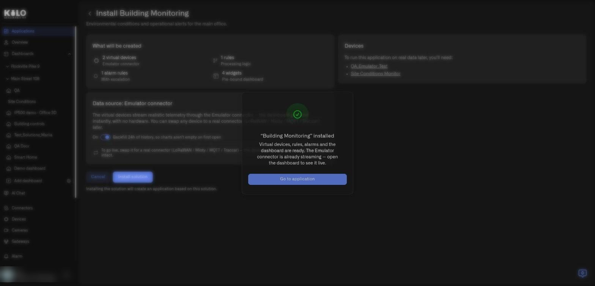
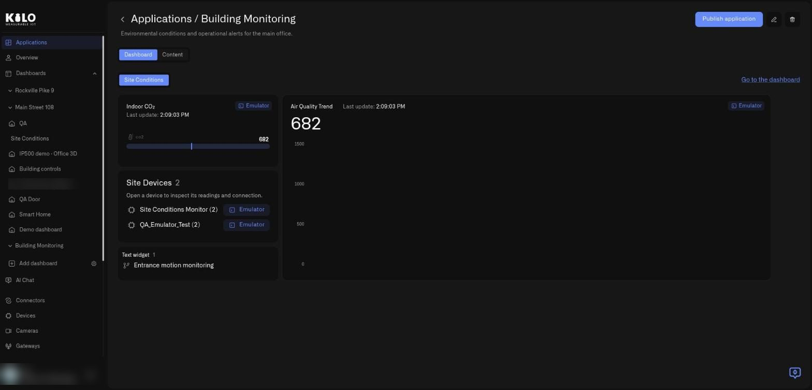

# How do I install a solution?

Installing a solution turns a dealer's finished setup into your own working application. You do not configure anything first. This guide walks through every element of the install screen and what happens after you press the button.

## How do I open the install screen?

1. In the left sidebar, select **Applications**, then the **Solutions** tab.
2. Select **Preview** on the solution you want.
3. Select **Use this solution** in the top-right corner of the preview.

The page title becomes **Install** followed by the solution name, with the solution's description under it. A back arrow returns you to the preview.

<figure><figcaption>
The install screen for a demo solution. Backfill is switched on by default.
</figcaption></figure>

## What does each card on the install screen mean?

* **What will be created.** Four tiles count exactly what you will get. **Virtual devices** (on the Emulator connector), **rules** (processing logic), **alarm rules** (with escalation), and **widgets** (a pre-bound dashboard). Nothing is a surprise.
* **Devices.** The heading says: to run this application on real data later, you will need these devices. It lists each virtual device by name, so you can see what real hardware the setup stands for.
* **Data source: Emulator connector.** Explains that the virtual devices stream realistic telemetry through the Emulator connector, so the dashboard goes live instantly with no hardware, and that you can swap any device to a real connector later.
* **The Backfill toggle.** A switch labelled **Backfill 24h of history, so charts aren't empty on first open**. It is on by default.
* **The footnote.** Under the buttons, a line confirms that installing the solution creates an application based on this solution.

### Should I leave the Backfill switch on?

Usually yes. Because the devices are emulated, they stream realistic readings the moment they exist. With the switch on, Kilo also generates a day of past readings, so trend charts look lived-in on the first visit. Switch it off if you prefer charts that start from now. If the history cannot be generated, the install still succeeds; only the past readings are missing.

## What happens when I select Install solution?

Select **Install solution**. The button changes to **Installing…** and is disabled while Kilo works. Kilo creates the following, in your organization and in this order:

1. **An application** named and described after the solution.
2. **The virtual devices**, on the Emulator connector, with their metrics already mapped.
3. **The alarms**, with their escalation.
4. **The rules**, deployed and running.
5. **The dashboards**, in a folder named after the application, with every widget bound to your new devices.

You get a complete application, not a list of things to finish. Select **Cancel** instead if you change your mind; nothing has been created at that point.

Installing runs in the background. If you leave the page, Kilo remembers the running install in the same browser and picks it up again when you return. If it takes more than a minute and a half, you will see **Still installing, this can take a while — you can leave this page and check later.**

## What do I see when the install finishes?

A confirmation dialog appears with the solution name in quotes followed by "installed". It reads: virtual devices, rules, alarms, and the dashboard are ready; the Emulator connector is already streaming, so open the dashboard to see it live.

<figure><figcaption>
The confirmation dialog after a successful install in a demo organization.
</figcaption></figure>

Select **Go to application**. You land on the new application's page, which opens on the **Dashboard** tab.

<figure><figcaption>
The freshly installed application. Values appear as the emulated devices report; the chart fills in as readings arrive.
</figcaption></figure>

From now on it is a normal application under **Applications → My applications**, and the new dashboard also appears in the **Dashboards** section of the left sidebar, in a folder named after the application. To learn every part of this page, see [How do I use the My applications tab?](my-applications-tab.md)

## Who receives the alarms?

You do. Whatever recipients the dealer used while preparing the solution, the alarms in your copy are addressed to the person who installed it. Review them in [Alarm](../alarm/README.md) and add colleagues or channels before you rely on them.

## Why was my installation refused?

Kilo checks the installation against your plan before it creates anything, and it tells you what went wrong.

* **A plan limit.** A solution counts toward your devices, dashboards, and rules limits, just like things you create by hand. If the solution would exceed one, the install is refused with a message that names the limit, shown as **Installation failed** followed by the reason. Nothing is created. Remove something you no longer need or upgrade your plan, then try again. Emulated devices count as devices, so a solution with many virtual devices needs room for all of them.
* **Missing permissions.** You need permission to create each kind of resource the solution contains. The message names the missing one.
* **Another install is already running.** If the same solution is being installed in your organization, or an earlier attempt needs cleanup, you will see: *Another installation of this solution is already running in your organisation, or a failed one needs an operator to clean it up before you can retry.* Use **Go to my applications** to check.
* **The catalog is being updated.** *The catalog is being updated — please retry in a minute.*
* **The install was cancelled.** *Installation cancelled* followed by the reason, with a retry button.

If something fails halfway, Kilo removes what it had created, so you are not left with half an application. In the rare case that it cannot clean up, you will see *Installation failed and needs manual cleanup — contact support. This solution cannot be reinstalled from here.*

## What should I do after installing?

1. Open the dashboard and watch the virtual devices report.
2. Read the rule and alarm so you understand what the setup does. The **Content** tab of the application explains each one.
3. When your real sensors are ready, [swap the Emulator for real devices](swapping-the-emulator-for-real-devices.md).

If you do not like the result, delete the application. Because an installed application is an ordinary application, [deleting it](deleting-an-application.md) never affects the dealer's solution or anyone else's copy.
