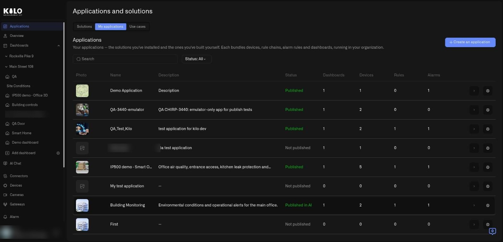
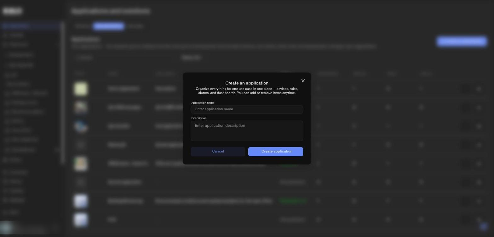
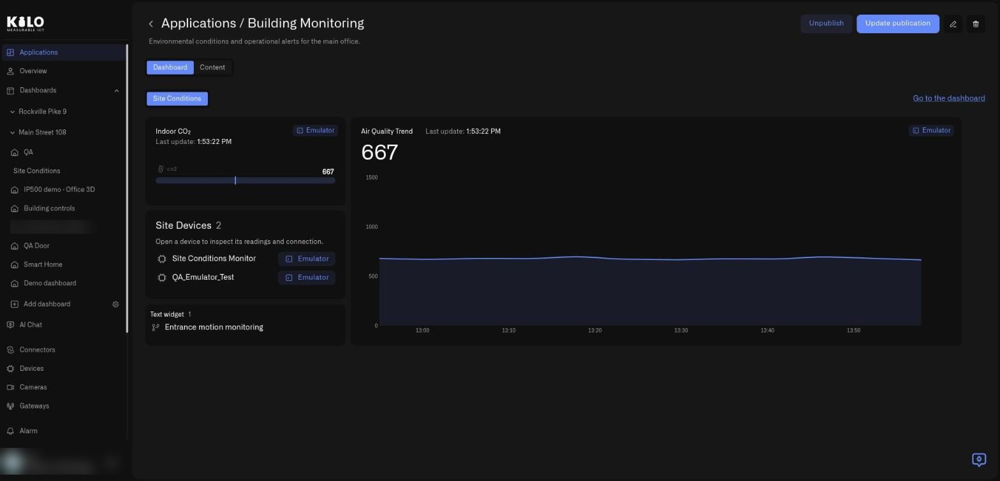
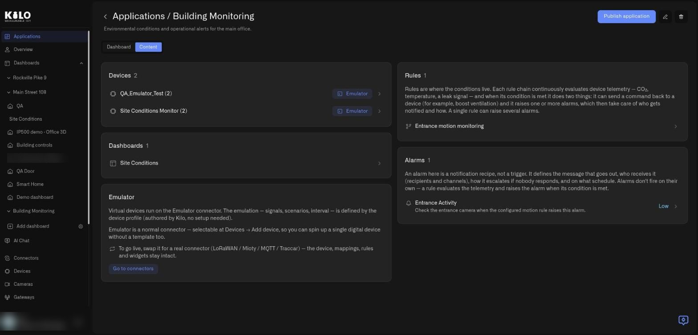
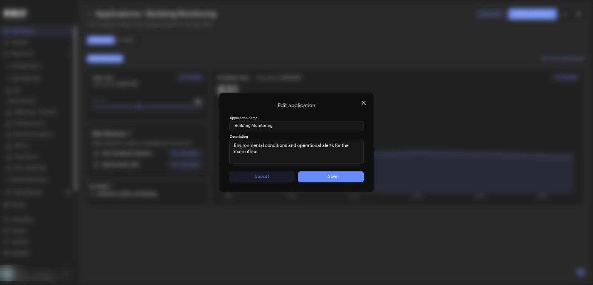
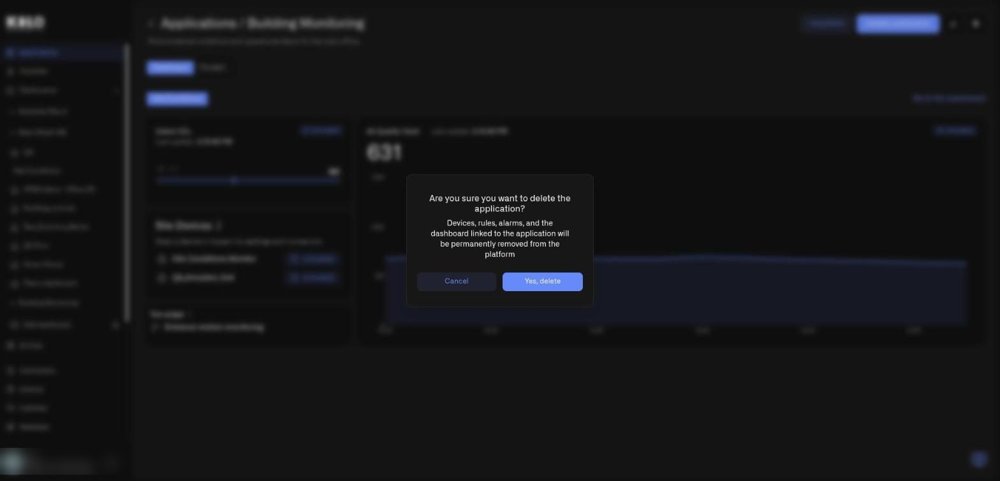

# How do I use the My applications tab?

**My applications** is home base for everything you run. It lists the applications you installed from solutions and the ones you built yourself, because Kilo treats them as the same thing. This guide describes every element of the list and of an application's own page.

## How do I open My applications?

1. In the left sidebar, select **Applications**.
2. Select the **My applications** tab (the second tab).

The heading is **Applications**, with the introduction: your applications are the solutions you installed and the ones you built yourself, each with its devices, rules, alarms, and dashboards, running in your organization.

<figure><figcaption>
The My applications tab of a demo organization. This organization publishes the catalog (Kilo), so it also shows the Photo and Status columns.
</figcaption></figure>

## What is in the application list?

Above the table:

* **Search.** Filters the list by name as you type.
* **Status: All.** A filter with the options **Status: All**, **Status: Published**, and **Status: Not published**. Only the organization that publishes the catalog sees this (that is Kilo).
* **Create an application.** The blue button in the top-right corner. See below.

The table columns:

| Column | What it shows |
|---|---|
| **Photo** | The picture of the application, if one was added when publishing. Only the organization that publishes the catalog sees this (that is Kilo). |
| **Name** | The application name. |
| **Description** | A short description of its purpose. A dash means none was written. |
| **Status** | Only the organization that publishes the catalog sees this (that is Kilo). **Published**, **Not published**, **Published in landing**, **Published in AI**, or **Published in landing & AI**. The last three describe where Kilo has listed it. |
| **Dashboards**, **Devices**, **Rules**, **Alarms** | How many of each the application holds. |

At the end of each row are one or two icon buttons. The **arrow** opens the application. For the organization that publishes the catalog, the **gear** opens the publish dialog (**Publish application** for an unpublished application, **Update publication** for a published one); see [How do I publish a solution?](publishing-a-solution.md). Selecting anywhere else on the row also opens the application.

If your organization has no applications, the tab invites you to create your first one.

## How do I create an application?

1. On the **My applications** tab, select **Create an application**.
2. In the dialog, type an **Application name** (for example, Building Monitoring).
3. Optionally type a **Description**.
4. Select **Create application**. Select **Cancel** to close without creating.

The dialog explains the idea in one line: organize everything for one use case in one place, including devices, rules, alarms, and dashboards, and add or remove items anytime.

<figure><figcaption>
The Create an application dialog. Only the name is needed to start.
</figcaption></figure>

A new application is empty until you add things to it. Assign devices, dashboards, rules, and alarms to it using their **Application** field. See [Creating an Application](creating-an-application.md) and [Organizing Content](organizing-content.md).

## What is on an application's page?

Select an application to open it. The title reads **Applications / ** followed by the name, with the description under it and a back arrow on the left. In the top-right corner you will find, depending on your role:

* **Publish application**, or **Unpublish** and **Update publication** for a published one. Only the organization that publishes the catalog sees these (that is Kilo).
* A **pencil** icon that opens the **Edit application** dialog.
* A **trash** icon that starts deletion.

Two tabs sit under the title: **Dashboard** and **Content**.

### What does the Dashboard tab show?

It shows the application's dashboards in one place. A chip row names each dashboard (here **Site Conditions**), and **Go to the dashboard** at the right opens the full dashboard. Every widget and device fed by the Emulator carries an **Emulator** badge, so you can always see what is still virtual.

<figure><figcaption>
The page of a published application in a demo organization. Only the organization that publishes the catalog (Kilo) sees Unpublish and Update publication; other members do not.
</figcaption></figure>

### What does the Content tab show?

**Content** lists everything behind the application, in cards you can open:

* **Devices**, with a count. Each row shows the device name, an **Emulator** badge if it is emulated, and an arrow that opens the device.
* **Dashboards**, with a count.
* **Rules**, with a count and a short explanation: rules are where the conditions live, and a rule can send a command back to a device and raise one or more alarms.
* **Alarms**, with a count and their severity label (for example **Low**). An alarm here is the notification, not the trigger; a rule raises it when its condition is met.
* **Emulator.** Shown only while the application holds at least one emulated device. Explains how virtual devices run on the Emulator connector, with a **Go to connectors** button for when you are ready to use real hardware. See [How do I swap the Emulator for real devices?](swapping-the-emulator-for-real-devices.md)

<figure><figcaption>
The Content tab of an installed application in a demo organization.
</figcaption></figure>

Counts show how many items are in each category. A **0** means it is empty. A dash means the count is unavailable, for example because you lack access to that category.

## How do I rename an application?

Select the **pencil** icon. The **Edit application** dialog shows the **Application name** and **Description**, with **Cancel** and **Save**.

<figure><figcaption>
The Edit application dialog for a demo application.
</figcaption></figure>

## How do I delete an application?

Select the **trash** icon. Kilo asks **Are you sure you want to delete the application?** and warns that the devices, rules, alarms, and the dashboard linked to the application will be permanently removed from the platform. In practice rules are stopped and moved to Trash, where you can restore them; devices, dashboards, and alarm definitions are removed for good. Details: [What happens when I delete an application?](deleting-an-application.md) Select **Yes, delete** to confirm, or **Cancel**.

<figure><figcaption>
The delete confirmation. Deleting an application removes the resources inside it.
</figcaption></figure>

Deleting an installed application affects only your copy, never the solution in the catalog. Read [Deleting an Application](deleting-an-application.md) before you retire anything that holds real data.
