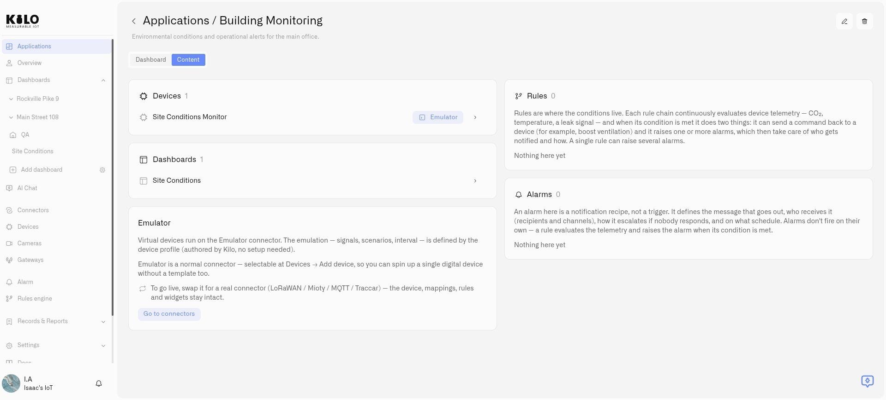

# How do I organize content in an application?

An application's **Content** tab lists everything behind it. For Building Monitoring, this might be temperature sensors, a facilities dashboard, an overheating rule, and an alarm for the response team.

The same Content tab opens on an application installed from a [solution](what-are-solutions-and-applications.md), where everything the solution created is already listed and you can keep adding to it. Create further devices, dashboards, rules, and alarms the usual way, then set their **Application** field. You need permission to edit the one you are assigning.

<figure><figcaption>
The Content tab groups the application’s devices, dashboards, rules, and alarms.
</figcaption></figure>

## How do I add things to an application?

| What | Where to choose the application |
|---|---|
| Device | In the left sidebar, open **Devices** and select the device. On the **Device info** tab, choose **Application**, then select **Next** to go on to the next tab. |
| Dashboard | In the left sidebar, open **Dashboards**. In the dashboard's add or edit dialog, choose **Application**. |
| Rule | In the left sidebar, open **Rules engine**. In the rule list, choose an application in the rule's **Application** selector. |
| Alarm | In the left sidebar, open **Alarm**, then **Alarm definitions**. In the create or edit dialog, choose **Application**, then save. |

Select `Building Monitoring` in each relevant field. Return to **Applications → My applications → Building Monitoring → Content** to confirm that the items appear in the right cards.

One item belongs to one application at a time. To move it, change its **Application** selector. **Default** means the item is not in any named application. It is not a second copy or a separate organization.

## What is included in an application?

The Content tab has separate cards for **Devices**, **Dashboards**, **Rules**, and **Alarms**. Open a listed item to keep working with it. What you can see and do depends on your permissions.

A rule checks readings; an alarm is the notification. Putting both in an application does not connect them. Set the rule's alarm action to use the alarm you want, as described in [Alarm Definitions](../alarm/notification-rules.md).

Use the Content tab to check for missing pieces. A dashboard shows readings, but monitoring that runs on its own also needs rules and alarms.

## How do I keep things when reorganizing?

Moving an item only changes which application it belongs to. Deleting an application removes what is inside. Before you delete one, [read what deletion does](deleting-an-application.md) and move anything you want to keep to another application or **Default**.

## How do I find an item in a large application?

Long lists scroll inside their own card, and search appears when a list is large enough. Open an item from the application and use the back arrow to return.

## What do the counts on the Content tab mean?

The numbers show how many items are in each category. **0** means it is empty. A dash means the count is not available, for example because you lack access.

## Good to know

* The **Application** selector starts at **Default** until you successfully create something with another choice. After that it remembers your last choice, separately for each organization.
* **Add new application** in a selector creates the application right away, even if you cancel the form you were filling in.
* You can change a rule's application while someone has its editor open. That changes only where the rule belongs, not the rule itself. An open rule editor can still block deleting the application that holds the rule.
* An **Emulator** badge marks a device that sends sample readings. The **Emulator** card offers **Go to connectors**; see the [Emulator Connector](../connectors/emulator-connector.md) guide to replace sample readings with a real connection.
* A real device shows whether it is reporting. A device that is still loading can appear without a status for a moment.
* The Rules and Alarms cards show up to 200 entries each, including disabled alarms. For more, open **Rules engine** or **Alarm** and use their full lists.
* An error while loading is not the same as an empty application.
