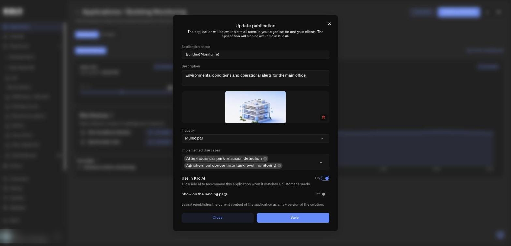
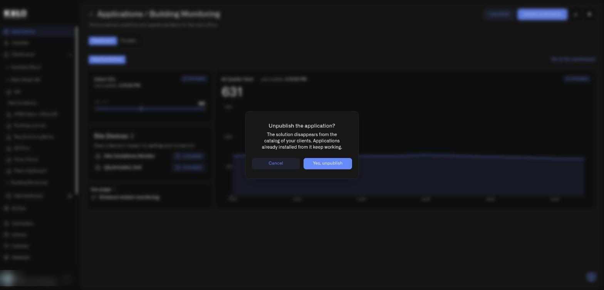

# How do I publish a solution?

Publishing is how a dealer turns finished work into something repeatable. You configure an application once, press **Publish application**, and every customer of yours can install it. This guide describes every button and field in the dealer workflow.


Publishing is available to dealers. A dealer is an organization that prepares solutions for its own customers. Dealers can publish today, and Kilo's own catalog is the first. If you do not see **Publish application** on an application, your organization is not a dealer.


## Where do I start?

Build and test the application first: devices, rules, alarms, and the dashboard. Every device must use the Emulator connector, because a solution has to work for every customer without their hardware (see below). Then you have two ways in:

* On **Applications → My applications**, select the **gear** icon at the end of the application's row. It opens the same dialog described below.
* Or open the application and select **Publish application** in the top-right corner of its page.

<figure><figcaption>
A dealer's My applications list in a demo organization. Each row has an arrow and a gear; the Status column is dealer-only.
</figcaption></figure>

## What does the publish dialog contain?

The dialog is titled **Publish application** the first time and **Update publication** afterwards. Under the title it states who gets the solution: all users in your organization and your clients.

<figure><figcaption>
The publication dialog for a demo application. The fields from Industry downward are shown to the platform's own catalog publisher.
</figcaption></figure>

Every dealer sees these fields:

* **Application name.** Up to 70 characters. This is the title customers see on the card.
* **Description.** Up to 300 characters. Write the problem it solves, not the equipment it uses.
* **Add application preview photo.** A PNG or JPG, about 5 MB recommended. It appears on the card and in your **Photo** column. A trash icon removes a chosen photo.

The platform's own catalog publisher also sees:

* **Industry.** The industry the solution belongs to.
* **Implemented Use cases.** A searchable multi-select. Pick the problems this solution solves. See [What are use cases in Kilo?](use-cases.md).
* **Use in Kilo AI.** A listing option for the platform's own catalog. When it is on, Industry and Implemented Use cases become required: *Required when Use in Kilo AI is on*. There is no customer-facing recommendation feature behind this option yet.
* **Show on the landing page.** A listing option for the platform's own website.

At the bottom, **Close** dismisses the dialog and **Save** (**Publish application** on the first publication) publishes. A note on a republication reminds you that saving republishes the current content of the application as a new version of the solution.

When it succeeds, a confirmation dialog names the application and says it is published. The card appears in your customers' **Solutions** tab, and in your list the **Status** column changes to **Published**.

## Which devices can a published solution contain?

Only emulated ones. A solution must work for every customer without their hardware, so each device must use the Emulator connector. If an application contains a device on a real connector, publishing is refused with this message: *The application has a device with a connector that is not an emulator. Replace the device's connector with an emulator to publish the application.* The dialog shows *The publication was refused. Fix the fields below and try again* with a list of the problems. Fix them, and publish again.

Alarm recipients are not copied from you to your customers. Installers become the recipients of their own copy.

## How do I update a published solution?

Change your application, then open the publish dialog again from the gear icon, or select **Update publication** on the application's page. Saving republishes the current content of the application as a new version of the solution. Customers who already installed an earlier version keep what they have; new installs get the new version.

<figure><figcaption>
A published application. Dealers see Unpublish and Update publication next to the pencil and trash icons.
</figcaption></figure>

## How do I unpublish a solution?

1. Open the application.
2. Select **Unpublish**.
3. In the dialog **Unpublish the application?**, read the warning: the solution disappears from the catalog of your clients, and applications already installed from it keep working.
4. Select **Yes, unpublish**, or **Cancel**.

<figure><figcaption>
The unpublish confirmation in a demo organization.
</figcaption></figure>

The application itself remains in My applications, with the status **Not published**. You can publish it again at any time.

## What happens if I delete the application I published?

The published solution stays in your customers' catalog. In **My applications**, a section called **Published solutions without an application** lists such solutions, marked **Application deleted · published**. Each has an **Edit card** button so you can still change the card, and you can unpublish it. The note explains: the source application was deleted, and you can still edit the card or unpublish the solution.

## Tips for a solution people want to install

* Write the description as the problem solved, not the equipment used.
* Use the About text to explain who it is for, and **How it works right now** for a short installation checklist: where to mount each sensor and how to connect it.
* Add a photo that shows the result.
* Keep the dashboard simple enough to understand in ten seconds.
* Check that your rule and alarm make sense for someone who has never seen them.
