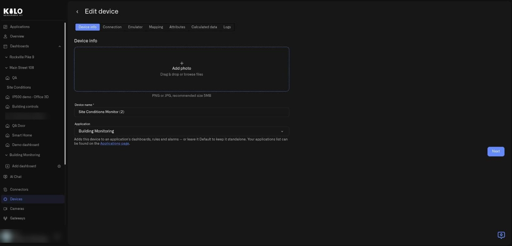
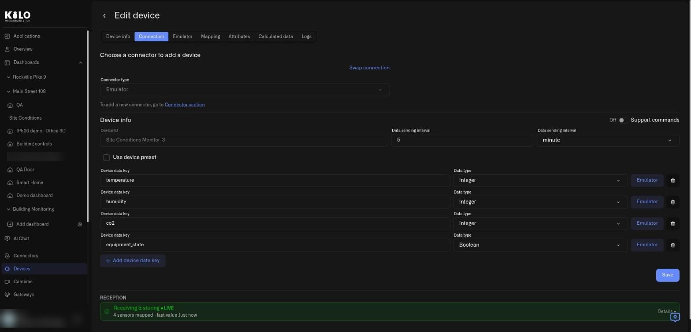
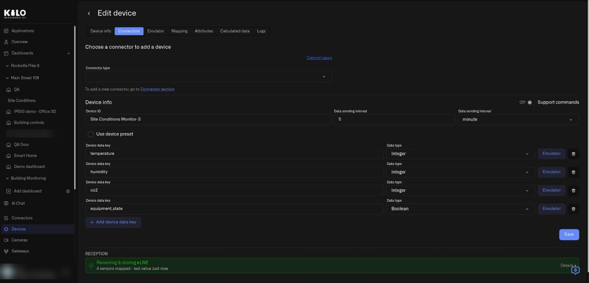
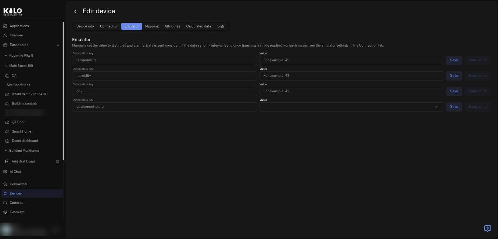
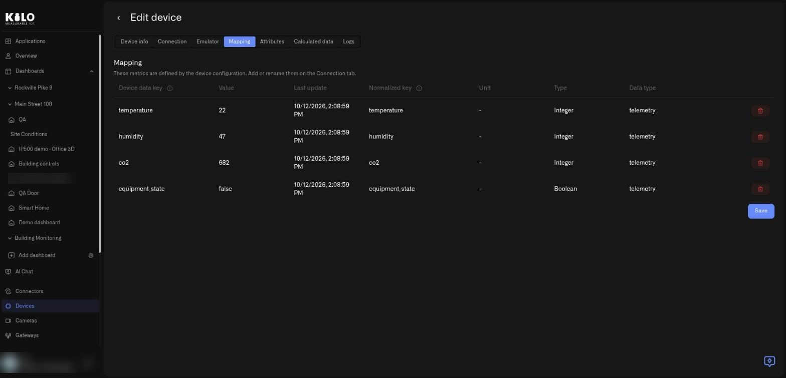

# How do I swap the Emulator for real devices?

A solution starts with emulator devices (sample devices that send realistic readings) standing in for the devices listed on the install screen. The real value arrives when you buy those devices and they replace the sample ones. You can ask [Kilo's AI chat](../ai-assistant/README.md) to do this (for example, "I got these devices, can you connect them to the application I installed?") or follow the manual steps below. Only the source of the readings changes. You do not rebuild anything. This guide follows the path click by click and describes every tab of the device page.

## What do I need before swapping?

* **The real device**, powered on and within range of its network.
* **Which connector it uses.** The solution's description and the device's manual say. The choices are:
  * **LoRaWAN:** a low-power radio network for small sensors that send a little data over long distances.
  * **MIOTY:** another low-power radio network for sensors, built to handle many devices at once.
  * **MQTT:** a common way for devices to send readings over the internet to a broker (a message server).
  * **Traccar:** a way to bring in GPS trackers, for example from vehicles.
* **The device's identifiers**, such as its ID or EUI (a long hexadecimal number). They are usually printed on the device label or in its manual. Which ones you need depends on the connector; each [connector's page](../connectors/README.md) lists them.

## How do I get to the device?

1. Open **Applications → My applications** and select your application.
2. Select the **Content** tab. While the application has at least one emulator device, the **Emulator** card explains the idea: to go live, swap the Emulator for a real connector (LoRaWAN, MIOTY, MQTT, or Traccar), and the device, mappings, rules, and widgets stay intact.
3. In the **Devices** card, select a device row. The **Edit device** page opens.

<figure><figcaption>
The Content tab. The Emulator card has a Go to connectors button if you first need to set up the real connector.
</figcaption></figure>

If you have not yet connected the hardware that will replace the emulator devices, select **Go to connectors** first and set up the [connector](../connectors/README.md) for your sensors. Then come back to the device.

## What are the tabs of the Edit device page?

The page title is **Edit device**, with a back arrow, and a row of tabs: **Device info**, **Connection**, **Emulator**, **Mapping**, **Attributes**, **Calculated data**, and **Logs**. For the swap, you work on **Connection** and check **Mapping**. The others are good to know about.

### What is on the Device info tab?

Device info holds the basics.

<figure><figcaption>
The Device info tab of a device that belongs to the Building Monitoring application.
</figcaption></figure>

* **Add photo.** Drop a PNG or JPG (about 5 MB recommended) or browse for a file, so the device is recognizable in lists.
* **Device name.** Required.
* **Application.** The application this device belongs to. Choose **Default** to keep a device outside any named application. A link to the **Applications page** sits under the field.
* **Next.** Moves to the next tab.

### What is on the Connection tab?

The Connection tab is where the swap happens.

<figure><figcaption>
The Connection tab of an emulated device. The Swap connection link is at the top right of the connector area.
</figcaption></figure>

* **Connector type.** Grayed out and set to **Emulator** while the device is an emulator device.
* **Swap connection.** The link that starts the swap. Next to it is a note that to add a new connector you go to the **Connector section**.
* **Device info.** The **Device ID**, the **Data sending interval** (a number plus a unit such as minute), a **Support commands** switch, and a **Use device preset** checkbox.
* **Device data keys.** One row per reading the device sends, such as temperature, humidity, co2, or equipment_state. Each row has the key name, its **Data type** (for example Integer or Boolean), an **Emulator** button that opens that reading's emulator settings, and a trash icon to remove the row.
* **Add device data key.** Adds another reading.
* **Save.** Saves the tab.
* **Reception.** A status bar near the bottom, such as **Receiving & storing, LIVE**, with a count of mapped sensors, the time of the last value, and a **Details** link. It is your proof that data is arriving.

### How do I start the swap?

1. On the Connection tab, select **Swap connection**.
2. The link becomes **Cancel swap**, and **Connector type** becomes an empty selector you can change.
3. Choose the real connector type, for example LoRaWAN, MIOTY, MQTT, or Traccar.
4. Enter the identifiers of your physical device. The fields depend on the connector, and each connector's page describes them: see [Connectors](../connectors/README.md).
5. Select **Save**.

<figure><figcaption>
Swap mode. The connector selector is empty until you choose the real connector; Cancel swap leaves the device as it was.
</figcaption></figure>

Select **Cancel swap** at any time to leave the device on the Emulator.

A solution often includes the exact steps for each device in its description. For the smart-office demo, for example, the checklist says where to mount each sensor and how to set up the MQTT topic (the address the device publishes its readings to). Read the solution's **Content** text before you start.

### How do I know the swap worked?

After you save, look at the Reception strip on the **Connection** tab. When it shows **Receiving & storing, LIVE** and the time of the last value keeps moving, real readings are arriving.

If it does not, check these in order:

1. The identifiers you entered match the device exactly.
2. The device is powered on and within range of its network.
3. The connector itself is set up and running; see [Connectors](../connectors/README.md).

Still nothing? See [Device Diagnostics](../devices/device-diagnostics.md), or contact Kilo support.

### What do the Emulator and Mapping tabs do?

**Emulator.** While the device is an emulator device, this tab lets you test your rules without waiting. Each device data key has a **Value** field, a **Save** button that stores the value, and a **Send once** button that transmits a single reading right now. The note at the top explains that data is sent according to the data sending interval.

<figure><figcaption>
The Emulator tab. Use it to force a value and watch a rule or alarm react.
</figcaption></figure>

**Mapping.** This tab shows how each device reading gets the name that rules and charts use.

<figure><figcaption>
The Mapping tab. The mapping is what keeps your rules and widgets working when the source changes.
</figcaption></figure>

The columns are **Device data key** (what the device sends), **Value** (the latest reading), **Last update**, **Normalized key** (the name rules and charts use for a reading; it stays the same, so they keep working), **Unit**, **Type**, and **Data type**. For an emulated device the keys are defined by the device configuration on the Connection tab, and each row has a trash icon and a **Save** button below the table. Because rules and widgets use that name and not the device's own key, they keep working after you swap.

## What stays the same, and what changes?

| Stays the same | Changes |
|---|---|
| Reading names and units, so rules and charts keep working | The source of the readings |
| Rules and their alarms | The connector type of the device |
| Dashboards and widgets | You provide the identifiers of the real device |

## Can I mix emulator and real devices?

Yes. Swap devices one at a time. A solution with five devices can run with two real sensors while three keep sending sample readings, which is a convenient way to move across gradually. The **Emulator** badges in the application mark what is still virtual.

## Why does the emulator count against my plan?

Emulator devices count as devices on your plan, because they run continuously. When you swap one for a physical device, it is still one device, so the count does not change. For more on emulated devices, see [Emulated Devices](../devices/emulated-devices.md) and the [Emulator Connector](../connectors/emulator-connector.md).
