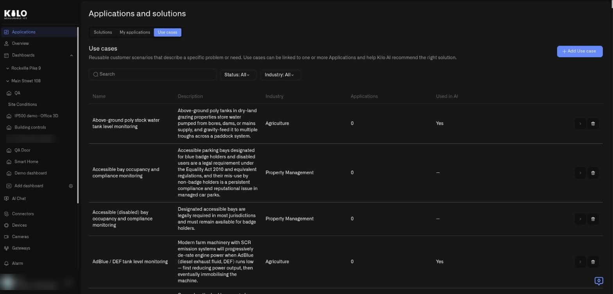
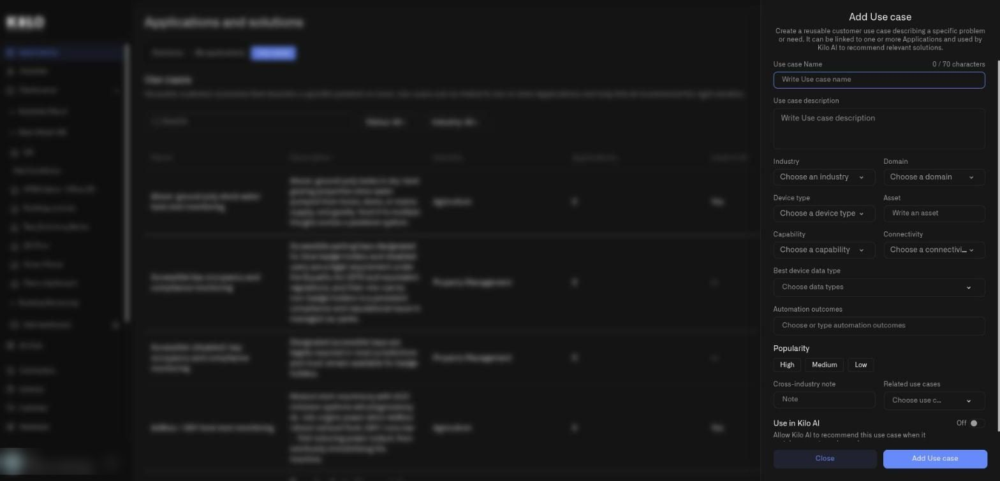

# What are use cases in Kilo?

This page is for the Kilo team that publishes the catalog. You do not need it to install and use solutions.

A solution is rarely about a single problem. A shopping-center solution might protect against leaks, save energy, and pump out a flooded basement. Each of those is a **use case**.

## What is a use case in Kilo?

A use case is one clearly described problem or need, in plain words: *Above-ground stock water tank level monitoring*, *After-hours car park intrusion detection*. It belongs to an industry such as Agriculture or Property Management, and many use cases can be linked to a single solution. The same use case can serve many solutions, because the same problem appears in different industries.

## Who manages use cases?

Kilo curates the use cases, so the **Use cases** tab appears only for Kilo's own organization. You will not see it. It is documented here so you understand how the catalog is organized.

Today, use cases organize the catalog: when a solution is published, the publisher chooses an industry and picks the use cases it implements, so the catalog is arranged around problems rather than product names.

## What is on the Use cases tab?

Open **Applications → Use cases**. The tab has a heading, **Use cases**, and an introduction: reusable customer scenarios that describe a specific problem or need, which can be linked to one or more applications.

<figure><figcaption>
The Use cases tab of a demo organization. The introduction mentions Kilo AI recommendations, which are not available to customers yet.
</figcaption></figure>

* **Search.** Finds a use case by name.
* **Status: All.** A filter with the options **Used in AI** and **Not used in AI**, which reflect the listing option.
* **Industry: All.** Filters by industry.
* **Add Use case.** Opens the form below.
* **Table columns.** **Name**, **Description**, **Industry**, **Applications** (how many applications implement it), and **Used in AI**. Each row ends with an arrow that opens the use case for editing and a trash icon that deletes it.

## How do I add a use case?

Select **Add Use case**. A panel slides in from the right.

<figure><figcaption>
The Add Use case panel over the use cases list.
</figcaption></figure>

Fill in the fields from top to bottom:

* **Use case Name.** Up to 70 characters; a counter shows how many are left.
* **Use case description.** The problem in plain words.
* **Industry** and **Domain.** Choose from the lists.
* **Device type**, **Asset**, **Capability**, and **Connectivity.** Describe what is monitored and how the devices connect. Device type, Capability, and Connectivity are lists; Asset is free text.
* **Best device data type.** The kinds of readings that matter most.
* **Automation outcomes.** What the setup achieves; choose or type your own.
* **Popularity.** **High**, **Medium**, or **Low**.
* **Cross-industry note.** A short note when the same problem appears in other industries.
* **Related use cases.** Link to similar ones.
* **Use in Kilo AI.** A listing option for the platform's own catalog. Its hint reads *Allow Kilo AI to recommend this application when it matches a customer's needs.*

Select **Add Use case** to save, or **Close** to leave without saving. To change one later, select the arrow on its row; the form is titled **Edit Use case**.

## How do I delete a use case?

Select the trash icon on its row. Kilo asks **Delete the use case «name»?** and explains that the use case stops being available for new publications and Kilo AI recommendations. Confirm with **Yes, delete**. If solutions still implement the use case, the server refuses and a second dialog lists them (**It is implemented by:** followed by their names; deleting detaches it from them). Confirm that one with **Yes, detach and delete**, or select **Cancel** to keep the use case.
