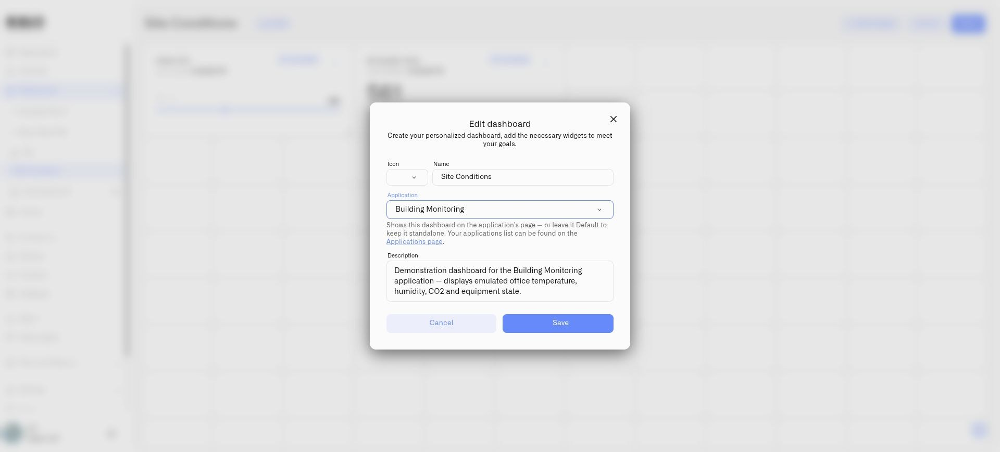

# How do I use application dashboards?

The **Dashboard** tab presents the dashboards associated with an application. It takes you from the application straight to its charts and controls. The **Content** tab lists the devices, rules, and alarms behind them.

An application installed from a [solution](installing-a-solution.md) arrives with its dashboard already added and connected to its devices. A Building Monitoring application can have separate dashboards for environmental conditions and equipment operation. To add a dashboard to the application, set its **Application** field.

<figure><figcaption>
Choose the application in the dashboard editor.
</figcaption></figure>

## How do I view an application dashboard?

1. Open **Applications → My applications**.
2. Select the application.
3. Open **Dashboard**.
4. If the application has several dashboards, select the one you want to view.

The dashboard displays its configured widgets. Their data and available interactions follow the underlying devices, widget configuration, and your permissions.

## How do I change the dashboard layout or widgets?

The application's dashboard view is not the layout editor. Select **Go to the dashboard** to open the dashboard itself, then use its normal editing controls (you can also find it under **Dashboards** in the left sidebar). See [Creating Dashboards](../dashboards/creating-dashboards.md) for the complete workflow.

After saving your changes, return to the application to check the result. The same dashboard is used in both locations; you are not maintaining an independent copy.

## Why does no dashboard appear?

Check **Content → Dashboards**. If it is empty, create a dashboard (or edit one in **Dashboards** in the left sidebar) and set its **Application** field to this application. If you cannot view an associated dashboard, ask the organization administrator to check your dashboard access.
