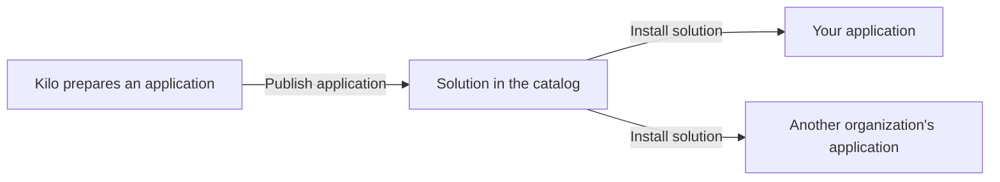

# What are solutions and applications in Kilo?

Kilo uses three words that sound alike and mean three different things. Once you see how they fit together, the whole feature becomes simple, and you will know exactly which screen to open for each one.

## What is the difference between a solution and an application?

Think of a recipe and a pie.

* An **application** is the pie: a real, working bundle in your organization. It holds the devices, dashboards, rules, and alarms you use for one job, and you can change any part of it.
* A **solution** is the recipe: a ready-made application from the Kilo catalog. It shows the use case it solves and arrives fully pre-configured with devices, dashboards, rules, and alarms. Installing a solution bakes a pie of your own.

An installed application is an ordinary application. You can rename it, change its rules, add devices, or delete it. An application you built by hand and an application installed from a solution behave identically. Nothing is synced back to the solution, and nothing changed in the catalog later alters your copy.

This also explains two important behaviors:

* **Unpublishing is safe.** If an application is withdrawn from the catalog, it disappears from the list, but copies that are already installed keep working.
* **Deleting your application is safe.** Deleting an installed application affects only your copy and never the solution in the catalog.

## Where do I find solutions and applications in Kilo?

Everything lives on one page. In the left sidebar, select **Applications**. The page is titled **Applications and solutions**, and a row of tabs sits directly under the title.

<figure><figcaption>
The Applications and solutions page, opened on the Solutions tab of a demo organization. The left sidebar shows the Applications item selected.
</figcaption></figure>

| Tab | What it is for | Who sees it |
|---|---|---|
| **Solutions** | The catalog of ready-made solutions provided by Kilo. You preview them and install them here. | Every organization member whose plan includes Applications. |
| **My applications** | Every application in your organization, both the ones you built and the ones you installed. | Every organization member whose plan includes Applications. |
| **Use cases** | The list of problems a solution can address, with industries. | Only the platform's own catalog publisher. Most organizations never see this tab. |

Each tab has its own guide:

* [How do I browse and preview solutions?](browsing-and-previewing-solutions.md)
* [How do I install a solution?](installing-a-solution.md)
* [How do I use the My applications tab?](my-applications-tab.md)

## Who can do what?

| Role | What they can do |
|---|---|
| Any organization member with the right permissions | Create their own applications. Browse the solutions in the catalog, preview them, and install them. |
| The organization that publishes the catalog | Everything above, plus publish an application as a solution, update the publication, and unpublish it. |

Publishing is currently limited to the platform's own catalog publisher, so you install solutions and do not publish them. Each solution is a complete, ready-made application for one use case, for example leak protection or tank level monitoring. New applications are added to the catalog with every release, starting with the next one.

## What is a use case?

A **use case** is a specific problem that a solution helps with, such as leak protection, tank level monitoring, or energy saving. One solution can address many use cases, and the same use case can appear in many solutions. For example, a "Building automation" solution might cover leak protection, energy saving, and occupancy monitoring, while a "Property management" solution also includes leak protection.

Today use cases organize the catalog, and they are managed by the platform's own catalog publisher. See [What are use cases in Kilo?](use-cases.md).

## What is inside a solution?

| Part | What you get when you install it |
|---|---|
| Virtual devices | Emulated devices with their metrics already mapped, streaming on the Emulator connector. |
| Rules | Processing logic that reacts to the readings, already deployed and running. |
| Alarms | Alarm definitions with escalation, set up so that you are the recipient. |
| Dashboards | A pre-built dashboard with widgets already bound to the devices. |

Next: [browse and preview solutions](browsing-and-previewing-solutions.md).
