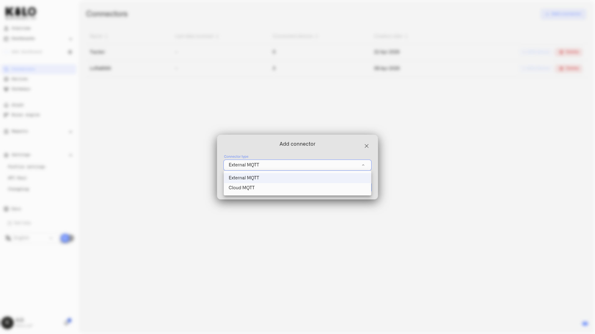

# How Do I Connect Devices With the MQTT Connector?

The MQTT connector brings readings from meters, controllers, and edge systems into Kilo's dashboards and automation. You can connect equipment that already publishes MQTT messages or use an edge bridge to translate another protocol, then map its fields to readings your rules can use.

**MQTT** is a messaging protocol. A **broker** receives messages and forwards them to subscribers; a **topic** is a named message channel, such as a meter's readings channel. Kilo's configured MQTT connection receives those messages and associates them with registered devices.

Choose **Cloud MQTT** for a broker endpoint and credentials supplied by Kilo, or **External MQTT** to connect a broker you already operate.

Two variants are available:

| Variant | How the broker is provided | Limit | Best for |
|---------|--------------------------|-------|----------|
| **External MQTT** | Your own broker — cloud-hosted, on-premise, or in a facility network, as long as it is reachable by the platform | Up to 10 per organization | Connecting existing infrastructure that already publishes to MQTT |
| **Cloud MQTT** | Platform-provisioned — the server provides a dedicated broker endpoint and credentials per connector | Unlimited | New deployments, pilots, and remote sites where you want MQTT ingestion without operating broker infrastructure yourself |

Use External MQTT when you already have a broker running. Use Cloud MQTT when you want the platform to provide one — you give the connector a name, the platform provisions the rest.

<figure><figcaption></figcaption></figure>

> **Scope.** This documentation covers MQTT telemetry ingestion and device mapping. Sending commands the other way — controlling a connected device with downlinks — is set up per device under [Device Commands](../devices/commands/).

## Where Can I Learn More About MQTT in Kilo?

- [What MQTT is](mqtt/what-is-mqtt.md) — Protocol primer for engineers new to MQTT or refreshing the model.
- [Cloud MQTT](mqtt/cloud-mqtt.md) — Provisioning a platform-managed broker for a connector.
- [External MQTT](mqtt/external-mqtt.md) — Connecting an existing broker, including network reachability, authentication, and verification.
- [Topics and device routing](mqtt/topics-and-device-routing.md) — How topic patterns, device-ID extraction, and the Mapping tab work together. Read before registering devices.
- [Troubleshooting](mqtt/troubleshooting.md) — Diagnosing connection, topic-match, and Logs-tab issues.

For the hardware/edge-gateway side of the integration — Modbus, BACnet, OPC-UA, Sparkplug B, and Zigbee2MQTT bridges that publish MQTT into the connector — see [MQTT Edge Gateways](../gateways/mqtt-edge-gateways/README.md) under Gateways.

---

## How Do I Add an External MQTT Connector?

1. Navigate to **Connectors** in the sidebar.
2. Click **Add connector**.
3. Select **External MQTT** from the **Connector type** dropdown and click **Add**. The **Add external MQTT connector** form opens.
4. Fill in the configuration form:

   | Field | Required | Details |
   |-------|----------|---------|
   | **Name** | Yes | Display name for this connector |
   | **Broker URL** | Yes | Full URL with scheme and port. The broker must be network-reachable from the platform — a broker accessible only on an isolated local network will not connect. Accepted schemes: `mqtt://`, `mqtts://`, `tcp://`, `ssl://`. Example: `mqtts://broker.facility.example.com:8883` |

5. In **Transport**, decide how the connection is secured and what to read. **Encrypt the connection (TLS)** switches on automatically for `mqtts://` and `ssl://` addresses and adds **CA Certificate** and **Server name (SNI)**. **MQTT version** defaults to 5.0, and **Topics to read** stays empty to read the whole broker. The [External MQTT guide](mqtt/external-mqtt.md#how-do-i-set-mqtt-encryption-server-name-version-and-topic-filter) explains each control.
6. Choose an **authentication method** from the tabs:

   | Method | What to fill in |
   |--------|----------------|
   | **Anonymous** | No credentials required |
   | **Basic** | Username and Password (password has a show/hide toggle) |
   | **Certification** | Two file upload buttons: **Client Certificate** and **Private Key**. Upload each file — do not paste PEM content. Encryption is held on for this method, and the CA Certificate goes in **Transport** |
   | **JWT Token** | **Token** field with a show/hide button and a copy button. The platform submits only the token for JWT authentication |

7. Click **Add connector** (the button reads **Save** when you edit an existing connector). **Test connection** is disabled for now and shows **Coming soon**.

The connector appears in the connectors table, and the app opens the new connector on its **Diagnostics** tab. Click a row later to reopen it on **Settings**. Broker ports the platform does not support cannot be saved; the URL field lists the **Supported ports**.

---

## How Do I Add a Cloud MQTT Connector?

1. Navigate to **Connectors** in the sidebar.
2. Click **Add connector**.
3. Select **Cloud MQTT** from the **Connector type** dropdown.
4. Enter a **Name** for the connector.
5. Click **Add**.

The platform provisions a dedicated broker endpoint and displays the generated credentials:

| Credential | Details |
|-----------|---------|
| **Broker URL** | The managed MQTT endpoint. Copy it using the copy button. |
| **Topic prefix** | All messages published to this connector must use this prefix. It keeps your data organized under the connector's assigned namespace. Copy it using the copy button. |
| **Username** | Assigned automatically. Copy it using the copy button. |
| **Password** | Shown once. **Copy it immediately.** If lost, rotate the credentials from the connector settings — devices will need to be reconfigured with the new password. In edit mode, a regenerate button is available. |

#### How Do I Connect Devices to Cloud MQTT?

Configure your devices or gateway software to publish to the provided endpoint. Key details before connecting:

- **The Broker URL is the complete endpoint** — copy it exactly as shown. It uses MQTTS (TLS) on port 1884. Configure your devices accordingly; this is not the standard port 1883.
- **All published topics must start with the Topic prefix.** The full topic your device publishes to is `{Topic prefix}/{device topic}` — for example, if the prefix is `iot/abc123/xyz789` and your device publishes power readings, you might publish to `iot/abc123/xyz789/EM-4492/power`.
- **Routing templates on the device do not include the prefix.** When configuring the device ID topic on the Connection tab, enter only the device-level portion — for example `{{deviceId}}/power`. The platform strips the prefix before routing.

No broker infrastructure on your end is required — the platform manages the broker.

---

## How Do I Register a Device on an MQTT Connector?

Each device that publishes through an MQTT connector must be registered individually. Registration maps the MQTT topic structure and payload format to the server's device model.

1. On the **Connectors** page, click **Add device** in this connector's row, or go to **Devices → Registering Devices** and select this connector.
2. Complete the standard device fields (name, connector, template).

> **Device ID = topic segment, character for character.** Whatever you enter as the device's identifier must match the device-level topic segment your hardware publishes exactly. A device ID is 1–64 characters, and case and spaces are preserved and significant, so `EM 4492` does not match a device publishing on `EM-4492`, and `em-4492` does not match `EM-4492`. Use the same exact string in the device record and on the publishing side.

3. Open the device's **Connection** tab. It holds the **Topic for defining Device ID** section and the **Topic Telemetry** section described below.
4. Open the separate **Mapping** tab to link the incoming keys to normalized metrics.

### How Do I Set the MQTT Topic on the Connection Tab?

The Connection tab tells the connector where to find the device identifier in each MQTT message and which topics carry telemetry. [Topics and device routing](mqtt/topics-and-device-routing.md) walks through the segment builder and the **Resolved** preview in detail.

#### MQTT Topic for device ID *(required)*

The MQTT topic pattern this device publishes to. Use `{{deviceId}}` to mark the segment of the topic that contains the device identifier. Saving without it shows **MQTT topic is required** or **Device ID topic is required**.

**Example:** If your energy meter publishes to `facility/meters/EM-4492/power`, enter:
```
facility/meters/{{deviceId}}/power
```

The platform extracts `EM-4492` from that segment and routes all matching messages to this device's Digital Twin.

#### Where to get the device ID

- **Topic** *(default)*: the ID is extracted from the `{{deviceId}}` segment of the topic.
- **Payload**: the ID is taken from a field inside the JSON payload. When selected, the **Payload template** field becomes required. Its placeholder reads **Specify the path to the device ID**, and the helper shows an example such as `deviceInfo.deviceId`. **Payload preview** shows the payload the platform sees.

For a payload `{"device": {"id": "EM-4492"}, "power": 4.2}`, enter this in **Payload template**:
```
device.id
```

#### Topic Telemetry *(optional)*

Telemetry topic rows define how individual measurements are extracted from MQTT messages.

For devices that publish a flat JSON payload on a single topic, such as building management systems or PLCs publishing a status object, you can skip this section. The platform parses all keys from the JSON payload automatically, and nested objects are flattened into dot-notation paths (for example, `{"device": {"temperature": 22.5}}` becomes `device.temperature`). The Mapping tab is still required: each payload key needs a row with a matching **Device data key** to become a normalized platform metric. Add telemetry topic rows only when you need explicit per-topic control, for example when metric values sit in the topic path rather than the payload.

| Field | Details |
|-------|---------|
| **MQTT Topic for telemetry** | Topic pattern for this row, using the `{{deviceId}}` placeholder |
| **Device data key** | Names the source key arriving from MQTT. It must match what the device publishes, and every telemetry row needs one (**Device data key is required**). It does not create a platform metric on its own; the Mapping tab links it to a normalized metric. |

**Add new topic** adds a telemetry topic row.

**Apply all** uses the device ID topic pattern as a prefix to generate telemetry topic templates for rows that already have a **Device data key**. It builds per-topic patterns from the device ID topic and does not copy its value verbatim.

#### Placeholder reference

| Placeholder | Where used | What it does |
|-------------|-----------|-------------|
| `{{deviceId}}` | Device ID topic, telemetry topic templates | Marks the topic segment containing the device identifier |
| `{{value}}` | Telemetry topic templates | Marks a topic segment whose content is the measurement value itself, for example `meters/EM-4492/230.5` where `230.5` is the reading. Do not use `{{value}}` for segments that name the metric (like `power` or `voltage`). The token is optional: a telemetry topic without it reads the value from the message body and stores it under the row's data key |

---

### How Does the MQTT Mapping Tab Work?

The Mapping tab links incoming MQTT data to normalized platform metrics. This is where raw device values become queryable sensor data in the Digital Twin.

The **Device data key** in the Mapping tab must match the key published in the MQTT message (or the Device data key defined on the Connection tab). Without a match the data is ignored. The helper text above the table says so: **"If the Device data key is not filled in, the data will be ignored."**

The table has these columns, left to right:

| Column | Type | Details |
|--------|------|---------|
| **Device data key** | Dropdown | Lists keys this device actually sends. Empty until at least one publish has arrived. A row left empty is ignored |
| **Value** | Read-only | Current live value received from the broker |
| **Last update** | Read-only | Timestamp of the most recently received value |
| **Normalized key** | Dropdown | Select from sensor templates; includes a "+ Add new metric" option |
| **Unit** | Read-only | Derived from the selected template |
| **Type** | Read-only | Integer, Float, String, or Boolean, derived from the template |
| **Data type** | Dropdown | **Telemetry** is the only option |
| (actions) | Icon | The **Remove** button deletes the row |

**Add key** adds a new empty mapping row.

#### Why Is the Device Data Key Dropdown Empty Until the Device Publishes?

The **Device data key** column is a dropdown populated from payload keys actually received from the device, not a free-text input. Before the first publish arrives, the dropdown is empty and the rows cannot be completed.

Registering an MQTT device is therefore a two-pass workflow:

1. Add a row per metric, select the **Normalized key** from the templates dropdown (or use **+ Add new metric** to create one), and leave the **Device data key** empty.
2. Click **Save**. The device record is persisted.
3. Confirm the device is publishing — for an MQTT-producing edge gateway, that the gateway process is running and the device has emitted at least one message.
4. Reopen the device. The **Device data key** dropdown now lists keys received from the most recent publishes.
5. Match a key to each mapping row.
6. Click **Save** again.

#### Why Does the Value Column Update but the Logs Tab Stay Empty?

The Mapping tab's **Value** column reflects the most recent payload — a live snapshot. Values appear here as soon as topic matching succeeds, even before Device data keys are populated.

The **Logs** tab is per-sensor history. It is populated only by publishes that arrive *after* Device data keys are saved. After the second pass of the workflow above, generate a fresh publish (a wake-on-event from the device, a scheduled report, or for development gateways a poll request) to confirm the Logs tab is receiving records.

#### How Do I Refine MQTT Mapping After Data Arrives?

MQTT mapping is not a one-shot operation. Initial registration is often based on the operator's expectation of what the device or edge gateway will publish; the first real payload frequently reveals additional keys — vendor-defined diagnostic fields, undocumented state fields, nested objects with useful sub-paths. Treat the Mapping tab as a place to revisit:

1. After live data has been arriving for a representative period, reopen the device record.
2. Inspect the **Device data key** dropdown and the **Value** column to see what the device is actually publishing.
3. Add Mapping rows for fields the deployment now wants to track (a diagnostic field for predictive maintenance, a state field that became operationally relevant, a nested vibration sub-metric, and so on).
4. Pick the right Normalized key for each new row.
5. Save.
6. Trigger a fresh publish so the Logs tab begins collecting history for the new mappings.

This iterative refinement is the expected workflow, particularly for vendor-mixed fleets where payload schemas vary subtly across firmware revisions of nominally-identical devices.

#### Which Metric Type Fits an MQTT Payload Value?

When a device publishes an enumerated state as a string (for example an actuator publishing `"OPEN"`/`"CLOSED"`, or a Zigbee `state` field with `"ON"`/`"OFF"`), the value arrives as a string even though the concept is binary. Map these to a **String** metric, not Boolean. A reading that does not fit the metric's Type is rejected and not stored, so a Boolean metric never receives `"ON"`.

For Zigbee2MQTT-bridged devices, the [zigbee2mqtt.io](https://www.zigbee2mqtt.io/supported-devices/) device pages list each feature with a type. Translate as follows:

| Z2M feature type | Metric Type | Notes |
|------------------|-----------|-------|
| `binary` | **String** | Values are `"ON"`/`"OFF"` strings, not booleans |
| `numeric` | **Float** or **Integer** | Pick Integer for whole-number ranges |
| `enum` | **String** | Enumerated values arrive as strings |
| `text` | **String** | Free-form text |

#### How Do I Find Out Which Keys a Device Publishes?

The Mapping tab does not auto-detect keys. Three discovery methods, in order of practicality:

1. **The device's documentation or vendor data sheet.** Industrial devices typically ship with a payload schema or topic catalog.
2. **For Zigbee2MQTT-bridged devices**, the device page at `https://www.zigbee2mqtt.io/devices/{modelId}.html` lists the Exposes set. Note that real payloads may include keys not on the device page — trust the live payload over the documentation when they differ.
3. **Subscribe to the broker and inspect the live payload** — `mosquitto_sub` against the broker (or the Logs tab once at least one mapping row resolves) shows the JSON payload directly. Every top-level key is a valid Device data key.

---

## What Should I See After the MQTT Connector Is Set Up?

After the connector is configured and devices are registered:

- The connector's row in the **Connectors** table shows **Last data received** updating as messages arrive, and **Connected devices** counts the registered devices.
- The connector's **Diagnostics** tab shows the live connection, incoming messages and activity (see [Troubleshooting](mqtt/troubleshooting.md)).
- Each device's Digital Twin updates with incoming telemetry — viewable on the device detail page and in dashboards.
- Rules engine conditions referencing these device metrics evaluate in real time.

---

## Why Is My MQTT Connector Not Receiving Data?

A short list — see [Troubleshooting](mqtt/troubleshooting.md) for diagnostic recipes covering authentication failures, certificate mismatches, the empty-Logs-tab pattern, and verification tooling.

**No data arrives after connection:**
- For External MQTT: verify the broker URL scheme (`mqtt://`, `mqtts://`, `tcp://`, or `ssl://`), confirm the broker is reachable from the public internet (Kilo IoT Server connects out to your broker), and double-check credentials.
- For TLS (Certification auth): verify the CA certificate matches the broker's certificate chain, and that the client certificate and private key are a matching pair.
- For Cloud MQTT: confirm that your devices are publishing to the correct Broker URL and Topic prefix, and that the username and password are correct. If the password was lost, rotate it from the connector settings.

**Device is registered but no data appears:**
- Compare the registered device ID topic against the exact topic the device publishes to. Topics are case-sensitive and must match exactly.
- Confirm the `{{deviceId}}` placeholder position lines up with the actual device ID segment in the topic.
- Confirm the device ID is character-for-character identical to the device-level segment. Case and spaces are significant.
- If using Payload source: verify the Payload template resolves correctly against the actual payload structure.

**Mapping tab Value column updates but Logs tab is empty:**
This is the most common pattern when Device data keys are saved after the most recent publish arrived. The Logs tab is populated only by publishes received *after* Device data keys are saved. Trigger a fresh publish — a device wake-up, a scheduled report, or a `/get` poll for development gateways — and the Logs tab will populate.

**Metric values missing or showing wrong keys:**
- Check that the Device data key in the Mapping tab matches the key in the MQTT payload exactly (case-sensitive).
- If relying on automatic JSON parsing (no telemetry topics defined): the platform flattens the entire JSON payload, including nested objects, into dot-notation keys — for example, `{"device": {"temperature": 22.5}}` becomes accessible as `device.temperature`. Use these dot-notation paths in the Device data key column of the Mapping tab.

**Cloud MQTT password lost:**
The password cannot be retrieved after creation. Rotate the credentials from the connector settings and reconfigure devices with the new password.

**Device fails to save on a Cloud MQTT connector:**
If saving a device on a Cloud MQTT connector fails, contact support. Support can help complete the registration through the supported API-assisted path.

---

## What Are Some Examples of MQTT Connector Setups?

**Factory PLC — per-topic telemetry:**
A PLC publishes discrete measurements to separate MQTT topics on a plant-floor broker (`mqtts://plc-broker.plant.example.com:8883`). External MQTT connector, username/password auth. Device ID topic: `plant/line-a/{{deviceId}}/data`. One telemetry topic row per measurement (cycle_time, reject_count, temperature). Each row maps to a normalized platform metric in the Mapping tab.

**Building HVAC system — flat JSON payload:**
A building management system publishes a JSON status object per device on a single topic. The payload is flat JSON, so no telemetry topic rows are needed — all keys are automatically parsed. Device ID is in the topic segment. Mapping tab maps each JSON key to the appropriate normalized metric.

**New site deployment — Cloud MQTT:**
A remote facility site needs MQTT ingestion but the team doesn't want to operate a broker. A Cloud MQTT connector is created; the platform provisions a broker endpoint. Energy meters and environmental sensors are configured to publish to the provided endpoint and topic prefix. No broker infrastructure to manage — the platform handles it.

**Sub-metering energy system:**
Energy meters publish individual readings (kWh, kW, voltage, current) to separate topics. Telemetry topic rows map each topic to a named Device data key. The Mapping tab links each Device data key to normalized platform metrics. All readings aggregate into a single device Digital Twin.

---

## What Should I Read Next After Setting Up MQTT?

- [Registering Devices](../devices/registering-devices.md) — Complete device registration and Digital Twin configuration.
- [Connectors](README.md) — Overview of all connector types.

For the device-level setup, follow [MQTT Devices](../devices/mqtt-devices.md). It covers the physical identifier, connection fields, measurement mapping and checking retained history.
