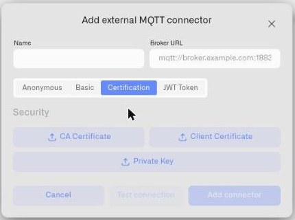
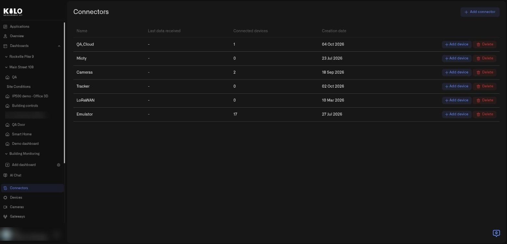
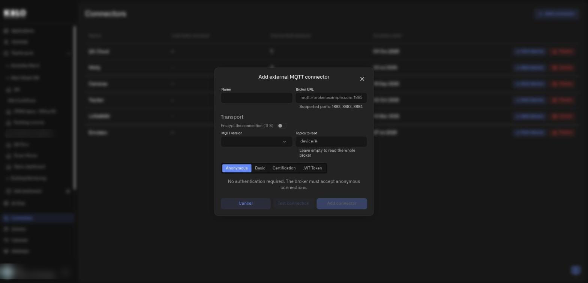
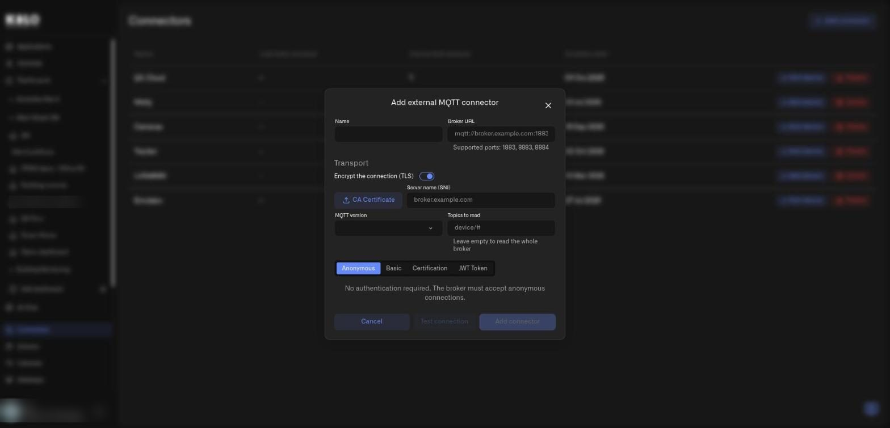

# External MQTT

External MQTT connects Kilo IoT Server to an MQTT broker you already operate. A **broker** receives device messages and forwards them to subscribers; Kilo connects to it and subscribes to the named message channels, or **topics**, used by your deployment.

Choose this option when equipment already publishes to an existing broker. Have its address and authentication details ready, and ensure it is reachable from Kilo. Then [route the messages](topics-and-device-routing.md) to registered devices and readings. [Cloud MQTT](cloud-mqtt.md) is the alternative when Kilo should provide the broker connection.

## When External MQTT is the right choice

- **An existing broker is already part of operations.** Devices already publish to it; multiple subscribers (historians, dashboards, integration platforms) already consume from it. Adding the platform as one more subscriber is operationally simpler than rerouting publishers.
- **Compliance or data-residency requirements** specify that telemetry must transit through your own broker before reaching SaaS consumers.
- **Hybrid architectures** where on-premise edge processing happens before a subset of telemetry is forwarded to the platform.

For deployments without an existing broker, [Cloud MQTT](cloud-mqtt.md) is the lower-overhead path.

## Reachability requirement

Kilo IoT Server connects out to your broker, so the broker must be reachable from the public internet via DDNS, port forwarding, or a dedicated public IP. A broker accessible only on a private VLAN is not reachable from the platform's cloud control plane.

The standard production pattern is a public IP or DDNS hostname for the broker, with firewall rules controlling which sources can connect.

For development or pilot deployments, an exposure tunnel such as ngrok works for short-lived testing — but note that running an exposure tool does not by itself confirm Kilo can reach the broker. After saving the connector, **publish a test message and confirm Last data received updates** in the connector's detail page. This is the only way to verify end-to-end reachability.

## Transport: encryption, server name, version and topic filter

Encryption is its own setting, separate from how you sign in. That matters in practice: most production brokers want a username and password **and** an encrypted channel, and you can now configure exactly that on one connector. The **Transport** section of the form holds five controls:

| Control | What it does |
|---------|--------------|
| **Encrypt the connection (TLS)** | Encrypts everything between Kilo and your broker. Typing an encrypted address such as `mqtts://` or `ssl://` switches it on for you, and the form refuses to save an encrypted address while the switch is off, so the two cannot disagree. With **Certification** authentication the switch is held on, because a client certificate is presented during the encrypted handshake. |
| **CA Certificate** | Appears once encryption is on. Upload the certificate authority that signed your broker's certificate when it is not a publicly trusted one. After you save, the field reads **CA Certificate — saved** with a remove button, so you can see a certificate is stored without it ever being displayed again. |
| **Server name (SNI)** | Appears once encryption is on. Set it when the broker serves several hostnames behind one address, or when its certificate names a host other than the one in the URL. |
| **MQTT version** | **Default (5.0)**, **3.1**, **3.1.1** or **5.0**. Pick **3.1.1** or **3.1** for older brokers and gateways that do not speak version 5. |
| **Topics to read** | The topics Kilo subscribes to on your broker. **Leave empty to read the whole broker**, or narrow it to the branches you actually need so a busy broker does not flood the platform with traffic you will never route. |

Below the **Broker URL** field, **Supported ports** lists the ports the platform will connect to. A URL on any other port is flagged and cannot be saved, so a firewall-friendly port is worth choosing before you build the broker side.

If you change the address, server name, CA certificate or encryption on a connector that stores a secret, Kilo asks you to enter the credentials again. A stored secret is only kept while the connection it protects is unchanged.

## Authentication options

The connector supports four authentication methods, selectable on creation:

| Method | When to use | Configuration fields |
|--------|-------------|---------------------|
| **Anonymous** | Development brokers only. **Do not use for production exposed brokers** — anyone on the internet who finds the broker can publish or subscribe. | None |
| **Basic** | Username + password authentication. The most common configuration for production deployments; switch on **Encrypt the connection (TLS)** so the credential is protected in transit. | Username, Password |
| **Certification** | TLS mutual authentication using client certificates. Highest assurance; standard for regulated deployments. | CA Certificate file, Client Certificate file, Private Key file (uploaded as files; do not paste PEM content) |
| **JWT Token** | Token-based authentication compatible with brokers that validate JWTs (e.g. AWS IoT Core with custom authorizers, or other brokers with JWT plugins). | Token |

For Certification, the three uploaded files form the client side of an mTLS exchange; the broker must be configured to trust the CA and to validate the client certificate against it. The Private Key must be unencrypted at upload time.

<figure><figcaption></figcaption></figure>

## How do I add an external MQTT connector, step by step?

1. In the main menu choose **Connectors**. The page lists your connectors with **Name**, **Last data received**, **Connected devices**, and **Creation date**, and each row has **Add device** and **Delete** buttons.

<figure><figcaption><p>The Connectors page. Select Add connector at the top right to start.</p></figcaption></figure>

2. Select **Add connector**. A small dialog asks for the **Connector type**. Choose **External MQTT** and select **Add**. **Cancel** closes the dialog.
3. The **Add external MQTT connector** form opens.

<figure><figcaption><p>The form with encryption off. Authentication defaults to Anonymous, and Add connector stays disabled until the form is valid.</p></figcaption></figure>

4. Fill in the top of the form:

   | Field | Required | Details |
   |-------|----------|---------|
   | **Name** | Yes | Operational label, for example `Plant 3 Mosquitto` or `North America Broker Cluster`. |
   | **Broker URL** | Yes | Full URL with scheme and port, for example `mqtts://broker.facility.example.com:8883`. The line below it, **Supported ports: 1883, 8883, 8884**, lists the ports Kilo will connect to. |

5. In **Transport**, set the encryption and the topics. Switching **Encrypt the connection (TLS)** on adds **CA Certificate** and **Server name (SNI)** to the form.

<figure><figcaption><p>With encryption on, the form adds CA Certificate and Server name (SNI) next to the MQTT version and Topics to read controls.</p></figcaption></figure>

6. Choose the authentication tab: **Anonymous**, **Basic**, **Certification**, or **JWT Token**, and complete its fields. The tab text explains the choice; for example **Anonymous** says *No authentication required. The broker must accept anonymous connections.*
7. Select **Test connection** to check that Kilo can reach the broker, then **Add connector**. **Cancel** closes the form without saving.

The connector appears in the connector table. If the broker drops the connection briefly, Kilo reconnects and re-subscribes on its own, so a short broker restart does not leave the connector silently deaf. Click into the detail page to find the **Last data received** indicator.

## Verification step

End-to-end reachability is confirmed only by an actual publish landing in the platform. After saving the connector:

1. Publish a test message to your broker on any topic the connector subscribes to.
2. Open the connector detail page in Kilo.
3. Confirm **Last data received** updates within a few seconds.

A simple one-shot test from a host that can reach the broker:

```bash
mosquitto_pub \
  -h broker.facility.example.com -p 8883 \
  --cafile /path/to/ca.crt \
  -u {username} -P {password} \
  -t "test/connectivity" \
  -m '{"hello":"world"}'
```

(Substitute scheme/port and credentials for your broker's authentication method.)

If **Last data received** does not update after a successful local publish, see [Troubleshooting](troubleshooting.md). The most common causes are firewall rules between the platform's egress and your broker, IP-allowlist mismatches, expired tunneling sessions when using ngrok for testing, or wrong TLS configuration on the broker side.

## Self-hosted Mosquitto reference deployment

For deployments that need a quick reference for setting up a self-hosted Mosquitto broker for testing or pilot purposes, the minimal Docker compose looks like:

```yaml
services:
  mosquitto:
    image: eclipse-mosquitto:2
    container_name: mosquitto
    restart: unless-stopped
    ports:
      - "1883:1883"
    volumes:
      - ./mosquitto/config:/mosquitto/config
      - ./mosquitto/data:/mosquitto/data
```

`mosquitto.conf`:

```
listener 1883
allow_anonymous false
password_file /mosquitto/config/passwd
persistence true
persistence_location /mosquitto/data/
log_dest stdout
```

Two operational notes:

- **`log_dest stdout`** is preferred over file-based logging in containerized deployments. Bind-mounted log directories often fail under SELinux/AppArmor or due to ownership mismatches; container stdout is collected by the Docker logging driver.
- **Port 1883 conflicts.** On developer or shared infrastructure, port 1883 may already be bound (e.g. a kubectl port-forward, another local broker). `ss -tlnp \| grep 1883` identifies the binding process. Remap the host-side port (e.g. `"1885:1883"`) and forward the new host port instead — the container internal port can remain 1883 for in-network publishers.

For TLS termination, a separate reverse-proxy or Mosquitto's native TLS configuration (out of scope here — see Mosquitto documentation) is required before public exposure.

## Limits

External MQTT connectors are limited to 10 per organization. For deployments needing additional broker integrations beyond this limit, engage platform engineering during deployment planning.

For the device-level setup, follow [MQTT Devices](../../devices/mqtt-devices.md). It covers the physical identifier, connection fields, measurement mapping and checking retained history.
