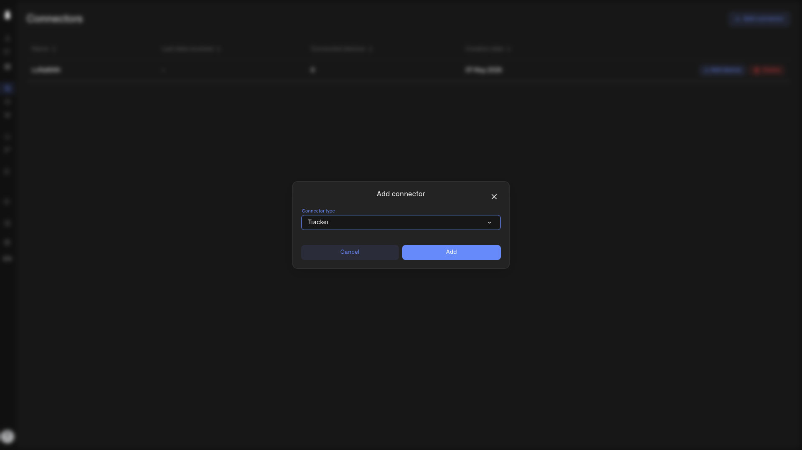

# Tracker Connector

The Tracker connector enables the Kilo IoT Server to accept data from vehicle trackers — OBD2, CAN bus, and standalone GPS vehicle tracking devices. The server includes preconfigured templates for over 2,000 vehicle tracker models.

<figure><figcaption></figcaption></figure>

## Adding the Tracker connector

1. Navigate to **Connectors** in the sidebar.
2. Click **Add connector**.
3. In the **Connector type** dropdown, select **Tracker**.
4. Click **Add**.

The connector is created immediately. Each organization can have only one Tracker connector.

## Inside the Tracker connector

Click the Tracker connector row in the connectors table to open it. This shows the shared device list. When registering a device through the Tracker connector, the **Connection** tab includes tracker-specific fields: **Unique ID**, **Device model**, and a **Url for GPS tracker** endpoint.

For device registration and management, see [Registering Devices](../devices/registering-devices.md) and [Device Management](../devices/device-management.md).

Give each vehicle a recognizable name, such as **Truck 18**, and map its reported location fields. With [Grok connected through MCP](../api/mcp-server.md#connect-grok), ask for that vehicle's latest reported location and timestamp. [Use Kilo in Your Tesla](../ai-assistant/tesla-grok.md) shows how to make the request by voice.
