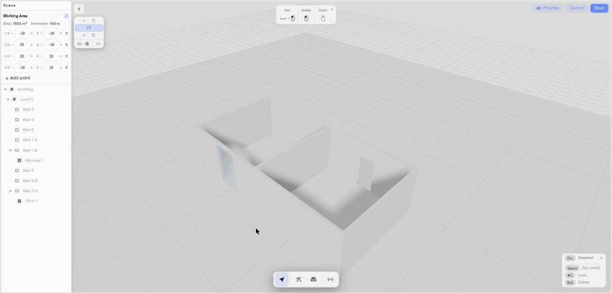
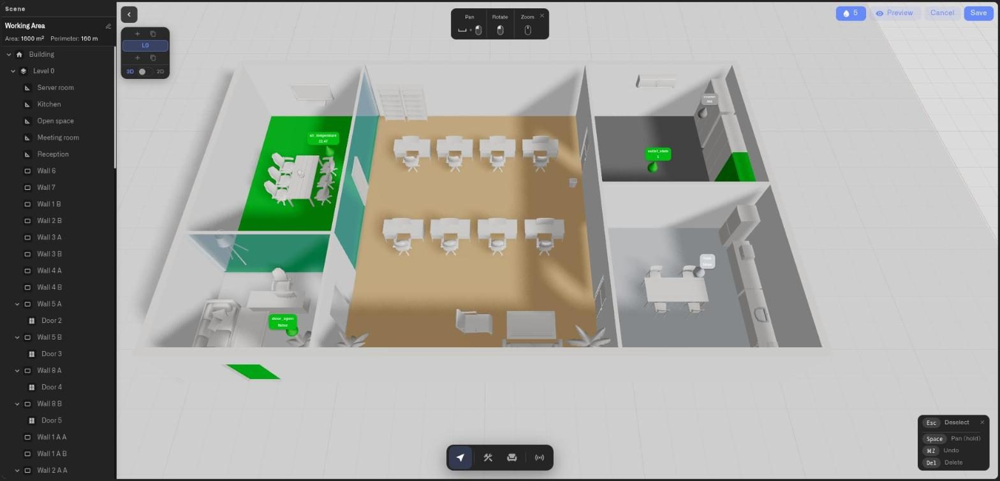

# How to Use the Digital Building Twin Editor

The Digital Building Twin editor is a full-screen workspace. Everything you do — drawing structure, placing objects, binding sensors, framing the view — happens here. This page is the map: what each toolbar and panel does, and how to move around the scene. The pages that follow go deep on each task; this one gets you oriented.

When you add a **Digital building twin** widget to a dashboard, the editor opens with a starter scene already in place: a building with one floor. You build outward from there.

<figure><figcaption></figcaption></figure>

## What do the bottom toolbar modes do?

The toolbar centered along the bottom of the screen is where most work begins. It has four modes:

* **Select** — the default. Click objects to select them, move them, and edit their properties. Press **Escape** at any time to return here.
* **Build** — opens a row of eight buttons: four draw tools (**Wall**, **Door**, **Window**, **Fence**), **Trace from map**, **Import from file**, and the one-click **Flat roof** and **Pitched roof** buttons. **Import from file** carries a **Beta** badge and appears only where DXF import is turned on. Use them to create the shell of the building. See [Drawing your building](drawing-your-building.md), [Tracing from the map](tracing-from-the-map.md) and [Importing a DXF plan](importing-a-dxf-plan.md).
* **Furnish** — opens the object catalog: five category tabs (**Furniture**, **Appliance**, **Kitchen**, **Bathroom**, **Outdoor**) and a scrollable strip of 3D models to drop into the scene. See [Placing objects](placing-objects.md).
* **Sensors** — opens the Sensors panel, where you connect devices and bind their readings to objects in the model. See [Binding sensors and colors](binding-sensors-and-colors.md).

Click a mode to enter it; click it again to return to Select.

## What is the Scene panel?

The **Scene** panel lists every element in the model as a tree — the building, its floors, and the walls, slabs, items, doors, windows, and zones on each floor. Click any entry to select that element in the 3D view. Double-click an entry (or use the pencil icon) to rename it — giving walls and zones meaningful names like "Loading Dock Wall" or "Server Row A" makes the model far easier to work with when you start binding sensors.

## What can I change in the properties panel?

Select any object and a properties panel opens with the settings for that specific element:

* **Items** (catalog objects) — Name, Position (X, Y height, Z), Rotation (with **+45°** / **-45°** buttons), Scale, and measured Dimensions.
* **Walls** — Length, Height, Thickness, and a **Material** grid (white, brick, concrete, wood, glass, metal, plaster, tile, marble, or a custom color).
* **Doors and windows** — Width, Height, position along the wall, hinge side and swing direction for doors, sill depth for windows.

Every selected object also gets an inline action badge. For catalog items, doors, and windows it carries **Move**, **Duplicate**, and **Delete** buttons; for walls and other structure it carries **Delete** only. The badge works in the **2D view** as well as in 3D, so you can lay out and rearrange a floor entirely from the top-down plan. The properties panel shows the same **Duplicate** button, again only for catalog items, doors, and windows.

<figure><figcaption></figcaption></figure>

## How do I move the camera?

The editor has two camera modes, switched from the floor selector (see below):

* **3D view** — orbit freely. Left-drag rotates, right-drag pans, the scroll wheel zooms. Hold **Space** to make left-drag pan instead of rotate.
* **2D view** — a straight top-down plan view. Rotation is locked; you can only pan and zoom. This is the cleaner view for laying out walls and reading a floor plate.

The camera you leave the editor with is saved with the widget and becomes the view the dashboard tile opens at, so frame it deliberately before you save. The editor remembers the live camera when you switch between **Edit** and **Preview** and when you go from 3D to 2D and back, so a quick check in 2D never costs you your carefully set angle. The pan offset from the arrow controls is saved too, and a scene you save while in 2D still keeps its 3D angle for the next time someone opens it in 3D. The dashboard shows the saved view exactly as framed, without re-centering on the building.

## What do the Edit and Preview buttons do?

A bar in the top-right corner of the editor holds, from left to right: the **Show sensor pins** toggle (a drop icon with a pin count, shown once at least one metric is pinned), the **Preview** button, **Cancel**, and **Save**.

* **Preview** hides the toolbar and the side panels and renders the model with full-quality lighting, the way it will look on the dashboard. The button then changes to **Edit**.
* **Edit** brings the toolbar and panels back.

The camera carries over in both directions, so switching never loses your framing.

## What does the floor selector do?

A floating stack of floor buttons sits to one side. It lists every floor (labeled **L0**, **L1**, and so on), lets you add or copy a floor above or below, and switches the active floor. It also carries the **3D / 2D** view toggle and, for multi-floor models, a **Stack / Solo** toggle. See [Floors and levels](floors-and-levels.md).

## How do I undo, redo, or delete something?

* **Undo** — Ctrl+Z (Cmd+Z on Mac).
* **Redo** — Ctrl+Shift+Z (Cmd+Shift+Z).
* **Delete** — select an object and press **Delete** or **Backspace**, or use the Delete button in the properties panel or the inline badge. The building and its floors are protected and cannot be deleted this way.
* **Cancel a tool** — press **Escape** or right-click to drop out of a drawing or placement action back to Select.

## How do I save or leave the editor?

* **Save** — the button in the top-right corner. It opens a **Widget name** dialog; enter or confirm the name and the model is saved to the dashboard.
* **Cancel** — leaves the editor. If you have unsaved changes, the editor asks you to confirm with a **Discard unsaved changes?** dialog — choose **Discard** to leave or **Keep editing** to stay.

## See also

* [Drawing your building](drawing-your-building.md) — Walls, doors, windows, and fences
* [Floors and levels](floors-and-levels.md) — Multi-floor models and the 2D/3D toggle
* [Placing objects](placing-objects.md) — The object catalog and placement
