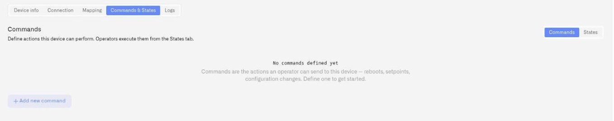
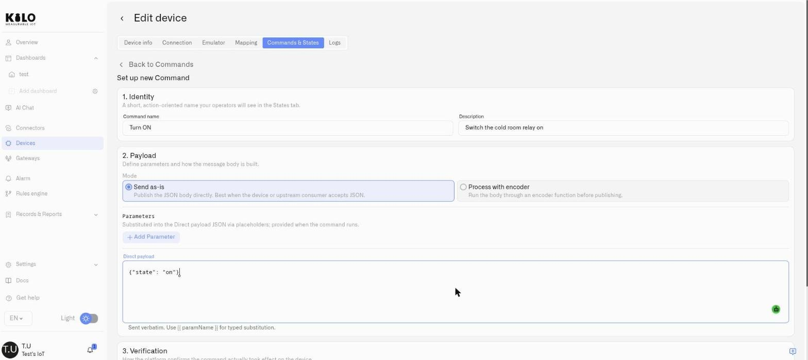
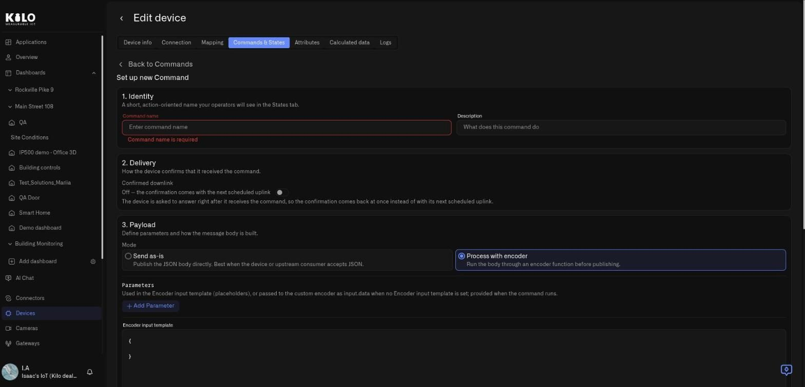

# Creating Commands

A command is a reusable, named action with typed inputs. You build it once in the command editor; afterward, operators run it from the **States** tab or a dashboard without touching topics, byte layouts, or payload templates.

To start, open the device's **Commands & States** tab, stay on the **Commands** sub-tab, and click **Add new command**. The editor has Identity, Routing, Payload, and Verification sections. An emulator omits Routing, so its sections are numbered differently.

<figure><figcaption></figcaption></figure>

<figure><figcaption></figcaption></figure>

<figure><figcaption></figcaption></figure>

## 1. Identity

Give the command a clear, action-oriented name — this is what operators see when they execute it.

* **Command name** — Required. Use an imperative label such as `Reboot controller`, `Set brightness`, or `Open valve`. Names must be unique on the device; reusing one raises *"A command with this name already exists on this device."*
* **Description** — Optional but recommended. One line on what the command does and when to use it.

## 2. Routing

Routing tells the platform *where* and *how* the message is addressed. The fields differ by protocol.

### MQTT devices

* **MQTT topic** — Where the message is published on the broker. Required.
  * For a Cloud MQTT connection, the read-only **topic prefix** is shown and you supply the remainder (for example `mqtt-test-01/set`). The device must subscribe to the full topic — prefix plus your value.
  * For an External MQTT connection, enter the full topic exactly as it is published on your broker (for example `devices/light-01/cmd`).
  * A topic must be at most 500 characters, must not contain the wildcards `#` or `+`, must not have empty segments (`a//b`), and must not begin with `iot/`, `external/`, or `external-downlink/` — those prefixes are reserved for the platform's own traffic.
* If another command on the same connection already publishes to the topic you enter, the editor flags the overlap so you can avoid accidentally colliding two actions on one topic.
* fPort and Confirmed downlink do not apply to MQTT — those are LoRaWAN settings. (MIOTY has its own **Delivery** switch, described below.)

### LoRaWAN devices

* **fPort** — Required. The LoRaWAN port the downlink is addressed to, an integer between **1 and 223**.
* **Confirmed downlink** — A toggle:
  * **On — wait for MAC ACK:** the network waits for the device to acknowledge receipt at the radio layer.
  * **Off — fire-and-forget at MAC layer:** the downlink is sent without waiting for an acknowledgment.
  * Turn this **on** if you intend to verify the command with *Query after ack* in section 4 — that strategy waits for the acknowledgment, so it cannot be saved against an unconfirmed downlink.
* LoRaWAN downlinks are raw bytes, so the payload always goes through an encoder — the send-as-is mode offered for MQTT is not available here.

### MIOTY devices

A MIOTY downlink is addressed by the endpoint itself, so the editor shows no fPort and no MQTT topic. Where a LoRaWAN command has a **Routing** step, a MIOTY command has **2. Delivery** ("How the device confirms that it received the command."), which holds one switch labeled **Confirmed downlink**. Its helper text reads: *The device is asked to answer right after it receives the command, so the confirmation comes back at once instead of with its next scheduled uplink.* The switch states are:

* **On — the device answers right after it receives the command.** The confirmation comes back at once.
* **Off — the confirmation comes with the next scheduled uplink.**

The editor reminds you that a MIOTY downlink is sent after the next uplink in which the device opens a receive window, so a command is not delivered the instant you press send; plan for the device's reporting rhythm. Both payload modes are offered, and an encoded command always carries its own encoder, because there is no codec on the MIOTY path. All three verification strategies are available. If the service center reports no result before its deadline, the execution says *Delivery outcome unknown: the mioty service center reported no result by the deadline.* instead of guessing. See [MIOTY Devices](../mioty-devices.md).

### Emulated devices

An emulator needs no MQTT topic or fPort. Its direct payload must be an object whose keys match the generated data keys, such as `{"valve_open": true}`. If you choose encoded mode, provide a custom encoder returning that object. Enable **Support commands** on the device first.

### Devices that cannot take commands

Tracker-connected devices are receive-only on the platform: they report in, and there is no downlink path back to them. They do not offer a Commands tab.

## 3. Payload

This section defines the message body and the inputs that shape it.

### Parameters

Parameters are the typed inputs an operator fills in at execution time — a brightness percentage, a setpoint, a mode. Click **Add Parameter** for each one. Per parameter:

* **Name** and **Description** — the description is shown to operators in the Execute dialog, so make it useful.
* **Type** — one of:
  * **Integer** / **Float** — numeric, with optional **Min**, **Max**, and **Default**. A default outside the range is rejected, and **Max** must be greater than **Min**.
  * **String** — with an optional comma-separated **Enum** (for example `auto, manual, off`), and a **Default**.
  * **Boolean** — with a **Default** of `No default`, `true`, or `false`.

Typed parameters are what make commands safe to hand to an operator: a setpoint can't be sent out of range, and a mode can only be one of the allowed values.

### Building the message body

**MQTT** offers two modes:

* **Send as-is** — Publish the JSON body directly. Best when the device or an upstream consumer accepts JSON.
* **Process with encoder** — Run the body through an encoder function before publishing.

In encoder mode (and always for LoRaWAN, where downlinks must be raw bytes), you define an **Encoder input template** — the JSON object passed to the codec, using `{{ parameterName }}` placeholders to substitute the operator's inputs. Every placeholder must match a parameter defined above. For LoRaWAN, the platform notes that downlinks are bytes, so an encoder is always required; you can use the encoder in the device codec or turn on **Use custom encoder JS** to override it with a per-command function.

For encoded MQTT commands, **Custom encoder** is required; there is no fallback to a LoRaWAN codec. An encoded emulator command also requires its own encoder and returns a data object rather than radio bytes.

For MQTT commands that send a payload verbatim (direct mode), you instead provide the target **MQTT topic** and the **Direct payload**, which is sent as written — `{{ parameterName }}` substitution still applies for typed values.

## Try Encoder

Whenever a command uses an encoder, the editor includes a **Try Encoder** tool (titled **Code function** for LoRaWAN, **Custom encoder** for MQTT). Enter test inputs and run it to see exactly what will be transmitted before you save:

* the encoded **Output**, or an **Error** if the function failed
* the result as **Hex** and **Base64**, plus the payload **Size** in bytes
* any **Console log** output and the execution time

This turns payload encoding from a guessing game into a verifiable step — you confirm the bytes are right before a single command ever reaches a device.

## 4. Verification

The fourth section decides how the platform confirms the command actually took effect — send and forget, wait for the device's next uplink, or poll the device after it acknowledges. It is where you declare which sensor should change and what it should read.

This section has a page of its own: see [Confirming Commands](verification.md). To find out which values the device reports back — and in what form — see [Payload Decoding and Connector Keys](../payload-decoding.md).

## Review commands after hardware replacement

Open each retained command and check **Routing**, **Payload**, and **Verification** against the replacement model. A different protocol, command format, or feedback field needs corresponding changes here. Keep feedback bound to the appropriate retained measurement, and confirm the new hardware reports the expected result before returning a control to routine use.

## Saving

Click **Save** to add the command to the device. It immediately appears in the **Commands** list and on the **States** tab, ready to execute. To change it later, reopen it from the Commands list with **Edit**; to remove it, use **Delete** (the platform warns you if other commands reference it as a query command).

## Next

* Decide how the platform confirms a command worked — see [Confirming Commands](verification.md).
* Run a command and watch its lifecycle — see [Executing Commands](executing-commands.md).

## Which messages can the command editor show?

Fields turn red and show a message under them while something blocks **Save**. Fix the field and the message disappears.

| Where | Message | What to do |
|---|---|---|
| **1. Identity** | **Command name is required** | Enter a name in **Command name**. |
| **1. Identity** | **A command with this name already exists on this device.** | Names must be unique per device; pick another. |
| **2. Routing** (MQTT) | **MQTT topic is required** | Fill **MQTT topic**. The helper reads **Full topic as it is published on your broker.**, or, when a topic prefix is shown, **The device must subscribe to the full topic: prefix + this value.** |
| **2. Routing** (MQTT) | **Heads-up: N other command(s) on this connection use the same topic: …** | Not an error. Two commands publish to the same topic, and the message lists them as device / command. |
| **2. Routing** (LoRaWAN) | **fPort is required** and **fPort must be an integer between 1 and 223** | Enter a whole number from 1 to 223. **Confirmed downlink** reads **On — wait for MAC ACK** or **Off — fire-and-forget at MAC layer**. |
| **3. Payload** (parameters) | **Max must be greater than Min** | Raise Max or lower Min on that parameter. |
| **3. Payload** (parameters) | **Default value … is outside the [min, max] range.** | Pick a default inside the range. |
| **3. Payload** (encoded) | **Encoder input template must be a JSON object** | The template must be valid JSON in curly braces. |
| **3. Payload** (encoded) | **Empty template produces an empty downlink. Add at least one key (encoded by the Connection codec), or turn on the custom encoder to build the payload in code.** | Add a key to the template, or switch on the custom encoder. |
| **3. Payload** (direct) | **Direct payload must be valid JSON** and **Empty payload produces an empty downlink. Add at least one key.** | Fix the JSON or add a key. |
| **3. Payload** | **Placeholder {{ name }} does not match any parameter defined above.** | Every `{{ placeholder }}` needs a parameter with the same name. |
| **4. Verification** | **Add at least one expected state to verify the result.** | Click **Add State**. See [Confirming Commands](verification.md). |
| **4. Verification** | **Expected value is required** | Type a literal value or a `{{ parameter }}`. |
| **4. Verification** | **This sensor is no longer mapped on the device. Pick another metric.** | The sensor was removed from the device's mapping; choose a mapped one. |
| **4. Verification** | **No sensors mapped on this device yet** | Map sensors first in the device's **Mapping** tab (the **Mapping section** link under the list opens it). |

## Parameter and editor actions

**Add Parameter** creates another input. Give each parameter a distinct non-empty **Name** and select Integer, Float, String or Boolean. Use the same name inside `{{ parameterName }}` placeholders. The **Remove** control deletes that parameter from the edited command; update payload and expected-value placeholders that referred to it before saving.

Numeric **Min** and **Max** are optional bounds; if both are supplied, Max must exceed Min. An optional numeric **Default** must fit the range. For String, **Enum (comma-separated, optional)** defines allowed values; separate choices with commas, and choose a matching Default when using one. The string editor has no minimum/maximum length controls. Boolean Default offers **No default**, **true** and **false**. **Description** explains the parameter in the execution dialog.

In encoder mode, **Available fields** lists inputs available to your function. Fill **Test inputs** for the parameter values, then use **Try Encoder** to inspect output or an error and any console messages. This previews encoding; it does not send the command. Correct invalid JSON, unknown placeholders or out-of-range parameter settings before saving.

**Back to Commands** returns to the list. Save your changes first if you want to keep them. Read-only access disables editing. To execute a saved command, follow the execution guide; configuring its payload does not itself operate the hardware.
