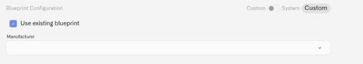

# How do MIOTY blueprints decode payloads in Kilo?

A MIOTY **blueprint** turns a device's compact radio payload into named fields you can use in Kilo, such as temperature, battery level, or a meter reading. Choose the decoder matching your endpoint, then map those fields to metrics for dashboards, rules, and alarms.

The blueprint is the decoding specification; the **endpoint** is the communicating sensor or meter. Keeping the decoder associated with its device model makes the same interpretation reusable when you add more units of that model.

A blueprint is stored as JSON, a structured text format, and is associated with a device-type identifier called `typeEui`. Choose the blueprint that matches the endpoint's model and payload format; registering a device alone does not decode its telemetry.

The catalog is arranged as **Manufacturer → Device Model → Blueprint**. Use **Blueprint Configuration** on the [MIOTY device form](mioty-devices.md) to select an existing entry or define a custom one.

A blueprint describes the endpoint's payload; the digital twin identifies the asset. When changing endpoint models on an existing twin, choose the decoder for the replacement and map its output onto the retained measurements. Check units as well as field names so values before and after the change are comparable. See [Device Management](device-management.md#replace-a-physical-sensor).

## The idea that matters most: per-device snapshots

When you select a blueprint for a device, it is **copied onto that device as an independent snapshot**.

The device is not a live pointer into the catalog. It carries its own copy of the decoder. Which means:

- **Editing a catalog blueprint does not change devices already bound to it.** They keep running on the copy they were commissioned with.
- **Removing a catalog entry later does not break devices already using it.** They keep decoding on their snapshot; the device form then shows **Pinned snapshot (source template deleted)** and the entry can no longer be chosen for new devices.
- **Two devices of the same model can run different blueprints.** A pilot batch on a corrected decoder and a production fleet on the proven one is a normal state, not a conflict.
- **A new version reaches a device only when you explicitly apply it.** Nothing about a catalog edit propagates on its own.

This is the same model the platform uses for LoRaWAN codecs, and it exists for a specific reason: on a fleet of several thousand endpoints, an accidental decoder edit that silently rewrote how every unit interpreted its payload would be an outage you would discover through your dashboards. The snapshot boundary means catalog work and production behavior are separate concerns. You improve a template freely; you roll it out on your schedule.

## System and Custom catalogs

The catalog is split into two, and the two are never mixed in one list — you switch between them.

| Catalog | Who can see and use it | Who can change it |
|---|---|---|
| **System** | Everyone — manufacturers, models, and blueprints are usable by any organization | Not in the device form. With **System** selected the form is read-only and says **System catalog is read-only. Switch to Custom to create or edit blueprints.** |
| **Custom** | Your organization | Users with permission to edit the device can create blueprints and add versions to their own models in the device form |

Using a System blueprint on a device creates **only the snapshot on that device**. Nothing is copied into your Custom catalog, and your Custom catalog stays exactly as you built it.

The practical split: System covers the hardware the platform already knows. Custom is where your own decoders, your vendor-specific variants, and your firmware-revision corrections live.

## Using an existing blueprint

This is the path for hardware the catalog already covers.

<figure><figcaption></figcaption></figure>

1. On the device form, open the **Connection** tab and find **Blueprint Configuration**.
2. Use the **Custom / System** toggle first. **Custom** is your organization's catalog; **System** is the shared one. A chip next to the toggle shows which catalog is active.
3. In **Custom**, tick **Use existing blueprint**. In **System** the pickers are always shown and the checkbox is not.
4. Select the **Manufacturer**.
5. Select the **Device Model**. The list narrows to that manufacturer's models.
6. Select the **Blueprint Version**. Each entry reads like `name (version)`.

The decoder specification appears under **Blueprint specification (read-only)** for review, followed by the **Test decoder** panel, and the **Type EUI** auto-fills on the device form and is not editable — it comes from the blueprint. Save the device, and the blueprint is snapshotted onto it.

Once that has happened the device is labeled **Pinned snapshot**, so you can see at a glance that what you are reading belongs to this device rather than to the shared catalog entry. If the catalog blueprint it was copied from has since been deleted, the label reads **Pinned snapshot (source template deleted)** — the device is unaffected and keeps decoding on its own copy, but the label tells you there is no longer a catalog entry behind it to compare against.

The **first blueprint created for a model becomes the default for new devices of that model** — so once a model is set up correctly, commissioning the rest of the fleet is a matter of selecting the model.

## Authoring a new blueprint

Take this path when the catalog does not cover your hardware, or when a firmware revision decodes differently from the existing entry.

1. Set the **Custom / System** toggle to **Custom** and clear **Use existing blueprint**. Authoring is not available in the System catalog.
2. **Manufacturer** — select an existing one, or choose **+ Add new manufacturer**, type a **New manufacturer name**, and click **Add**.
3. **Device Model** — pick an existing model, or choose **+ Add new model** and fill **Device model name** and the optional **Device model description**. If the name duplicates a model under that manufacturer, the form flags it — check whether you actually want to add a version to that model instead.
4. For an existing model, a **Blueprint Version** list appears. Pick a version to edit it, or choose **+ New version**. A note reminds you that editing a template updates it for new devices only.
5. **Blueprint version (e.g. 1.0.0)** — enter a version. Version deliberately, not incidentally; this string is what your team will use to tell two decoders apart in a year. The field is locked while you edit an existing version.
6. **Blueprint specification (JSON)** — paste the decoder into **Paste blueprint JSON**. It must be valid JSON and must contain a `typeEui` of exactly 16 hexadecimal characters.
7. When the specification is valid, a helper displays the parsed value — **"Type EUI: …"** — confirming what the device will be bound to.
8. Check the result in **Test decoder** (below), then click **Save Blueprint** (**Save changes** when you edited an existing version). A toast confirms *"Blueprint created"*, and the new model, version, and Type EUI are filled into the device form.

### Validation messages

| Message | What it means |
|---|---|
| **"Blueprint specification must be valid JSON"** | The pasted text does not parse. Check for a trailing comma, a truncated paste, or smart quotes from a document. |
| **"typeEui must be 16 hex characters"** | The `typeEui` field is present but not exactly 16 hexadecimal characters. |
| A message directing you to **"Use existing blueprint"** | The `typeEui` is already used by an existing model. That payload type is already in the catalog — select it rather than creating a competing entry. |

That last one is worth understanding rather than working around. The `typeEui` identifies a payload type. If it already exists, the correct move is to use the existing model — and if you need a different decoder for it, add a version to that model.

## Which other messages can the Blueprint Configuration section show?

| Message or control | What it means |
|---|---|
| **System catalog is read-only. Switch to Custom to create or edit blueprints.** | You have the **System** toggle selected. The form does not author System entries; switch to **Custom** to author your own. |
| **This device model has no default blueprint. Pick a version above.** | The model exists but no version is marked as its default. Choose a **Blueprint Version** yourself. |
| **+ Add new manufacturer** | Opens **New manufacturer name**; type the name and click **Add**. |
| **+ Add new model** | Opens **Device model name** and **Device model description (optional)**. A model name that already exists under the manufacturer is flagged: **A device model with this name already exists under this manufacturer**. |
| **+ New version** | Authors another version under an existing model. **Blueprint version (e.g. 1.0.0)** is flagged if it exists already: **A blueprint with this version already exists for this device model**. The note under the list says **Editing a template updates it for new devices only; devices already attached keep their pinned snapshot.** |
| **Save Blueprint** / **Save changes** | The button reads **Save Blueprint** for a new blueprint and **Save changes** when you edit an existing one. |
| **The source blueprint was deleted and no snapshot is pinned to this endpoint.** | The catalog entry is gone and the device never received a snapshot, so there is nothing to show. Pick another blueprint. |

## Decode preview

In **Test decoder**, enter a known **Sample payload (hex or base64)**, choose the **Format** (the user-data format of the uplink) and click **Run test**. Read **Decoded result (read-only)** or the red error beneath the input, which says **Decode failed** or gives the decoder's own error detail. This previews decoding without requiring a live transmission.

Use it. A blueprint that parses as JSON is not the same thing as a blueprint that decodes correctly — scaling factors, byte order, and signed values are the classic places a decoder is syntactically perfect and semantically wrong. A sample payload with a known value takes a minute at the bench and saves you from discovering the problem as a temperature chart that reads plausibly and is off by a factor of ten. Take a payload from the device's own documentation, or from a unit you have already commissioned.

## Applying a new version

Because devices run on snapshots, a new blueprint version reaches a device only when you apply it:

1. Author the new version under the same manufacturer and model.
2. Open the device you want to move.
3. In Blueprint Configuration, select the new **Blueprint Version**.
4. Save.

Roll out to one device first and confirm its decoded fields against the live payload before you move the fleet. The snapshot model is what makes this staged rollout possible — the rest of the fleet is untouched while you verify.

## Tips

- **Author once, commission many.** For a fleet rollout, get the blueprint right on one unit with **Test decoder**, then let the model default carry the rest.
- **Version on firmware, not on dates.** When a vendor ships a firmware revision that changes the payload, that is a new blueprint version. Name it so the connection is obvious.
- **Prefer System where it fits.** If the System catalog covers your hardware, use it — you get the decoder without owning its maintenance, and your device still gets its own snapshot. To make changes to a System entry, ask your administrator or Kilo.
- **Map metrics after decoding.** A blueprint produces named fields; metric templates normalize those fields into a vocabulary shared across manufacturers. See [Metrics](metric-templates.md).

## What's next

- **Commission the endpoint** — the MIOTY device form section by section. See [MIOTY Devices](mioty-devices.md).
- **Normalize the decoded fields** — map them to your deployment's measurement vocabulary. See [Metrics](metric-templates.md).
