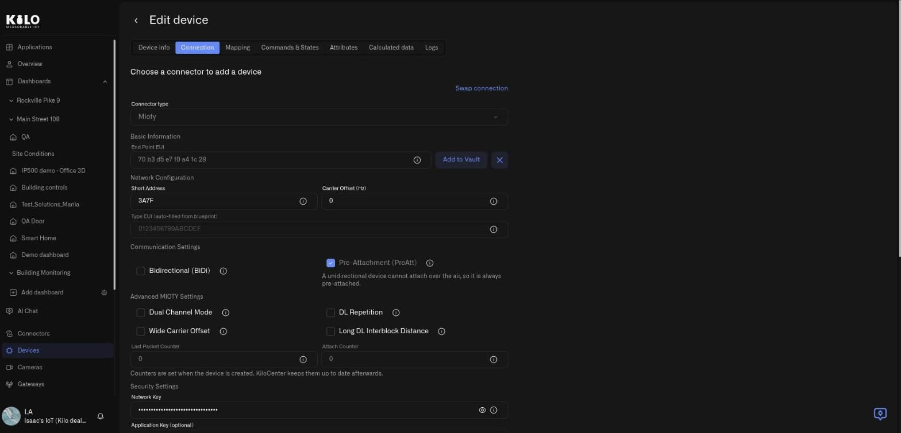
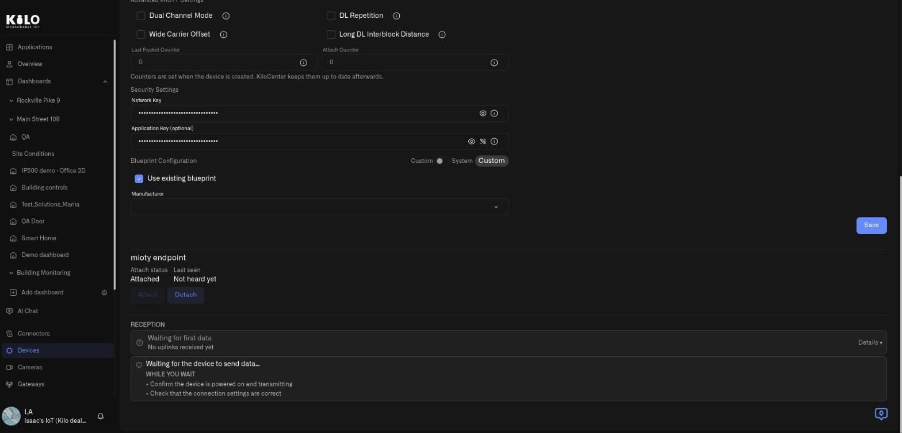

# MIOTY Devices

Register a MIOTY endpoint in Kilo Cloud to use its readings throughout the platform: place them on widgets, compare them in charts, evaluate them in rules, and notify a team through alarms. Cloud's enterprise Kilo Center service center handles the network communication beneath that application.

An **endpoint** is the physical sensor, meter, or other device communicating through a MIOTY **base station**, its radio gateway. Its Kilo device record brings the identity, settings, and readings together.

Before registration, set up the [MIOTY connector](../connectors/mioty-connector/README.md) and have the endpoint's identifiers and network key from its manufacturer or provisioning process. Those values associate the correct hardware with its record. A [blueprint](mioty-blueprints.md) supplies the decoding specification needed to turn its messages into named readings.

This page explains the MIOTY-specific fields. For naming, metrics, logs, and saving the device, follow [Registering Devices](registering-devices.md).

The endpoint supplies data to a [digital twin](README.md). Name the twin for the asset you monitor, such as **Refrigerator 1**, and keep the endpoint's EUI in its connection settings. Commissioning another endpoint for the same asset should retain that twin and its measurement rows; review the replacement's blueprint and map its decoded fields before relying on new readings.

## Prerequisites

- **A Mioty connector.** Without it, the MIOTY fields are unavailable and the form reports **"Create a Mioty connector first"**. See [MIOTY Connector](../connectors/mioty-connector/README.md).
- **At least one base station online.** Endpoints attach through base stations. See [MIOTY base stations](../gateways/mioty-base-stations/README.md).
- **Endpoint credentials from the manufacturer** — the End Point EUI and the Network Session Key, normally on the unit's label or in a shipped provisioning file.

## Selecting the connector

On the device form, select the Mioty connector as the connector type. The form then presents the MIOTY parameter sections described below.

<figure><figcaption></figcaption></figure>

## Basic

- **End Point EUI** — the endpoint's unique identifier, exactly 16 hexadecimal characters. This is the address the network knows the unit by. A value that is not 16 hex characters is rejected.

## Network

These fields describe how the endpoint places its telegrams on air.

- **Short Address** — the compact identifier the endpoint uses on the radio link, entered in hexadecimal. Valid values run from **0001** to **FFFF**; zero is not a valid short address and will be rejected. Assign short addresses deliberately across a site rather than at random — a scheme tied to zone or line makes a large rollout far easier to reason about later.
- **Carrier Offset** — optional. Shifts the endpoint's carrier within the band. Set it when the manufacturer's commissioning data or your site's frequency plan calls for it; leave it alone otherwise. It must be a whole number from 0 to 2147483647. The hint on the field is candid that it is informational: Kilo Center stores the value but does not send it to the base stations.
- **Type EUI** — read-only. This is filled in from the blueprint you select or author for the device, and identifies the endpoint's payload type. You do not enter it by hand. See [MIOTY Blueprints](mioty-blueprints.md).

## Communication

- **BiDi** — bidirectional communication. Enable it for endpoints that must receive as well as transmit.
- **PreAtt** — pre-attachment. Pre-attached devices are sent to the base stations as soon as they are created, which suits devices with pre-shared keys. Leave it off for devices that attach over the air, and use **Attach** on the device page for those (see below). A unidirectional endpoint cannot attach over the air, so the form keeps it pre-attached and says so; switching a new endpoint to bidirectional turns pre-attachment off for you.

Both settings are properties of how the unit is configured and specified by the manufacturer. Match the form to the hardware rather than choosing preferences here.

## Attach and Detach: control the endpoint from its device page

Registering a device record and having the base stations serve it are two different things, so the **Connection** tab of a saved MIOTY device carries a **mioty endpoint** panel that shows where the endpoint stands and lets you change it:

- **Attach status** reads **Attached**, **Detached**, **Attaching** or **Unknown** (Kilo Center may report a state the platform does not know yet), next to **Last seen**, which says **Not heard yet** until the first uplink arrives.
- **Attach** sends a pending configuration to the base stations or brings a detached endpoint back into service.
- **Detach** stops service on purpose, and asks you to confirm first because **the base stations stop serving this device: its uplinks are no longer received and no downlinks are sent until it is attached again.** It is the clean way to take an endpoint out of service without deleting its twin, history or rules.
- **Configuration pending** appears when you have changed settings that the base stations have not received yet. They keep the previous settings until the endpoint is attached again, so click **Attach** after editing a live endpoint.

Users with view-only access see the status but not the buttons.

<figure><figcaption></figcaption></figure>

## Advanced MIOTY

These parameters tune the endpoint's radio behavior and exist for deployments that need them. Set them to match the endpoint's own configuration:

- **Dual channel**
- **DL repetition** — downlink repetition
- **Wide carrier offset**
- **Long interblock distance**

Use the manufacturer's provisioning values. If a parameter is not documented, confirm it with the supplier before changing it; omitting it from a commissioning sheet does not establish what the hardware uses.

## Counters

- **Last Packet** — the packet counter position.
- **Attach** — the attachment counter.

Both are **0** for a new device, and you enter them only while creating it: after the device is saved they become read-only, so a stray edit cannot misalign a running endpoint. They exist so that a device record can be aligned with an endpoint that already has history — for example when you are migrating a unit that has been running elsewhere. For a unit out of the box, leave them at zero.

Aligning the counters lines up the *record*. It does not move the endpoint onto your network. A MIOTY endpoint attaches to one network at a time, and a unit that was running on another service center is still attached there — it will not appear under your base stations because you created a device record for it. Reset the endpoint so it attaches again, following the manufacturer's procedure for your model. Once a base station picks it up, the device's **Connection** tab moves to *Reached network — waiting for data*. See [Device Diagnostics](device-diagnostics.md) for how that lifecycle reads on the platform.

## Security

- **Network Key** — required. Exactly 32 hexadecimal characters. This is the key that secures the endpoint's link to the network; without a valid one the device cannot be saved.
- **Application Key** — optional. Provide it where the endpoint's payload is application-encrypted. You can clear it later, and the field's hint spells out what that does: clearing the key removes application-layer encryption for this device. Only clear it when the endpoint itself no longer encrypts its payload.

### Add to Vault

Endpoint credentials have a way of ending up out of reach — on a label on a unit that is now sealed inside an enclosure on a pipe rack. Click **Add to Vault** on the device form to store the End Point EUI and Network Session Key pair in Key Vault, where they are recoverable independently of the hardware and the sticker.

Do it at commissioning, while the credentials are still in front of you. Recovering a unit whose Network Session Key you no longer have on file means opening the enclosure — and some manufacturers only give the key back over a wired connection, if they give it back at all. See [Key Vault](../reports/key-vault.md).

## Validation — what blocks a save

The form will not save until these hold:

| Field | Requirement | What you see if it fails |
|---|---|---|
| **End Point EUI** | Exactly 16 hexadecimal characters | The field reports that the EUI must be 16 hex characters |
| **Short Address** | Hexadecimal, in range **0001**–**FFFF** | The field is rejected; zero is not valid |
| **Network Key** | Exactly 32 hexadecimal characters, required, and not all zeros | The field reports *Network Key must be 32 hex characters* or *Network Key must not be all zeros*; Kilo Center cannot attach an endpoint whose key is zero-filled |
| **Carrier Offset** | Optional; a whole number from 0 to 2147483647 | The field reports the allowed range |
| **Application Key** | Optional; 32 hexadecimal characters when supplied | The field reports an invalid key |
| **Last Packet** and **Attach** | Whole numbers from 0 to 4294967295 | The field reports an invalid counter |

If registration reports an EUI conflict, check for an existing endpoint registration and confirm which twin should own that physical device. Do not create another twin to work around a replacement binding.

## Decoding telemetry

A MIOTY endpoint's telemetry is **not decoded until a blueprint is selected for it**. Until then the device is registered and attached, but its payloads are not turned into named measurements — which means nothing usable reaches dashboards, rules, or history.

Blueprint Configuration lives on the same device form. You can pick an existing blueprint from the catalog or author a new one from JSON, and the choice is copied onto the device as its own independent snapshot. That snapshot model is what makes it safe to change catalog templates on a production fleet.

To check a decoder before you rely on it, use **Test decoder** in the blueprint section: paste a **Sample payload (hex or base64)**, choose the **Format** (the uplink's user data format, shown when the blueprint defines more than one) and click **Run test**. The **Decoded result (read-only)** shows what the endpoint's real messages will turn into. The result clears itself whenever you change the payload, the format, the blueprint or the model, so you never read an answer that belongs to an earlier input. See [MIOTY Blueprints](mioty-blueprints.md).

## What's next

- **Bind a blueprint** so the endpoint's payloads decode into named fields. See [MIOTY Blueprints](mioty-blueprints.md).
- **Map metrics** to normalize decoded fields across manufacturers. See [Metrics](metric-templates.md).
- **Complete the shared registration flow** — device info, Metrics, Logs. See [Registering Devices](registering-devices.md).

## Inspect keys privately

**Network Key** and the optional **Application Key** use the same secret-field controls: typing reveals the value, leaving the field or pressing Enter masks it, and the eye control changes visibility. Values loaded from a QR code remain masked. Keep keys hidden when sharing registration screenshots.
