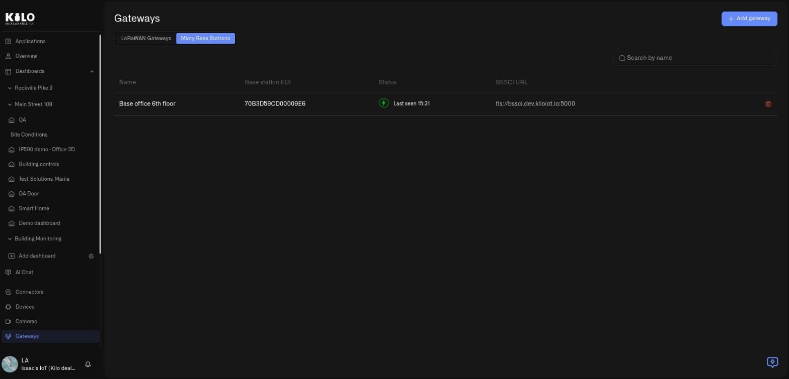
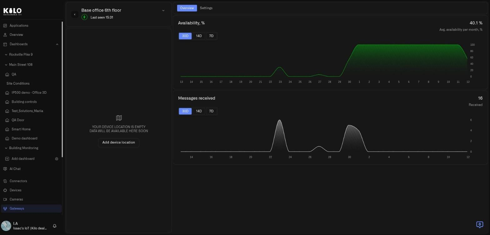
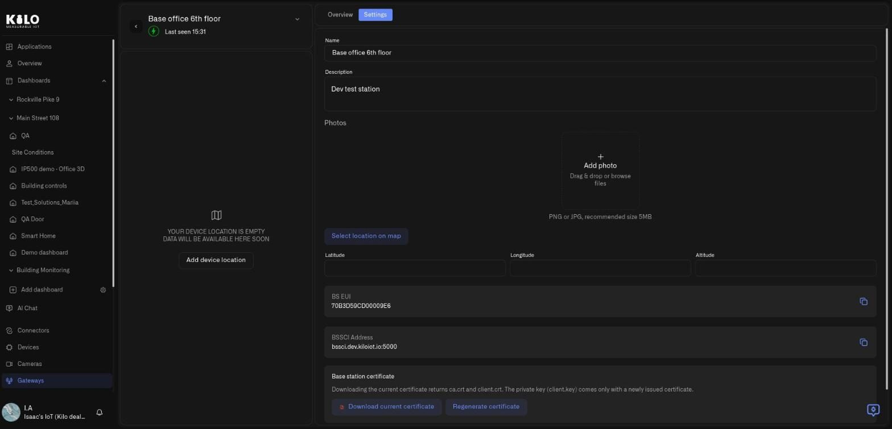

# MIOTY Base Station Monitoring

Once MIOTY base stations are deployed, the **Mioty Base Stations** tab on the Gateways page gives you a fleet view of the radio infrastructure, and each station's detail page gives you its operational state and configuration.

## The base station list

Click **Gateways** in the left sidebar and open the **Mioty Base Stations** tab.

<figure><figcaption></figcaption></figure>

### Table columns

| Column | What it shows |
|---|---|
| **Name** | The station name you assigned during registration |
| **BS EUI** | The station's 16-character hexadecimal identifier |
| **Status** | Current connectivity — online or offline |
| **BSSCI URL** | The service center endpoint this station holds its session to |
| **Last seen** | When the station last communicated |

Before your first station is registered, the tab shows **"No base stations yet"**.

**Status and last seen read together.** Status tells you the session state right now; last seen tells you how long a problem has been running. A station that went offline four minutes ago during a scheduled reboot and one that went offline nine days ago are the same status and very different incidents.

## Base station detail page

Click any row to open that station's detail page. It has two tabs: **Overview** and **Settings**.

### Overview tab

<figure><figcaption></figcaption></figure>

The Overview tab is the operational read on a single station:

- **Availability, %** — a chart of how much of each day the station's BSSCI session was up, with the monthly average shown at the top right. Use the **30D**, **14D** and **7D** buttons to change the range.
- **Messages received** — a chart of the uplinks the station received, with the total for the range at the top right and the same **30D**, **14D** and **7D** buttons.

- **Status** — an online/offline indicator showing the current state of the station's BSSCI session.
- **Description** — the notes you captured at registration: mounting details, antenna type, work order.
- **BSSCI URL** — the service center endpoint for this station. A copy control puts it on the clipboard, with a toast to confirm.
- **Creation date** — when the station was registered.
- **Last seen** — the most recent communication from the station.
- **Reported status** — a collapsible card above the map shows what the station itself last reported, grouped the way Kilo Center shows it. **Performance Metrics** covers **Temperature**, **CPU Load**, **Memory Load**, **Duty Cycle** and **BS Config**. **System Information** covers **System Time**, **Uptime** and **Last Status Update**. A value the station has not reported reads **Not available** rather than a misleading zero, and the EUI and BSSCI address are not repeated here, because the Settings tab shows both. This is the page to open when a station is online but misbehaving: a hot enclosure, a saturated duty cycle or a stale status update points at the cause before anyone drives to the site.
- **Map** — once coordinates are set, the station appears as a marker in its real position.

### Settings tab

<figure><figcaption></figcaption></figure>

The Settings tab is where you change what the station is and how it authenticates.

**Editable fields:**

- **Name** — the station's display name across the fleet view.
- **Description** — free-text detail.
- **Coordinates** — latitude, longitude, and altitude. Altitude is worth entering accurately on multi-story or mast installations; a station on a 40 m stack and one at grade cover very different footprints from the same map pin. Latitude must be between -90 and 90, longitude between -180 and 180, and they are set together (*Set latitude and longitude together*); altitude needs both. Emptying the location clears it. If Kilo Center refuses a save, you see its own message instead of a generic error.

  **A GPS station keeps its own position.** When the station reports a GPS position, the location fields are read-only and say *The location comes from the base station GPS and cannot be changed here.* That prevents a hand-typed pin from overriding the real one. If a GPS-equipped station has no fix yet, the fields stay editable and what you enter is saved as a manual placement, so a station mounted indoors or under cover can still appear on the map.

Click **Save changes**. A toast confirms *"Base station updated"*. If the change cannot be applied, the toast reads *"Failed to update base station"* — the station's stored configuration is unchanged, so correct the input and save again.

**Read-only identity:** the **Base station EUI** is fixed after registration. It has a copy control, with a toast on copy, as does the BSSCI address.

**Base station certificate** — downloading and issuing are separate actions, so looking at a certificate never replaces it:

- **Download current certificate** returns `ca.crt` and `client.crt` for the certificate already in use. It does not include the private key.
- **Issue certificate** (first time) and **Regenerate** create a new certificate, after a confirmation that explains the consequence: the base station can no longer connect with its current certificate until the new one is installed. Only this download includes the private key, `client.key`. The page warns *Keep client.key: it cannot be downloaded again.* Store the archive immediately.

The station must be reconfigured with the new certificate pair; until it is, it cannot re-establish its BSSCI session. The registration wizard and Settings share the same certificate panel.

**Delete base station** — removes the station from your organization. A dialog titled **Are you sure?** asks *Are you sure you want to delete this Basestation?* — select **Delete** to confirm, or cancel to keep it. A station that has no name is listed as **Unnamed base station**. You are returned to the gateways list, and a toast confirms *"Base station deleted"*. If the operation fails, the toast reads *"Failed to delete base station"* and the station remains.

## Operational tips

- **Set coordinates at commissioning, not later.** The map is the fastest way to answer "which station covers this endpoint" during an incident, and it only works if the pins are real. A fleet of stations at 0,0 is a list with extra steps.
- **Treat regeneration as a planned outage.** Regenerating a certificate does not take the station down by itself, but it does mean the station must be reconfigured before it can reconnect after its next session drop. Schedule it with a technician who can install the new bundle, rather than issuing it and walking away.
- **Regenerate after physical exposure.** If a station has been accessed by unauthorized personnel, or its `certs.zip` has been handled outside your controls, issue a new pair. The old certificates are what an attacker would present.
- **Watch last seen across the fleet, not per station.** Several stations going quiet in the same window is rarely a radio problem — look at the site's backhaul or power before you look at the hardware.
- **Delete only when the hardware is retired.** A deleted station's endpoints lose the path they were attaching through. If you are relocating a station rather than decommissioning it, update its name and coordinates instead.
