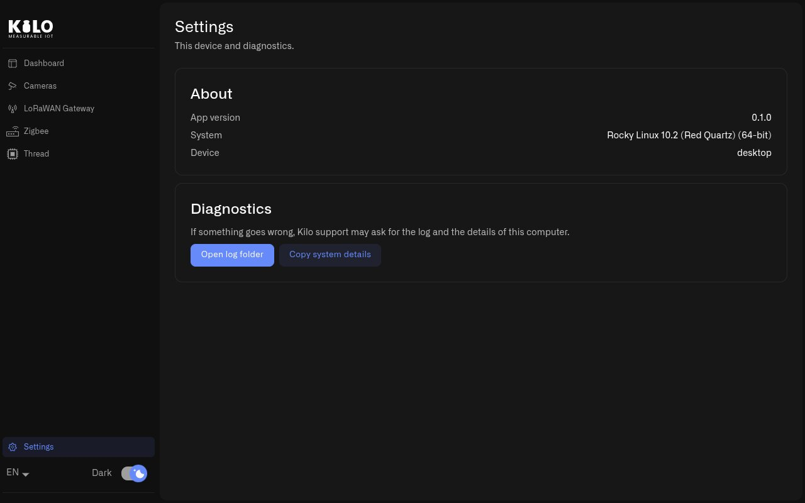

# What Is Kilo Hub?

Kilo Hub is the on-site companion to the Kilo IoT Server. You install it on a machine at the customer's site — a Raspberry Pi in a utility cabinet or a PC in the server room — and it installs, starts and monitors the local software your devices need: one camera recorder per IP camera, a Zigbee network, a Thread radio and, on a Raspberry Pi with a concentrator card, a LoRaWAN gateway.

<figure><figcaption>
The Dashboard shows the machine's resources and the state of every capability at a glance.
</figcaption></figure>

## Why does Kilo IoT need software on site?

Some devices can only be reached from inside the building. An IP camera streams on the local network, a Zigbee sensor talks to a USB radio, and a LoRaWAN concentrator sits on the board it is plugged into. Something on site has to hold those connections and pass the results to Kilo.

Without Kilo Hub, each of those pieces is a separate installation: Docker, a container per camera, a Zigbee2MQTT configuration file with the right serial port and radio driver, a local MQTT broker, certificates for the gateway. Kilo Hub replaces that with buttons. It finds the hardware, picks the settings, runs the software in Docker and shows the result in one window, so a site technician can finish an installation without command-line skills.

## What can Kilo Hub set up?

| Capability | What Kilo Hub does | Where it runs |
|---|---|---|
| **Cameras** | Finds cameras on the local network and starts one recorder ([Twin](../lens/installing-twin.md)) per camera, ready to pair with Kilo Lens | Raspberry Pi and computers |
| **Zigbee** | Recognizes the USB coordinator, starts a Zigbee network with its own security key and opens a pairing window | Raspberry Pi and Linux computers |
| **Thread** | Runs a Thread border router for Matter devices on its own radio, next to the Zigbee radio | Raspberry Pi |
| **LoRaWAN gateway** | Reads the gateway ID from the concentrator card, takes the certificates Kilo issues for it and runs the gateway on Kilo's built-in LoRaWAN Network Server | Raspberry Pi with a concentrator HAT |

Each capability has its own page in the left menu. A capability whose hardware is missing stays in the menu and says what it needs, so a missing radio is never mistaken for a fault.

## Should I run Kilo Hub on a Raspberry Pi or a computer?

Kilo Hub runs on both, and the choice comes down to radios and camera count.

* **Raspberry Pi** — one small box for cameras, Zigbee and Thread, and a LoRaWAN gateway too if you add the card. A Raspberry Pi 4 records about six or seven cameras. See [Raspberry Pi](raspberry-pi/README.md).
* **Windows, macOS or Linux computer** — more processing power, so far more cameras per site, and the starting point for an edge hub in a factory or a commercial building. A computer has no slot for a LoRaWAN concentrator card. See [Windows, Mac and Linux](computer.md).

## How do I get started with Kilo Hub?

1. [Download and install Kilo Hub](download-and-install.md) on the machine that will stay on site.
2. Open Kilo Hub. The **Dashboard** lists the machine (system, memory, processors, Docker version) and the state of each capability.
3. Open the capability you need from the left menu and follow its page: [Cameras](cameras.md), [Zigbee](zigbee.md), [Thread](thread.md) or the [Raspberry Pi LoRaWAN gateway](raspberry-pi/lorawan-gateway.md).

The **Processor load** and **Memory used** bars on the Dashboard turn orange as the machine fills up. Check them before adding another camera.

## Where do I find Kilo Hub logs?

Open **Settings** at the bottom of the left menu. It shows the Kilo Hub version, the operating system and the type of device.

<figure><figcaption>
Settings holds the version and the two diagnostics actions support asks for.
</figcaption></figure>

* **Open log folder** opens the folder with Kilo Hub's log files.
* **Copy system details** copies the version, operating system and hardware details to the clipboard, ready to paste into a support request.

## Tips

* Install Kilo Hub on a machine that stays powered on. Cameras record and Zigbee devices report only while the machine is running.
* Give the machine a wired network connection where possible. Cameras stream continuously, and a wired link keeps recordings complete.
* The language selector at the bottom of the menu switches Kilo Hub between English, German, French, Spanish and Portuguese. The **Dark** switch changes the theme.
