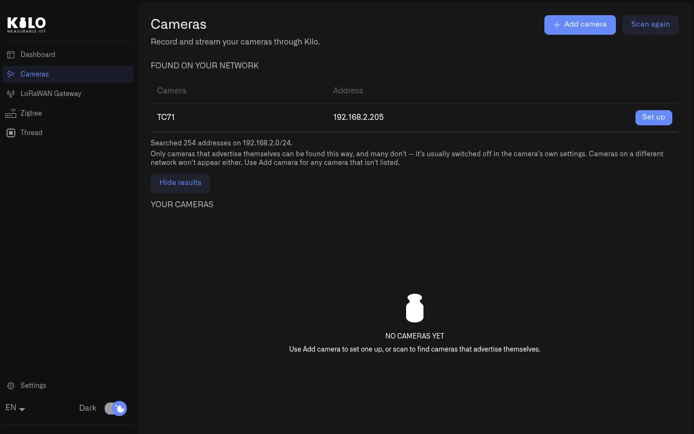
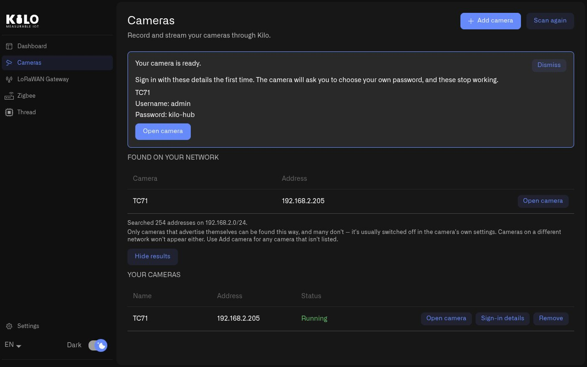
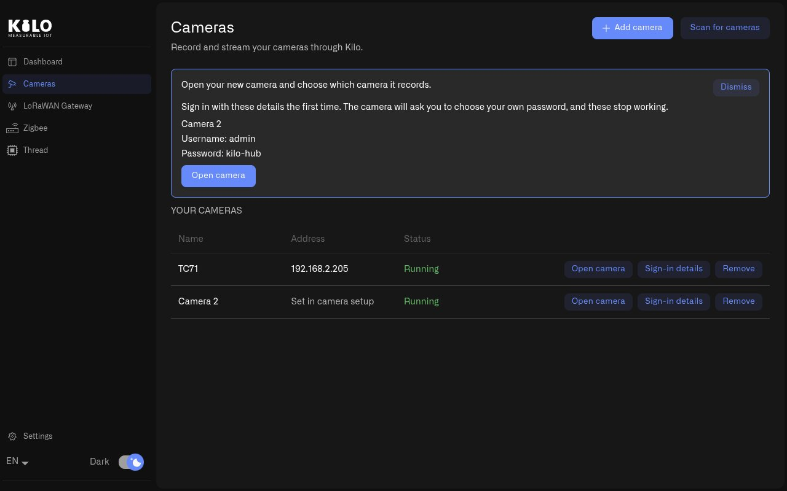

# How Do I Add IP Cameras with Kilo Hub?

Kilo Hub sets up the on-site side of Kilo Lens for you. For each camera it starts one [Twin](../lens/installing-twin.md) — the local recorder that holds the camera's stream, records it and connects it to Lens in the cloud — without Docker commands, image versions or port numbers.

## Why use Kilo Hub for cameras?

Installed by hand, every camera needs a Docker container with its own name, storage volume, free port and image version, and a site with fifteen cameras needs fifteen of them. Kilo Hub creates and tracks each one, installs Docker when the machine does not have it, and shows every camera's state in one list.

## How do I find cameras on the network?

1. Open **Kilo Hub** and select **Cameras** in the left menu.
2. Select **Scan for cameras**. Kilo Hub searches the local network, which takes about twenty seconds.
3. Cameras that announce themselves appear under **Found on your network** with their name and address.

<figure><figcaption>
A scan lists the cameras that announce themselves on the local network.
</figcaption></figure>

Only cameras with discovery (ONVIF) switched on are found this way, and only on the same network as the hub. Cameras that are not listed are added with **Add camera** instead.

## How do I set up a camera found by the scan?

1. Select **Set up** next to the camera. Kilo Hub shows its progress in three steps — **Docker**, **Camera software** and **Your camera**. The first camera downloads the camera software once; every camera after it is ready in seconds.
2. When **Your camera is ready.** appears, note the sign-in details shown with it.
3. Select **Open camera**. The camera's Twin page opens in your browser.
4. Sign in with the username and password Kilo Hub shows. The Twin asks you to choose your own password at that first sign-in, and the details shown by Kilo Hub stop working after that.
5. Continue in the Twin: enter the camera's stream and pair it with Lens, as described in [Connecting a Camera](../lens/connecting-a-camera.md).

<figure><figcaption>
A new camera shows its first sign-in details and an Open camera button.
</figcaption></figure>

## How do I add a camera that the scan does not find?

1. Select **Add camera**. Kilo Hub sets up a new camera right away and gives it a numbered name, such as **Camera 2**.
2. The message **Open your new camera and choose which camera it records.** appears with the sign-in details.
3. Select **Open camera**, sign in, and enter the camera's stream address in the Twin. The **Address** column reads **Set in camera setup** until then. [RTSP Camera URLs](../lens/rtsp-camera-urls.md) lists the stream addresses of common camera brands.

<figure><figcaption>
A camera added by hand gets its stream address in the camera's own setup page.
</figcaption></figure>

## What if Docker is not installed?

Cameras run in Docker. When it is missing or stopped, Kilo Hub explains what it will do and offers one button — **Install Docker and add camera**, **Start Docker and add camera** or **Fix permissions and add camera** — then finishes the camera on its own.

* **Windows** — Kilo Hub downloads and installs Docker Desktop; approve the administrator prompt. The computer may restart, and Kilo Hub reopens afterwards to finish the camera.
* **macOS** — Kilo Hub sets up its own Docker engine (about 400 MB) with no password and nothing added to Applications.
* **Linux and Raspberry Pi** — Kilo Hub installs Docker Engine and asks for your password.

## How do I manage or remove a camera?

Every camera in **Your cameras** has three buttons:

* **Open camera** — opens the camera's Twin page in your browser.
* **Sign-in details** — shows the first sign-in details again.
* **Remove** — asks what to do with the recordings: **Remove, keep recordings** stops the camera and keeps its recorded video on the machine; **Remove and delete recordings** removes the video as well.

## How many cameras can Kilo Hub record?

It depends on the machine Kilo Hub runs on. A [Raspberry Pi](raspberry-pi/README.md) 4 records about six or seven cameras alongside its other jobs. On a [computer](computer.md) the only limit is its processor, memory and network, so a site with many cameras runs Kilo Hub on a PC or a small server. **Processor load** and **Memory used** on the Dashboard show how much room is left.

## Tips

* Switch on ONVIF discovery in the camera's own settings to have the scan find it.
* Check the Dashboard's **Processor load** before adding cameras to a Raspberry Pi; about six or seven is the limit on a Raspberry Pi 4. For more, run Kilo Hub on a [computer](computer.md).
* Store the password you choose at the first sign-in in your team's password manager. Kilo Hub does not keep it.
