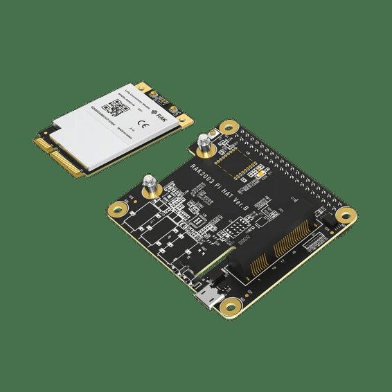

# How Do I Assemble a Raspberry Pi LoRaWAN Hub?

Assembly takes about fifteen minutes and needs a small screwdriver. Do it with the Pi unplugged, and fit the antenna before the Pi is ever powered with the card in place.

## How do I fit the concentrator card to the Pi HAT?

1. Hold the RAK5146 card at a slight angle and push its gold edge fully into the mPCIe slot on the Pi HAT.
2. Press the card down flat and fix it with the screw on the HAT's standoff.
3. Connect the antenna cable to the card's **LoRa** antenna connector — the small round connector that is *not* marked GPS. Press it straight down until it clicks.
4. If you have a GPS antenna, connect it to the connector marked **GPS**. GPS gives the gateway accurate time and location; the gateway works without it.

<figure><figcaption>
The card goes into the mPCIe slot on the HAT and is held by one screw.
</figcaption></figure>


Never power the Pi with the concentrator card fitted and no antenna connected. A LoRa radio that transmits without an antenna can damage itself.


## How do I mount the HAT on the Raspberry Pi?

1. Screw the standoffs that come with the HAT into the Pi's four mounting holes.
2. Line the HAT's 40-pin socket up with the Pi's 40-pin GPIO header and press it down evenly until it sits fully on the header. Every pin must be inside the socket; a HAT that is one row off does not work.
3. Fix the HAT to the standoffs with the remaining screws.

## How do I put the hub in its case?

1. Place the Pi with the HAT in the case.
2. Bring the antenna cable's SMA end out through the case's antenna opening and tighten its nut.
3. Screw the LoRa antenna onto the SMA connector on the outside of the case.
4. Close the case, leaving the ventilation openings clear.

Mount the antenna upright and as high as practical, away from metal. Range depends far more on where the antenna is than on the gateway.

## How do I connect the Zigbee and Thread radios?

1. Plug the Zigbee coordinator into a USB port **through a short USB extension cable**.
2. If you use Thread, plug the Thread radio into another USB port, also on an extension, a little apart from the Zigbee dongle.
3. Prefer the black USB 2 ports. USB 3 ports and their cables interfere with 2.4 GHz radios.

## How do I connect the cameras?

1. Connect each IP camera to the same network as the Pi, through a PoE switch or a PoE injector if the camera is powered over its network cable.
2. Note each camera's user name and password. You enter them in the camera's recorder when you connect it to its stream.

## How do I connect the Pi itself?

1. Insert the microSD card prepared in the next step.
2. Connect the network cable.
3. For the first setup, connect a screen, keyboard and mouse.
4. Connect the power supply last. The Pi starts as soon as it has power.

Next: [How Do I Set Up the Raspberry Pi for Kilo Hub?](setup.md)
