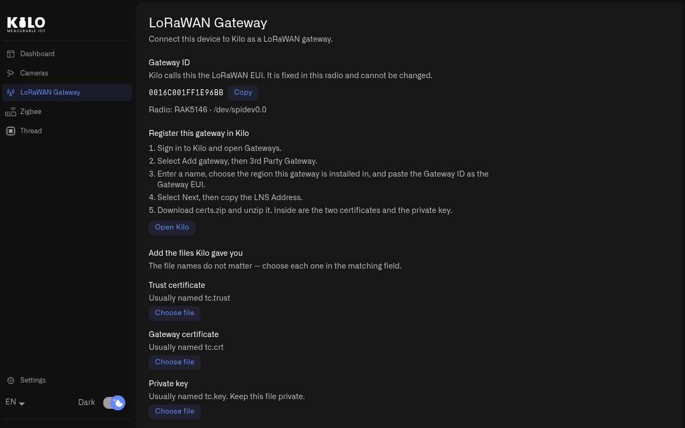
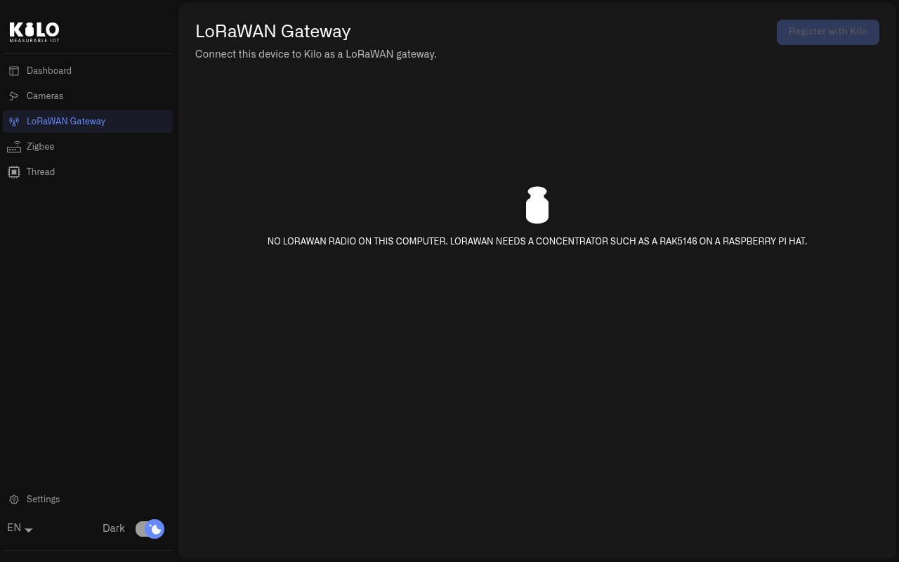

# How Do I Build a Raspberry Pi LoRaWAN Gateway?

A LoRaWAN gateway is the receiver that picks up the radio messages of your LoRaWAN sensors and sends them on to Kilo. Most people buy a [ready-made LoRaWAN gateway](../../gateways/lorawan-gateways/README.md), which doesn't need Kilo Hub. This page is for the other way: building your own on a Raspberry Pi with the LoRaWAN card fitted. To compare the two, see [Should I buy a LoRaWAN gateway or make the Pi one?](README.md#should-i-buy-a-lorawan-gateway-or-make-the-pi-one) If your Pi has no card, skip this page and go to [How Do I Add IP Cameras with Kilo Hub?](../cameras.md)

With the card fitted and the setup script run, your Pi has everything a gateway needs. Two things are left: Kilo has to know about the gateway, and the gateway needs its security certificates from Kilo so the two can trust each other. Kilo Hub guides you through both, and it installs the certificates for you. You don't edit any settings files.

## When does it make sense to build the gateway on the Pi?

When you enjoy building things yourself, or when the site has a Pi hub for cameras or Zigbee anyway. Then the same Pi can also receive your LoRaWAN sensors, and you have one box to power, mount and keep up to date. If you would rather not build anything, a ready-made gateway does the same job.

The Pi connects to Kilo over an encrypted connection. To learn how Kilo handles gateways in general, see [LoRaWAN Gateways](../../gateways/lorawan-gateways/README.md).

## What do I need before I start?

* A Raspberry Pi with the RAK5146 card and a LoRa antenna ([parts](shopping-list.md), [assembly](hardware.md)), with the setup script run and Kilo Hub installed ([setup](setup.md)).
* A Kilo login that's allowed to add gateways. If you're not sure, ask whoever runs your Kilo account.
* The LoRaWAN region where the gateway will be installed, for example **EU868** in Europe or **US915** in North America.
* An internet connection on the Pi.

## How do I connect the Raspberry Pi gateway to Kilo?

You go back and forth between Kilo Hub and Kilo in a web browser. On the Pi, the browser is Firefox, which the setup script installed.

1. In **Kilo Hub** on the Pi, select **LoRaWAN Gateway** in the left menu. The page shows the **Gateway ID**, which Kilo Hub reads from the card. This ID is fixed in the card and identifies your gateway.
2. Select **Copy** next to the Gateway ID, then select **Open Kilo**. Kilo opens in Firefox. Sign in.
3. In Kilo, open **Gateways**, select **Add gateway**, then **3rd Party Gateway** (the Pi counts as a third-party gateway).
4. Enter a name, choose the region the gateway is installed in, and paste the Gateway ID into **Gateway EUI**. Select **Next**.
5. Copy the **LNS Address**. LNS stands for LoRaWAN Network Server: this is the address of Kilo's server that your gateway connects to.
6. Download **certs.zip**. In Firefox's list of downloads, select `certs.zip`. It opens in the archive tool. Select **Extract**, and the files go to your Downloads folder. You get three files: the trust certificate (`tc.trust`), the gateway certificate (`tc.crt`) and the private key (`tc.key`).
7. Back in Kilo Hub, under **Add the files Kilo gave you**, select **Choose file** next to **Trust certificate**, **Gateway certificate** and **Private key**, and pick the matching file from your Downloads folder each time. Paste the address into **LNS address**.
8. Select **Save** and enter your password when asked. Kilo Hub first checks that the three files belong together. Then it installs them and starts the gateway.
9. The page says **This gateway is set up and running.**

<figure><figcaption>
The Gateway ID, the steps to follow in Kilo and the fields for the files Kilo issues.
</figcaption></figure>

If a file doesn't fit, for example certificates from two different downloads or a private key with a password on it, Kilo Hub tells you which file to choose again and changes nothing. If saving fails, Kilo Hub puts the previous files back and tells you so. If it can't, it says the files may be incomplete: choose all three files again and select **Save**.

## How do I know the gateway is connected to Kilo?

Kilo Hub can only see what happens on the Pi: whether the files are in place and whether the gateway software is running. Whether the gateway actually reached Kilo, only Kilo can tell you.

Select **Open Kilo** and open the gateway under **Gateways**. There you see its status and the messages it receives. See [LoRaWAN Gateway Monitoring](../../gateways/lorawan-gateways/lorawan-gateway-monitoring.md).

If Kilo Hub says **This gateway is set up but not running.**, select **Start gateway**.

## Why does Kilo Hub say there is no LoRaWAN radio?

The LoRaWAN Gateway page needs the card, and it needs the setup script to have found the card. On a computer, on a Pi without a card, or on a Pi where the script did not find the card, the page says **No LoRaWAN radio on this computer. LoRaWAN needs a concentrator such as a RAK5146 on a Raspberry Pi HAT.** The Dashboard card says **No LoRaWAN radio on this device.**

<figure><figcaption>
Without a concentrator card, the LoRaWAN Gateway page names the hardware it needs.
</figcaption></figure>

If you fitted the card after running the setup script, run the script again: see [What if I add a LoRaWAN card later?](setup.md#what-if-i-add-a-lorawan-card-later) If the card is fitted and still not found, see [Why Isn't My Raspberry Pi Hub Working?](troubleshooting.md#what-if-the-setup-script-says-the-concentrator-did-not-answer)

## What should I know once the gateway runs?

* Mount the antenna as high as you can and outside metal cabinets. Where the antenna sits matters far more for range than the gateway itself.
* Keep `certs.zip` private. Anyone with it can pose as your gateway. If it leaks, create new certificates in Kilo and add the new files in Kilo Hub.
* Add your LoRaWAN sensors in Kilo as usual: see [LoRaWAN Devices](../../devices/lorawan-devices.md). The Pi passes on their messages like any other gateway.

Next: [How Do I Add IP Cameras with Kilo Hub?](../cameras.md) To run Kilo Hub on a computer instead, see [How Do I Run Kilo Hub on Windows, Mac or Linux?](../computer.md)
