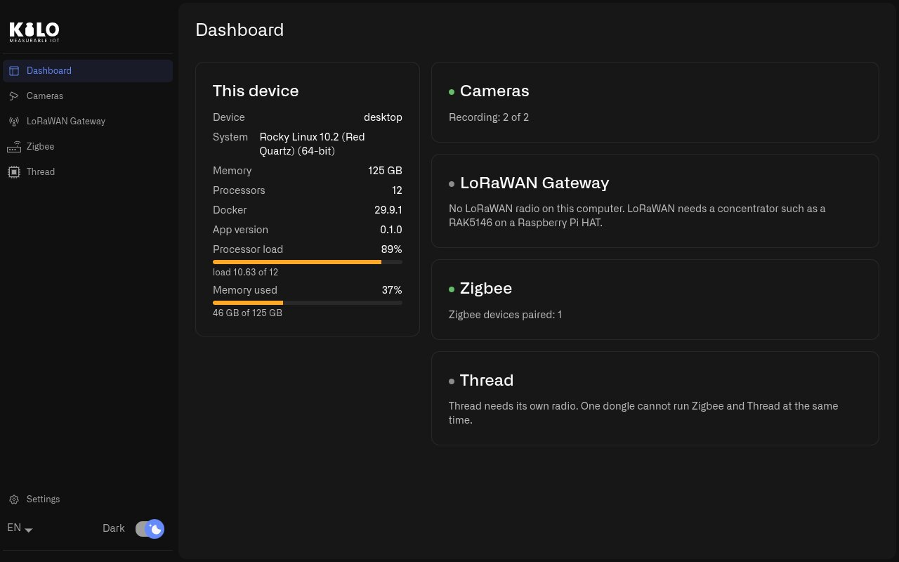

# How Do I Set Up the Raspberry Pi for Kilo Hub?

Setting up the Pi takes three steps: write Ubuntu to the microSD card, run one setup script that prepares the LoRaWAN card and the radios, and install the Kilo Hub app. Plan 30–45 minutes, most of it waiting for downloads.

## How do I write Ubuntu to the microSD card?

Kilo Hub's Raspberry Pi setup runs on **Ubuntu Server 24.04 LTS or 26.04 LTS (64-bit)**.

1. On your computer, install **Raspberry Pi Imager** from [raspberrypi.com/software](https://www.raspberrypi.com/software/) and insert the microSD card.
2. In Raspberry Pi Imager, choose:
   * **Device:** your Raspberry Pi model (Raspberry Pi 4 or Raspberry Pi 5).
   * **Operating system:** **Other general-purpose OS → Ubuntu → Ubuntu Server 24.04 LTS (64-bit)**, or 26.04 LTS when it is listed.
   * **Storage:** the microSD card.
3. When Imager offers to customize the settings, do it:
   * set a **hostname**, for example `kilo-hub`;
   * set a **username and password** — you need them to sign in and to approve changes later;
   * enter your **Wi-Fi** network if the Pi will not use a network cable;
   * set your **time zone and keyboard layout**;
   * under **Services**, turn on **SSH** if you want to finish the setup from your computer.
4. Write the card, put it in the Pi, connect the network cable, screen and keyboard, and connect the power.

The first start takes a few minutes while Ubuntu finishes setting itself up. Sign in with the username and password you chose — on the Pi's own screen, or from your computer with `ssh <username>@kilo-hub.local`.

## How do I prepare the Pi for the LoRaWAN card and the radios?

Run the setup script from the Raspberry Pi IoT Hub repository. In the terminal on the Pi:

```sh
git clone https://github.com/chirpdepin/raspberry-pi-iot-hub.git
cd raspberry-pi-iot-hub
sudo ./scripts/install-ubuntu.sh --with-desktop
```

The script takes 10–20 minutes. It:

* updates Ubuntu;
* turns on the interface the concentrator card uses and checks that the card **answers** — this is where a badly seated card is caught;
* reads the gateway ID from the card;
* installs Docker and the LoRaWAN gateway software, which waits for its certificates;
* installs the Zigbee and Thread radio support, which follows each USB radio by its serial number;
* with `--with-desktop`, adds a minimal screen session in which Kilo Hub starts by itself.

When it finishes, it prints the **Concentrator** — the gateway ID — and says the gateway is installed but not registered yet. That is expected: registering it is done from Kilo Hub.

If the script says **a reboot is required**, run `sudo reboot`, sign in again and run the same `sudo ./scripts/install-ubuntu.sh --with-desktop` once more. Running it again is safe; it skips what is already done.

If it stops with **the concentrator did not answer**, see [Why Isn't My Raspberry Pi Hub Working?](troubleshooting.md#what-if-the-setup-script-says-the-concentrator-did-not-answer)

## How do I install Kilo Hub on the Raspberry Pi?

Still in the terminal on the Pi, download the latest Kilo Hub package for the Pi and install it:

```sh
curl -s https://api.github.com/repos/chirpdepin/raspberry-pi-iot-hub/releases/latest \
  | grep -o 'https://[^"]*_arm64\.deb' | head -1 | xargs wget
sudo apt install ./kilo-hub_*_arm64.deb
```

The first command fetches `kilo-hub_<version>_arm64.deb` from the [latest release](https://github.com/chirpdepin/raspberry-pi-iot-hub/releases/latest); you can also download that file in a browser and copy it to the Pi.

Then restart the Pi:

```sh
sudo reboot
```

The restart also applies the group memberships the setup script added, which Kilo Hub needs to reach the radios and the Zigbee settings.

## What should I see after the restart?

With a screen connected, the Pi signs in by itself and **Kilo Hub** opens full screen on the **Dashboard**:

* **This device** shows the Raspberry Pi, its memory, processors and Docker.
* **LoRaWAN Gateway** says **LoRaWAN radio found. It is not set up yet.**
* **Zigbee** shows the coordinator if one is plugged in.
* **Cameras** says **No cameras yet.**

<figure><figcaption><p>The Dashboard shows the device and one card per capability.</p></figcaption></figure>

Without a screen the Pi runs exactly the same: the gateway, Zigbee and the cameras keep working. The screen is only needed while you set things up in Kilo Hub.

## What do I set up next?

Work through the capabilities you need, in any order:

1. **LoRaWAN gateway** — register the gateway in Kilo and add its certificates: [How Do I Build a Raspberry Pi LoRaWAN Gateway?](lorawan-gateway.md)
2. **Zigbee** — start the network and pair devices: [How Do I Pair Zigbee Devices with Kilo Hub?](../zigbee.md)
3. **Cameras** — find and add the site's cameras: [How Do I Add IP Cameras with Kilo Hub?](../cameras.md). The first time, Kilo Hub may say **Docker is installed, but this account is not allowed to use it yet.** Select **Fix permissions** and approve the password prompt.
4. **Thread** — give the Thread radio its role: [How Do I Add Thread to Kilo Hub?](../thread.md)

## Tips

* Kilo Hub asks for your password when it changes something on the system — starting the gateway, installing certificates, starting Zigbee the first time. That is the Pi's own password from Raspberry Pi Imager.
* Update Kilo Hub the same way you installed it: download the newer `.deb` and install it over the old one. Gateway certificates, the Zigbee network and the cameras are kept.
