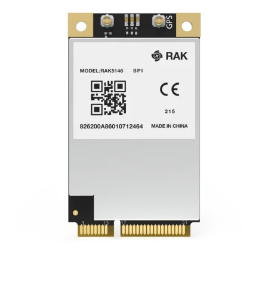

# What Do I Need to Build a Raspberry Pi IoT Hub?

You only buy the parts for what you want the Pi to do. Every hub needs the Raspberry Pi itself, with its power supply, memory card and case. Everything after that is optional: the parts for cameras, for Zigbee and Thread, or for a LoRaWAN gateway. If you only want cameras, you buy the Pi and the cameras, and nothing else.

Where a part is sold in the [Kilo Electronics store](https://kiloelectronics.com/), the link opens its store category, so you see every model in stock.

## What do I need for the Raspberry Pi itself?

Every hub needs these.

| Part | What to buy | Why it matters |
|---|---|---|
| Raspberry Pi | Raspberry Pi 4 Model B (4 GB or 8 GB) or Raspberry Pi 5 (4 GB or more) | This is the computer that runs Kilo Hub. A Pi 5 records more cameras than a Pi 4 |
| Power supply | The official Raspberry Pi USB-C supply for your model: 15 W (5 V / 3 A) for a Pi 4, 27 W (5 V / 5 A) for a Pi 5 | With a weak phone charger, the Pi restarts when it gets busy, and that looks like random faults |
| microSD card | 32 GB or larger, marked A2 (a speed class for cards that run programs), from a known brand | Holds the operating system and the camera recordings. A good card lasts longer under constant writing |
| Case | A case with air vents, ideally with a fan | A Pi that gets too hot slows down |
| Network cable | An ordinary Ethernet cable marked Cat 5e or better | A wired connection keeps cameras and the gateway online when Wi-Fi drops |
| Computer, screen and keyboard | A computer with a microSD card reader, plus a screen with an HDMI cable (micro-HDMI on the Pi), a USB keyboard and a mouse | You use the computer to put the operating system on the card. Kilo Hub runs on the Pi's own screen, so keep the screen and keyboard handy for when you add a camera or a device. The hub keeps running without them |

You can buy Raspberry Pi boards, power supplies and cases from any Raspberry Pi reseller.

## What do I need to record IP cameras?

Only if you want the hub to record cameras.

| Part | What to buy | Where |
|---|---|---|
| IP cameras | Cameras that support ONVIF (lets the hub find the camera on the network) and RTSP (lets it pick up the video), which most current IP cameras do. A Raspberry Pi 4 records about six or seven. For more, run Kilo Hub on a computer | [Surveillance](https://kiloelectronics.com/en/product-category/iothardware/surveillance/) |
| Power for the cameras | Some cameras get their power through the network cable. This is called PoE (Power over Ethernet). For those, a PoE switch or one PoE injector per camera | [Accessories](https://kiloelectronics.com/en/product-category/iothardware/accessories/) |

## What do I need to connect Zigbee and Thread devices?

Only if you want Zigbee or Thread devices, such as sensors, plugs and lights.

A Zigbee dongle (also called a coordinator) is a small USB stick with a radio in it. Your Zigbee devices talk to it, and it is plugged into the Pi. Thread works the same way but needs a radio of its own.

| Part | What to buy | Why |
|---|---|---|
| Zigbee dongle | A USB Zigbee dongle Kilo Hub recognizes. See the list on the [Zigbee](../zigbee.md#which-zigbee-coordinators-does-kilo-hub-recognize) page | It runs your Zigbee network |
| Thread radio | A separate USB radio that the seller says comes with OpenThread RCP firmware (the software Thread needs) already on it. Otherwise you have to load that firmware yourself with the maker's tool. See [Which radio do I need for Thread?](../thread.md#which-radio-do-i-need-for-thread) | One dongle cannot run Zigbee and Thread at the same time, so Thread needs its own |
| USB extension cables | One short USB extension cable per radio | It moves the radio away from the Pi. The Pi and its USB 3 ports disturb these radios |

## What do I need to turn my Raspberry Pi into a LoRaWAN gateway?

Only if you have LoRaWAN sensors and want to build their gateway yourself on this Pi. Most people buy a ready-made gateway instead, which doesn't need these parts or the Pi: see [Should I buy a LoRaWAN gateway or make the Pi one?](README.md#should-i-buy-a-lorawan-gateway-or-make-the-pi-one) If you don't build one, skip this section.

To receive LoRaWAN sensors, the Pi needs a LoRaWAN radio. That radio is a concentrator card: a small board that listens to many LoRaWAN sensors at once. The card does not plug into the Pi directly. It sits on a Pi HAT, an add-on board that fits on top of the Pi.

The easiest way is the **RAK5146 Pi HAT kit**: the HAT and the card together, so you don't have to match them yourself. You find it in the [RF modules](https://kiloelectronics.com/en/product-category/modules/rfmodules/) category. Then add an antenna, an antenna cable and a taller case. If you buy the parts one by one, this is the full list:

| Part | What to buy | Where |
|---|---|---|
| Pi HAT | RAKwireless RAK2287/RAK5146 Pi HAT. It holds the concentrator card and plugs onto the Pi's 40-pin header | [Raspberry Pi accessories](https://kiloelectronics.com/en/product-category/iothardware/raspberry-pi-en/) |
| Concentrator card | RAKwireless RAK5146 mPCIe card, **SPI** version, for your region's band (868 MHz in Europe, 915 MHz in North America and Australia). A variant with GPS is available | [RF modules](https://kiloelectronics.com/en/product-category/modules/rfmodules/) |
| Antenna | A LoRa antenna for the same band, with an SMA or RP-SMA connector | [Antennas](https://kiloelectronics.com/en/product-category/iothardware/antennas/) |
| Antenna cable | An iPEX (MHF4)-to-SMA pigtail. It connects the card to an antenna socket on the outside of the case | [Cables](https://kiloelectronics.com/en/product-category/iothardware/cables/) |
| Case | A case tall enough for the HAT on top of the Pi, with an opening for the antenna socket. Standard Raspberry Pi cases are too low | Any Raspberry Pi reseller |

<figure><figcaption>
The RAKwireless Pi HAT sits on the Raspberry Pi and holds the concentrator card.
</figcaption></figure>

<figure><figcaption>
The RAK5146 concentrator card. The connector marked GPS is for the optional GPS antenna; the other one is for the LoRa antenna.
</figcaption></figure>

<figure><figcaption>
The RAK5146 Pi HAT kit: card and HAT together.
</figcaption></figure>


Buy the card and the antenna for the band used in the country where the hub will run. You cannot change the band later. Everything else about the region is chosen in Kilo when you register the gateway.


Keep the antenna's box. It states the band, and you need that when you register the gateway in Kilo.

## Can I add parts later?

Yes. Buy what you need now. You can add a Zigbee dongle, cameras, a Thread radio or the LoRaWAN parts later without starting over.

Next: [How Do I Assemble a Raspberry Pi IoT Hub?](hardware.md)
