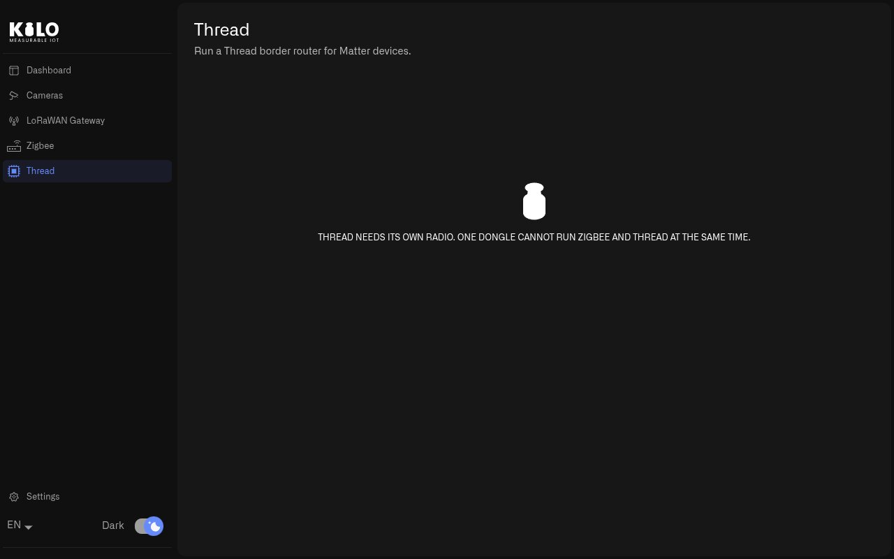

# How Do I Add Thread to Kilo Hub?

Thread is the low-power mesh network that Matter devices use: sensors, locks, blinds and lights from many manufacturers. Like Zigbee, it needs a radio on site, and a Raspberry Pi running Kilo Hub runs the Thread border router for it.

## Why does Thread need its own radio?

Zigbee and Thread use the same 2.4 GHz radio chips, but different firmware. A dongle runs one or the other, never both at the same time. A site that uses both protocols therefore needs two USB radios: one with Zigbee coordinator firmware for the [Zigbee](zigbee.md) network, and one with Thread firmware. Kilo Hub keeps the two apart, so the Thread radio is never mistaken for the Zigbee coordinator or the other way round.

## What radio does Thread need?

Use a USB radio flashed with OpenThread radio co-processor (RCP) firmware, for example a second Silicon Labs MG24 or Nordic nRF52840 dongle. Many dongles sold for Zigbee can be reflashed for Thread; the dongle manufacturer publishes the firmware and the flashing steps.

## How do I set up Thread on a Raspberry Pi?

On a Raspberry Pi prepared with the [setup script](raspberry-pi/setup.md#how-do-i-prepare-the-pi-for-the-lorawan-card-and-the-radios), the Thread border router (OpenThread) is already installed and starts by itself once a radio has the Thread role.

1. Plug the Thread radio into a USB port, next to the Zigbee coordinator if there is one.
2. Find its USB serial number: it is the long code at the end of its name in `ls /dev/serial/by-id`.
3. Give it the Thread role once:

   ```sh
   sudo iot-hub-radio-assign <usb-serial> thread
   ```

   The command checks that the radio is plugged in and not already the Zigbee radio, links it as the Thread radio, and the border router starts. The role follows the radio's serial number, so it survives reboots and other USB ports.
4. Open **Kilo Hub** and select **Thread** in the left menu. The page shows **Thread radio found.**

When no Thread radio is plugged in, the Thread page and the Thread card on the Dashboard both say **Thread needs its own radio. One dongle cannot run Zigbee and Thread at the same time — they use different firmware.**

<figure><figcaption><p>Without a Thread radio, the page explains that Thread and Zigbee need separate radios.</p></figcaption></figure>

On Windows and macOS, Kilo Hub cannot use USB radios, so Thread runs on a Raspberry Pi.

## Tips

* Label the two dongles. They often look identical, and a Zigbee dongle plugged in where Thread was expected is the most common reason the Thread page reports no radio.
* Keep both radios on short USB extension cables, a little apart from each other and from the machine's Wi-Fi antenna.
