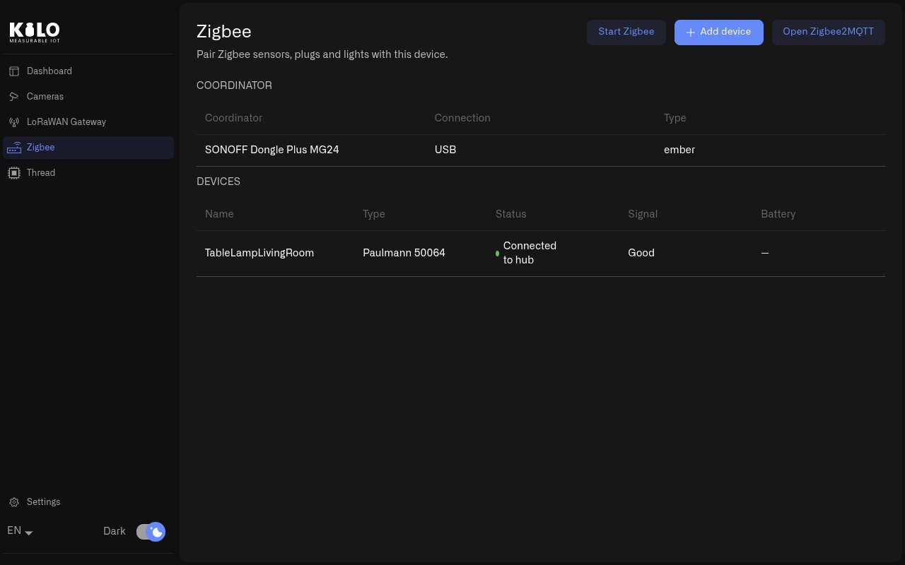
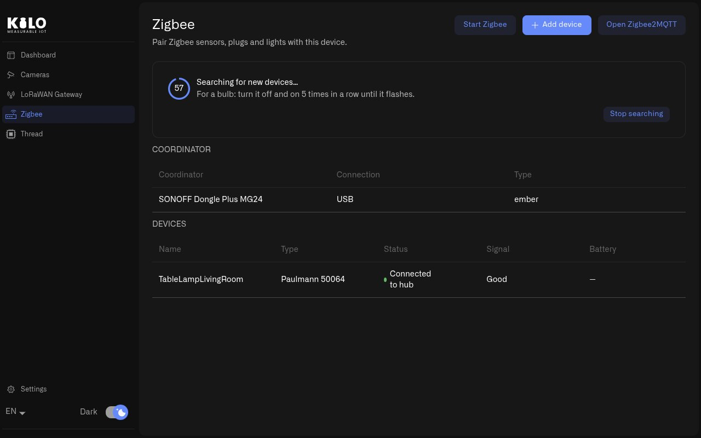
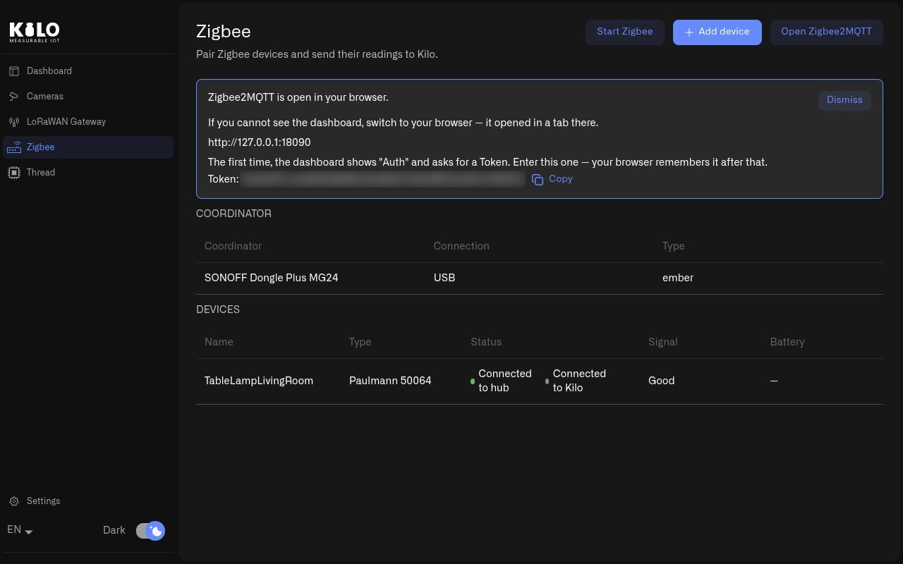

# How Do I Pair Zigbee Devices with Kilo Hub?

Zigbee is a low-power radio network used by many sensors, plugs and lights. These devices don't connect to Wi-Fi. They talk to a small USB stick with a radio in it, called a Zigbee dongle or coordinator, which you plug into the hub. Kilo Hub turns that dongle into a working Zigbee network, and you pair your devices from the app.

Zigbee works with Kilo Hub on a Raspberry Pi and on Linux computers.

## Why use Kilo Hub for Zigbee?

Setting up a Zigbee network by hand means finding where the dongle is connected, telling the software which kind of chip is inside it, creating a security key for the network and writing all of that into a settings file. If you get the chip wrong, the error message rarely tells you so.

Kilo Hub reads all of this from the dongle itself. It gives your network a security key of its own, and it keeps using the same dongle after a restart, even if you plug other USB devices in.

## Which Zigbee coordinators does Kilo Hub recognize?

Kilo Hub recognizes these USB dongles and sets them up for you:

* SONOFF Zigbee Dongle Plus MG24, ZBDongle-E, ZBDongle-P and Dongle Max
* SMLIGHT SLZB-06P, SLZB-06U, SLZB-06MU, SLZB-07 and SLZB-07P
* Home Assistant SkyConnect and Connect ZBT-1
* dresden elektronik ConBee

Plug the dongle in before you open the **Zigbee** page. If it is the only dongle plugged in and Kilo Hub recognizes it, Kilo Hub picks it for Zigbee and saves that choice the first time you select **Start Zigbee**.

If you plug in two or more radios, for example a Zigbee dongle and a Thread radio, Kilo Hub doesn't guess. The page lists them under **Radios needing a decision**. Select **Use for Zigbee** on the Zigbee dongle. Kilo Hub remembers that dongle by its serial number, so it stays your Zigbee radio after a restart and in any USB port.

If no dongle is plugged in, the page says **No Zigbee coordinator found. Plug in a supported USB dongle and it will appear here.**

## How do I start the Zigbee network?

1. In **Kilo Hub**, select **Zigbee** in the left menu. The **Coordinator** table shows your dongle, its **Connection** (USB) and its **Type**, a short code for the kind of chip inside, such as `ember` or `zstack`. If **Type** says **Unknown**, Zigbee cannot start on that dongle. Use one from the list above.
2. Select **Start Zigbee**. The first time, this takes up to a minute while Kilo Hub waits for the network to come online.
3. When you see **Zigbee started.**, the network is running. Devices you already paired appear in the **Devices** table.

<figure><figcaption>
The Zigbee page lists the coordinator and every paired device with its signal and battery.
</figcaption></figure>

If the network is already running, **Start Zigbee** restarts it. That is also the first thing to try when devices stop responding.

On a Raspberry Pi, the first **Start Zigbee** asks for the Pi's password once. After that, the Zigbee network starts by itself every time the Pi starts, with or without a screen.

## How do I pair a Zigbee device?

The network must be running first. If it isn't, **Add device** asks you to start Zigbee.

1. Select **Add device**. The network now accepts new devices, and a countdown shows how long it stays open.
2. While **Searching for new devices…** is shown, put the device into pairing mode. On most sensors you hold a button for a few seconds. For a bulb, turn it off and on 5 times in a row until it flashes. The device's manual has the exact steps.
3. The device appears in the **Devices** table with its name, **Type**, **Status**, **Signal** and **Battery**. A green **Connected to hub** means it has joined.
4. Select **Stop searching** when you have paired everything, or let the countdown run out. Either way, the network stops accepting new devices.

<figure><figcaption>
While the pairing window is open, put the device into pairing mode.
</figcaption></figure>

Pair each device where it will be installed. Zigbee devices pass messages on through each other, and mains-powered devices such as plugs and lights do most of that work. So set those up first and battery sensors after.

## How do I open the Zigbee2MQTT dashboard?

The Zigbee network runs in a program called Zigbee2MQTT. It has its own web page where you can rename devices, see every value they report, switch lights and plugs, update their firmware and see a map of the network.

1. Select **Open Zigbee2MQTT**. The page opens in a tab of your web browser (on a Raspberry Pi, in Firefox).
2. The first time, it shows **Auth** and asks for a **Token**. Kilo Hub shows the token under **Zigbee2MQTT is open in your browser.** Select **Copy** and paste it into the page. Your browser remembers it after that.

<figure><figcaption>
Kilo Hub shows the dashboard's address and the token it asks for the first time.
</figcaption></figure>

Each installation has its own token, and the page only opens on the machine that runs Kilo Hub.

Give your devices names your team recognizes there. Kilo Hub shows the same names.

## Where should I plug in the Zigbee dongle?

Use a short USB extension cable, and keep the dongle away from USB 3 ports and from the machine's own Wi-Fi. They disturb the Zigbee radio.

## Where do I see and control my Zigbee devices?

On the hub. The **Devices** table on the **Zigbee** page shows each device with its status, signal and battery. To see the values a device reports, such as temperature, and to switch lights and plugs, select **Open Zigbee2MQTT**. On a Raspberry Pi, Kilo Hub runs on the Pi's own screen, so keep a screen and keyboard handy for this.

Next: [How Do I Add Thread to Kilo Hub?](thread.md)
