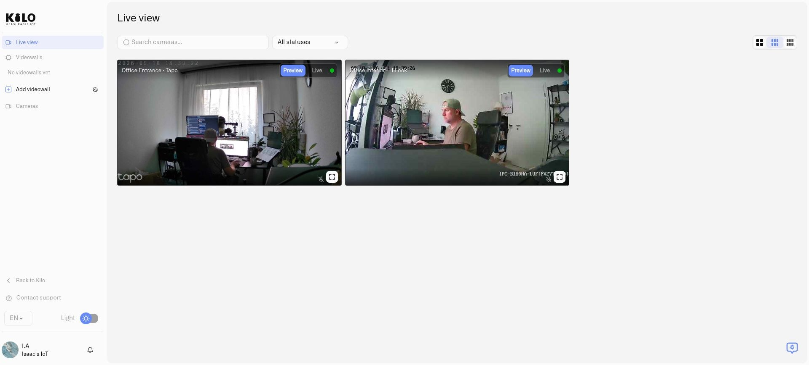
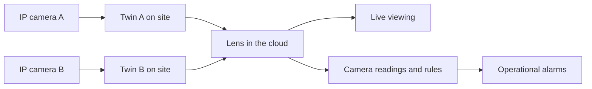

# Cameras

Open **Cameras** in the main navigation to use **Lens**, Kilo’s camera monitoring product.

**Lens** brings video cameras into Kilo IoT Server alongside devices, sensor readings, rules, and alarms. It gives teams a common place to view compatible cameras and use camera motion as an input to operational workflows.

Existing cameras need not become a separate replacement project. A business with different camera brands in New York, Washington, and London can connect compatible RTSP feeds to the same Kilo organization. Operators gain a shared platform for video and IoT information instead of relying on a different manufacturer's application for each installation.

Lens exists for four reasons:

- **One place for every site.** Cameras from different brands and offices appear in one organization, with one access model.
- **Keep the hardware you own.** Any camera that offers an RTSP stream can connect, so a rollout does not start with a replacement budget.
- **Smart features without smart cameras.** Motion zones and rules run off the camera, so older cameras gain features through software updates.
- **Video next to your sensors.** Camera readings use the same rules, alarms, and dashboards as every other device, and recordings can be kept in storage you own.

<figure><figcaption>
Tapo and HiLook cameras connected to the same Kilo organization, shown in Preview mode.
</figcaption></figure>

## Why use Kilo Lens?

### What problem does Lens solve for companies with several offices?

Picture a company with offices in Berlin, London, Cologne, Amsterdam, and Washington, D.C. Each office bought its cameras at a different time, from a different vendor. The camera industry is as fragmented as IoT, so every vendor ships its own phone app, and security staff end up switching between several of them. Nothing shows all offices together, and nobody can easily answer who has access to which camera.

Lens puts every compatible camera into one Kilo organization. You open one **Live view**, save a [videowall](videowalls.md) for each site, and manage access in one place. Each member of the organization gets **Edit**, **View**, or **No access** to Cameras, and you remove a departing colleague once. Access is set per feature, not per location, so use separate organizations if two sites must never share a camera list.

### Do you have to replace your cameras to use Lens?

No. Lens connects to the RTSP stream that a wide range of IP camera models can provide, and supported ONVIF cameras also expose discovery and camera controls. Check your model's stream settings in [RTSP Camera URLs](rtsp-camera-urls.md) before you buy anything. A site can adopt Lens one camera at a time and keep its existing recorders and wiring.

### How does Lens make a simple camera smart?

Expensive cameras do their analysis on a chip inside the camera. Lens moves that work off the camera. Today, you draw a motion zone on any feed, and Twin watches only that area for changing pixels. A loading-dock camera from several years ago can raise an alarm when someone moves near the door, with no built-in analytics. See [Motion Zones](motion-zones.md).

Detection today is motion inside the zones you draw. It does not recognize people, vehicles, or plates. Understanding what a camera sees is the direction we are building toward, not a feature you can use today.

### Where do you keep the recordings?

You can keep clips on the Twin host, or send an encrypted copy to your own Amazon S3, Google Cloud Storage, or Walrus storage. You pay your storage provider directly, and your own retention policy applies. See [Cloud Archive](cloud-archive.md).

### What changes when video sits next to your sensors?

Each camera becomes a device in Kilo, with a **Camera motion** reading and a **Camera status** reading. Rules, alarms, and dashboards treat them like any temperature or door sensor. Today a rule can combine a camera's motion with a door sensor's state and raise an alarm. Because both live in one platform, later automations can reach across the two kinds of device.

### How does video help physical AI?

Physical AI means AI that acts in the real world, including robots, machines, and buildings. A robot only knows what its own sensors report. Kilo is the operating system that lets those devices share context, and cameras are a rich source of it.

Here is an illustration, not a shipped feature. A security robot patrols a university campus. A wireless sensor on a door on the far side of the campus reports that it opened after hours. Because both are connected to Kilo, the door event is visible to every connected system, and a camera pointed at that door provides the picture. In the same way, a camera that reads a license plate could pass the result to a gate controller. We describe these as examples of what cross-device automation makes possible. Lens does not read plates today. For how Kilo governs AI that acts on devices, see [Physical AI](../physical-ai.md).

## What does Lens add to the cameras you already have?

### Can you see cameras from different brands in one place?

Yes. Different camera brands at different locations usually mean a different app, recorder and login for each. With Lens, compatible cameras from any manufacturer, at any number of sites, appear in one Kilo organization. Operators watch them in one place and save [videowalls](videowalls.md) for each site or task.

### Who can see and change the cameras?

Many camera systems give access through a shared login on each camera or recorder. In Kilo, access to cameras is set per user: **Edit**, **View** or **No access** (see [Roles and Page Access](../account/roles-and-page-access.md)). When someone leaves the team, you remove their access in Kilo once, without changing anything on the cameras. The local Twin administrator login stays separate from users' Kilo accounts (see [Access and Troubleshooting](access-and-troubleshooting.md)).

### Can an old camera become a smart camera?

Yes. Lens does not need analytics inside the camera. The camera only has to capture video and offer it as an RTSP stream, which most IP cameras can do, including older models. The processing happens off the camera: Twin, at your site, detects motion inside the zones you draw and can record locally, and Kilo uses each camera's motion reading in rules and alarms together with your other sensors.

For example, a loading dock has an older camera above the dock door and a wireless door sensor on the door. Draw a motion zone around the door in Twin. When the camera reports motion there, a rule checks the door sensor's state and raises an alarm if the door is open.

### Where is Lens going?

We are adding more AI to Lens. It runs off the camera, on the platform, where there is room for larger models and more advanced logic than a chip inside a single camera can hold. Because the processing does not depend on the camera's own hardware, cameras that are already installed, including older ones, gain new features through software updates instead of replacement. Today, Lens detection is motion inside selected zones; it does not recognize people or objects.

## Lens in the cloud, Twin at the site

**Twin** is the edge program you install at your site. It is the digital twin of one physical camera: it connects to that camera's video stream on your network and links the camera to Lens, which runs in the cloud. Twin runs as a Docker container. Each Twin connects to **one camera**: twenty cameras require twenty Twin containers. Multiple containers can run on a suitable host, with separate configuration and enough processing, network, and storage capacity for the workload.

RTSP is a standard way for an IP camera to provide a video stream. A broad range of camera manufacturers support it. Twin connects to that stream; supported ONVIF cameras can also expose discovery and camera controls. Check your camera's stream settings and credentials before installation.

## Where Lens fits

| Deployment | Practical use |
|---|---|
| Security and property management | Check entrances and shared areas while monitoring environmental or equipment readings. |
| Smart cities | Bring compatible cameras from public spaces into the same platform as other IoT infrastructure. |
| Traffic monitoring | Observe roads, junctions, or access points alongside relevant sensor information. |
| Public transportation | View stations, stops, and depots and configure responses to motion in selected areas. |
| Distributed enterprises | Reuse different camera brands across offices and facilities with organization-managed access. |

The per-camera Twin model lets deployments expand camera by camera and site by site. Size each site's host and connection for its actual feeds, and check organization subscription limits when expanding.

## Give an existing camera a useful new role

Suppose an entrance camera sees a busy pavement, stairs, and an office door. Drawing a motion zone around the doorway lets Twin detect movement there without using the entire scene as the trigger. The camera does not need built-in AI for this selected-area motion detection.

The resulting motion reading can start a Kilo rule. The rule can evaluate a condition and raise an alarm whose notification behavior you configure. This connects visual monitoring to the same automation system used by other IoT devices.

Use [motion zones](motion-zones.md) and [camera rules and alerts](camera-rules-and-alerts.md) together to build this example. Zone-based motion detects changing pixels; it does not identify people, vehicles, or the reason for movement.

## Keep operational views ready

Create [videowalls](videowalls.md) to save selected feeds in layouts tailored to a site or task. Arrange and resize panels for a security desk, transport hub, or property portfolio, then reopen the wall for routine monitoring.

## Connect the first camera

1. [Install Twin](installing-twin.md) at the camera's site.
2. [Connect and pair the camera](connecting-a-camera.md) with the correct Kilo organization.
3. [Open live video](watching-live-video.md).
4. Configure motion, a rule, and optional [local recording](local-recordings.md) or a [cloud archive](cloud-archive.md).

Download Twin from the official [chirpiot/lens-twin Docker Hub repository](https://hub.docker.com/r/chirpiot/lens-twin). Organization permissions control who can use Lens; [access and troubleshooting](access-and-troubleshooting.md) explains the current requirements.

For ongoing administration, see [Managing Cameras](managing-cameras.md). To connect an account-backed camera or HomeKit accessory, see [Provider Camera Sources](connecting-cloud-camera-sources.md).
