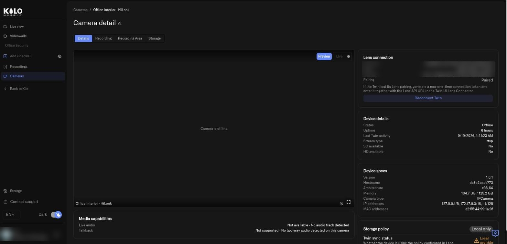
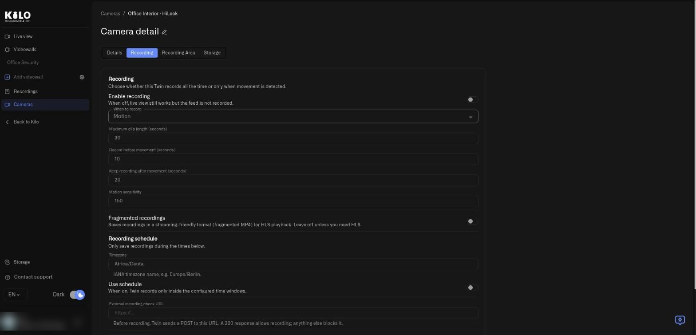
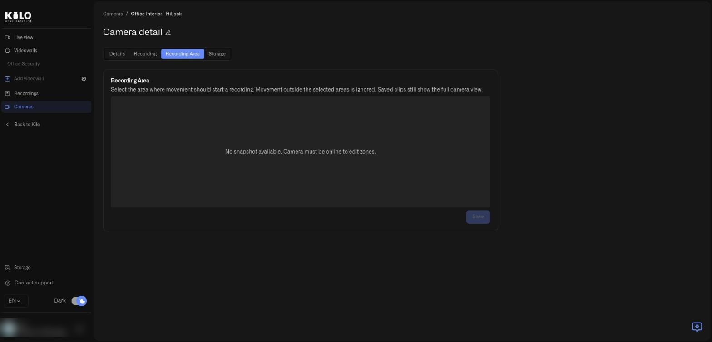
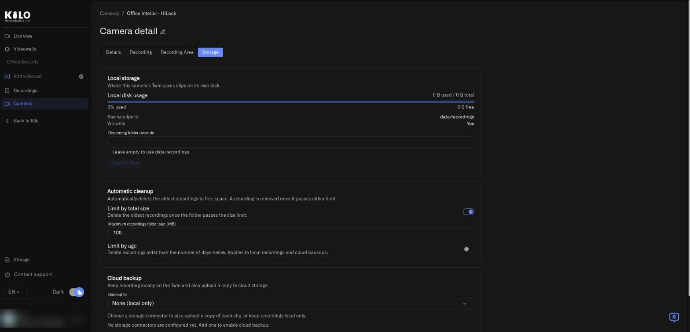
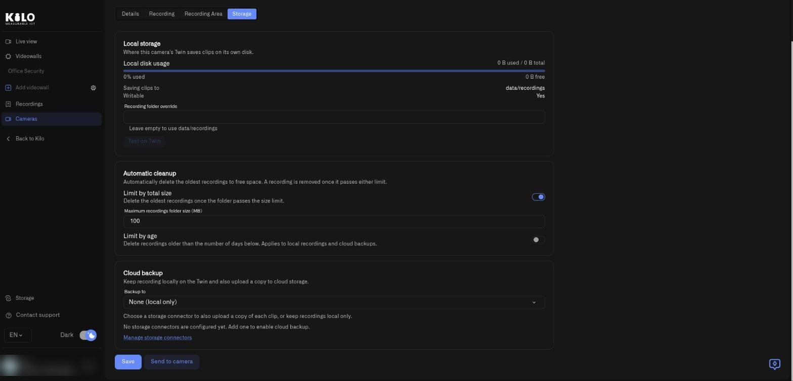

# Camera Detail Page: Every Tab Explained

Open **Cameras** in the Lens menu and select a camera's name to open its detail page. This is where you check a camera's health, decide when it records, draw the area that triggers recording, and choose where recordings are kept. Changes are saved in Lens and sent to the camera's Twin.

<figure><figcaption>
The Details tab. The Twin key and device ID in the Lens connection panel are blurred in this screenshot; they identify a real installation and you should not share them.
</figcaption></figure>

## What does the Details tab show?

The tab opens with a large picture area and a set of information panels.

- **Preview** and **Live** switch the picture between a regular snapshot and a live stream. A camera that is offline shows **Camera is offline**.
- The pencil beside **Camera detail** renames the camera.
- **Media capabilities** states whether **Live audio** and **Talkback** are available for this camera.
- **Lens connection** shows the **Device ID**, **Name**, **Twin key**, and **Pairing** state. **Reconnect Twin** generates a new one-time token if the Twin lost its pairing. See [Managing Cameras](managing-cameras.md).
- **Device details** lists **Status**, **Uptime**, **Last Twin activity**, **Stream type**, and whether an **SD** and **HD** stream are **available**.
- **Device specs** lists the Twin's **Version**, **Hostname**, **Architecture**, **Memory**, **Camera type**, **IP addresses**, and **MAC addresses**. Check **Version** when you want cloud archive, which needs Twin 1.1.0 or later.
- **Storage policy** shows a badge for the camera's storage mode: **Local only** (gray) or **Local + Cloud** (green). Beside it, **Twin sync status** says whether the device uses the policy configured in Lens:
  - **In sync** (green check): hover for **Twin is using the policy set by Lens**.
  - **Local override** (amber warning): hover for **Twin is using a locally overridden config.** Someone changed the storage settings in the Twin itself. To make the Twin follow Lens again, open the **Storage** tab and select **Send to camera**.
  - **Unknown**: hover for **Sync status unknown - device may not have reported yet**. It clears once the Twin reports in.

## How do I decide when a camera records?

Open the **Recording** tab.

<figure><figcaption>
The Recording tab. Recording is switched off for this demo camera.
</figcaption></figure>

| Control | What it does |
|---|---|
| **Enable recording** | Turns recording on. When it is off, live view still works but the feed is not recorded |
| **When to record** | **Motion** records when movement is detected in your recording area. **Continuous** records all the time |
| **Maximum clip length (seconds)** | Caps one clip. Continued movement starts another clip |
| **Record before movement (seconds)** | Motion mode only. Includes video from just before the trigger, so you see what led to the event |
| **Keep recording after movement (seconds)** | Motion mode only. Keeps recording after movement stops, to capture the aftermath |
| **Motion sensitivity** | Motion mode only. Counts changed pixels. Lower numbers detect smaller changes. About 150 is balanced |
| **Fragmented recordings** | Saves a streaming-friendly file format. Leave it off unless you need HLS playback. When on, **Fragment duration (seconds)** sets the length of each segment |
| **Recording schedule: Timezone** | The time zone the schedule follows, as an IANA name such as `Europe/Berlin` |
| **Recording schedule: Use schedule** | When on, a weekly timetable appears with two start and end times per weekday, so recording happens only inside those windows |
| **External recording check URL** | Before recording, Twin sends a POST to this address. A 200 response allows recording; anything else blocks it |
| **Save test clip** | Saves a short clip immediately and does not wait for motion areas, so you can test your setup. It is available only when **Enable recording** is on and **When to record** is **Motion**; otherwise it stays greyed out. A green message says **Test clip requested.** or a red one says **Could not request a test clip.** |
| **Save** | Saves the settings in Lens and sends them to the camera |

When **Enable recording** is off, every other field on the tab is greyed out; switch it on to edit them. If the Twin has not reported its settings yet, a yellow message says **Twin settings aren't available yet. Make sure the Twin is online.** and **Save** stays disabled until it is online. A green message confirms **Recording settings saved and sent to the camera**. If the camera is offline you see **Saved in Lens. Send to camera failed. Try again.** The settings are kept, and you can retry when the Twin is back. A red message, **Could not save recording settings.**, means Lens itself did not save them. [Local Recordings](local-recordings.md) explains these same settings from the Twin side.

## How do I limit recording to the area that matters?

Open the **Recording Area** tab.

<figure><figcaption>
The Recording Area tab for an offline camera. Zones can be drawn only while the camera is online and a snapshot is available.
</figcaption></figure>

The tab shows a snapshot of the camera. Draw one or more areas on it; movement outside them is ignored and does not start a recording. Saved clips still show the full camera picture. Select **Save** to apply the areas; **Save** stays disabled until you change something. A green message says **Zones saved.** A yellow one, **Saved — pending sync to camera.**, means the areas are stored in Lens and reach the Twin when it is next online. A red message, **Failed to save zones. Please try again.**, means nothing was saved. If the camera is offline the tab says **No snapshot available. Camera must be online to edit zones.** See [Motion Zones](motion-zones.md) for how areas also drive motion readings for rules.

## Where do recordings get saved?

Open the **Storage** tab. It has three sections and two buttons.

<figure><figcaption>
The top of the Storage tab: where this camera's Twin keeps clips on its own disk.
</figcaption></figure>

**Local storage** describes the Twin's own disk.

- **Local disk usage** shows used and total space with a bar, and the percentage used and free.
- **Saving clips to** and **Writable** show the folder in use and whether the Twin can write to it.
- **Recording folder override** is an advanced field for a different folder. Leave it empty to use the default; the hint shows the default path. **Test on Twin** stays greyed out until you type a folder. Select it to have the Twin check the folder: a spinner shows while it checks, then **Path OK** (green; hover to see **Writable, free** with the space left) or **Invalid** (red; hover to read **Path is not writable** or the Twin's own error). If the Twin has not reported its disk yet, the usage bar says **Disk usage not available - device has not reported yet.**

**Automatic cleanup** removes the oldest recordings so the disk does not fill.

- **Limit by total size** with **Maximum recordings folder size (MB)** deletes the oldest recordings once the folder passes the size.
- **Limit by age** with **Maximum recording age (days)** deletes recordings older than that. This limit applies to **local recordings and cloud backups**, so cloud copies are removed when they pass the age as well.

<figure><figcaption>
Cleanup limits and the Cloud backup section. No storage connector exists yet in this demo organization, so Backup to offers only None (local only).
</figcaption></figure>

**Cloud backup** is where you switch on [cloud archive](cloud-archive.md).

- **Backup to** lists **None (local only)** and every storage connector you created. Choose a connector to upload a copy of each clip. If you have none, the tab says **No storage connectors are configured yet. Add one to enable cloud backup.** If the list cannot load, a red message says **Could not load the storage connectors.** with **Try again**. **Manage storage connectors** (a link under the menu) opens the Storage connectors page.
- If the connector you chose was deleted since, a yellow message says **The selected connector is no longer available. Choose another connector or switch to local only.** and **Save** stays disabled until you pick another.
- The fields below appear only after you choose a connector. Choosing **None (local only)** hides them and clears the cloud size limit.
- **Upload queue folder** is an advanced field for the folder where clips wait for upload. Leave it empty for the default.
- A caption **"Delete after upload" is set on the camera itself.** appears when the Twin already removes clips after upload by its own setting.
- **Delete local clips after upload** removes the local copy once Lens confirms the upload. Leave it off to keep a permanent local backup.
- **Limit cloud storage** with **Maximum cloud storage (MB)** removes the oldest cloud backups for this camera once the size limit is passed. The size field appears when the switch is on. Local recordings are not affected.
- A caption explains that removed cloud backups disappear from Lens immediately, though some providers release the physical space only when their retention period ends. For Walrus, a caption **Kept for at least** *N* **days** appears when **Limit by age** is on, because Walrus keeps files for the paid period. **Uploads are encrypted (managed by Lens)** confirms encryption.

Select **Save** to store the settings in Lens and send them to the Twin. A toast says **Storage settings saved and sent to the camera.** If the Twin was offline the toast says **Saved in Lens. Send to camera failed. Try again.** If Lens could not save, it says **Could not save storage settings.** **Send to camera** pushes the stored settings to the Twin again without changing anything; a toast says **Settings sent to the camera.** or **Failed to send settings to the camera.** Both buttons stay disabled while the Twin has not reported its settings; the tab then shows **Twin settings aren't available yet. Make sure the Twin is online.** (or **Couldn't check configuration status. Reload and try again.**).
