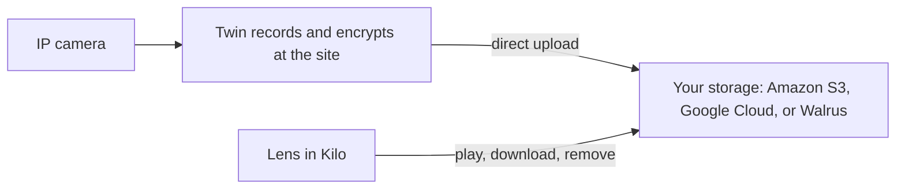
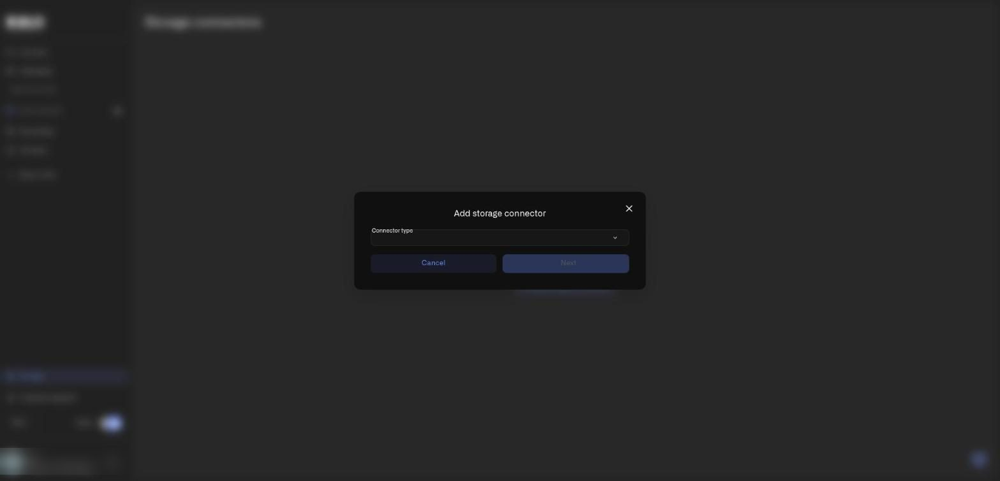

# What is cloud archive for camera recordings?

Cloud archive keeps a copy of your camera recordings in cloud storage that **you** own. Footage that matters, such as an after-hours entry or a delivery dispute, no longer depends on one disk in a closet at the site. You decide where it lives, how long you keep it, and what you pay for it.

Twin still records locally first. When you turn on cloud backup for a camera, each finished recording is also uploaded to the storage connector you choose. You then watch, download, or remove those recordings from Lens.

## Why keep camera recordings in your own cloud storage?

- **Retention under your own contract.** Your S3 bucket, Google Cloud bucket, or Walrus storage follows your retention policy and your provider's agreement. Compliance and audit teams already know how to review those.
- **Footage survives site problems.** A theft that also removes the recorder, a failed disk, or a flooded server room leaves the uploaded copy intact.
- **One archive for many sites.** Cameras in every office can send to one bucket, with a key prefix to keep sites separate, and operators open them all in one Recordings view.
- **Direct upload, predictable cost.** Twin uploads straight to your storage, so video does not pass through Kilo's own servers on the way. Your storage provider bills you for what you keep.

## How does cloud archive work?

1. Twin saves a recording locally, as described in [Local Recordings](local-recordings.md).
2. Twin encrypts the recording on the computer that runs it, before the file leaves the site. It never uploads an unencrypted file.
3. Twin uploads the encrypted recording directly to your storage, and the platform checks each upload when it finishes.
4. In Lens, **Recordings** lists the archived recordings. Playback, download, and removal go through the platform.

Previews, screenshots, and exports that Lens creates for a recording are kept on the platform side, not in your bucket.

## What does cloud archive protect, and what can the platform see?

Be clear about the model before you rely on it. The connector form says it directly: **your storage keeps the recordings; the platform keeps the keys and previews and can read the archive.**

- Recordings are encrypted before they leave the site, and they are encrypted in your storage.
- Kilo holds the encryption keys so that it can play the recordings back to your authorized users.
- Because Kilo holds the keys, this is not end-to-end encryption, and it does not hide your video from the platform. Access to recordings follows your organization's permissions for Cameras.
- **Rotating a key protects future recordings, not past ones.**

## How do I set up cloud archive, step by step?

You need Twin **1.1.0 or later** on the camera. With an older Twin, the camera records locally and the camera page asks you to update it. You can check the version under **Device specs** on the camera's **Details** tab. See [Installing Twin](installing-twin.md) for updates.

### Step 1: Add a storage connector

1. In the main menu choose **Cameras** to open the Lens workspace, then select **Storage** in the Lens menu, below **Back to Kilo**. The page is called **Storage connectors**.
2. Select **Add storage connector**. A dialog opens with a **Connector type** menu.

<figure><figcaption>
The first step of the dialog: choose the connector type, then select Next.
</figcaption></figure>

3. Open **Connector type** and choose **Amazon S3**, **Google Cloud Storage**, or **Walrus**, then select **Next**.
4. Fill in the fields for that type and select **Add connector**. [Storage Connectors](storage-connectors.md) shows each form and explains every field.

### Step 2: Send a camera's recordings to the connector

1. Open **Cameras**, then select the camera's name, and open the **Storage** tab. [Camera detail page](camera-detail-settings.md) shows the whole tab.
2. Scroll to **Cloud backup**. Open **Backup to** and choose your connector instead of **None (local only)**.
3. Decide what to do with the local copy. Switch on **Delete local clips after upload** to remove the local file once Lens confirms the upload, or leave it off to keep a permanent local backup as well.
4. Optionally switch on **Limit cloud storage** and set **Maximum cloud storage (MB)**. When this camera's archive passes the limit, Lens removes the oldest cloud backups. Local recordings are not affected.
5. Remember that **Limit by age** under **Automatic cleanup** also applies to cloud backups. A recording older than the limit is removed from both places.
6. Select **Save**, and select **Send to camera** if the Twin was offline when you saved.

### Step 3: Check that it works

1. On the camera's **Recording** tab, switch on **Enable recording**, set **When to record** to **Motion**, and select **Save test clip** to record a short clip right away. The button is available only in Motion mode, because that is the mode where a clip normally waits for movement.
2. Open **Recordings** in the Lens menu and select **Refresh**. The clip should appear once it has uploaded. If it does not, see the table of labels below and [Access and Troubleshooting](access-and-troubleshooting.md).

## How do I watch, download, or remove an archived recording?

Open **Recordings** in the Lens menu. Filter with **All devices** and **Date range**, sort with **Newest first** or **Oldest first**, and select **Refresh** to load new items.

- **Open a recording.** Select its card on **Recordings**. The recording detail page has **Download**, the removal button, **Export**, the player, **Show live** and **Show playback**, **Media info**, and the **Screenshots** gallery. [Lens Workspace Tour](lens-workspace-tour.md#what-is-on-the-recording-detail-page) walks through the page.
- **Play.** Recordings play in the Lens player, and you can seek within them. While the stream loads the player says **Loading video...**. If your storage does not support partial reads, the player says **Seeking is not available** and explains that you need storage that serves file parts. Walrus playback needs an aggregator that supports byte ranges. If playback cannot start you see **Playback unavailable. Storage connector could not provide a stream reference.** or **Storage is not responding. Try again.** Reload the page, and check the connector with **Verify**.
- **Download.** Select **Download** to save the file as MP4 for investigation or evidence. Select **Cancel download** to stop a running download. In Chrome and Edge a save dialog lets you choose the folder. Other browsers keep the file in memory, so they refuse files above 1 GiB with **This file is larger than 1 GiB. Download it in Chrome or Edge.** If the save dialog expired, the toast says **Click Download again to choose where to save it.** (for a file above 1 GiB, **This file is larger than 1 GiB. Click Download again to choose where to save it.**). Other messages: **Could not save the file. Check the folder permissions and free disk space, then try again.** and **Failed to get download link. Please try again.**
- **Delete recording.** For Amazon S3 and Google Cloud Storage, this removes the file from your bucket. A dialog titled **Delete recording** says **Once deleted, this action cannot be undone.** Select **Delete recording** to confirm, or **Cancel**. A green toast says **Recording removed** and the page returns to the list. If the removal fails the toast says **Failed to remove the recording. Please try again.** and the recording stays.
- **Remove from archive.** This button replaces **Delete recording** for a Walrus recording, a recording whose storage period ended, or a recording whose key was erased. The confirmation tells you what happens: for Walrus, **The recording disappears from the archive. The file stays in Walrus until its paid period ends.**; for ended periods, **The recording disappears from the archive. Its storage period has already ended.**; for erased keys, **The recording disappears from the archive. The file stays in your storage.** After confirming, a yellow toast repeats that the file stays (**Walrus keeps files for the paid period. They can't be deleted earlier.** or **The file stays in your storage.**).

You may also see a state label on a recording, on its card and on its detail page:

| Label | Meaning |
|---|---|
| **Unreadable** | The recording was damaged on upload and cannot be played. It still uses space in your storage. Record again |
| **Archive disconnected — key erased** | You disconnected the storage, so the platform erased its keys and cannot read these files any more. Use **Remove from archive** to clear them from Lens |
| **Storage period ended** | A Walrus recording whose paid period is over. The storage no longer provides it |
| **Kept on the camera** | The recording was not uploaded and stays only on the Twin. The line below it gives the reason: **Update the camera to enable the cloud archive.**, **The camera used a key this storage doesn't recognize. Next recordings upload once the camera receives the current key.**, **The camera used a compromised key.**, **The storage was disconnected.**, or **The storage did not accept the upload. Check the storage settings and credentials.** |

A recording marked **Unreadable**, **Archive disconnected — key erased** or **Storage period ended** hides **Download**, **Export** and **Capture**, and its card cannot be ticked for export.

## How do I rotate the key if I think it leaked?

1. On the **Storage connectors** page, find the connector and select **Mark key as compromised**.
2. Read the warning: a new key is issued and sent to the cameras, recordings made with the old key stay readable, cameras that have not received the new key keep recording locally, and cameras with outdated software cannot open local recordings made before the change.
3. Type the connector's name in **Storage name** and select **Mark key as compromised**. The button stays disabled, and the field says **The name does not match the storage name.**, until the name matches exactly.
4. When every camera received the key, a green toast says **Key marked as compromised**. If some cameras were offline, a dialog opens with **New key issued, but** *N* **cameras did not receive it.** and, where applicable, *N* **cameras will receive the new key when they next connect.** Select **Resend** to push the key again (the toast **Key sent to all cameras** confirms), or **Close** if you will let offline cameras pick it up later.

The connector's **Details** column then shows **Key compromised** with the date and the person who did it. Rotation protects future recordings only; for files already written, also rotate the credentials in your provider's console.

## How do I stop using a storage connector?

On the **Storage connectors** page choose **Disconnect storage** for the connector. Disconnecting erases the platform's keys for that connector permanently. The files stay in your storage, but nobody can play them back through Lens afterward, and reconnecting will not bring them back. To confirm, type the connector's name in **Storage name** and select **Disconnect storage**. A green toast says **Storage disconnected**.

Disconnecting is blocked while cameras still write to the connector. The dialog then names them: **Cameras still write to this storage:** *camera names*. **Move them to another storage or to local recording first.** Open each camera's **Storage** tab and change **Backup to**.

A disconnected connector shows the **Disconnected** badge and the note **Disconnected** with the date and person. To use it again select **Reconnect**, enter the credentials again, and select **Reconnect** in the form. The recordings made before the disconnect stay unreadable. To remove the connector itself, select **Delete**; Lens refuses while recordings, unfinished uploads, or camera settings still point to it. The list of files that reached your storage without finishing is under **Uploaded but not registered**; see [Storage Connectors](storage-connectors.md#how-do-i-read-the-storage-connectors-list).

## Which storage should I choose?

| If you want | Consider |
|---|---|
| The broadest choice of providers | **Amazon S3**, which also covers S3-compatible storage through a custom endpoint |
| To stay inside a Google Cloud account | **Google Cloud Storage**. It is newly released, so test it with a short recording before you depend on it |
| Decentralized storage with a paid retention period | **Walrus**, where storage is bought for a number of epochs |

Next: [Storage Connectors](storage-connectors.md) for every field, and [Local Recordings](local-recordings.md) for the Twin settings that decide what gets recorded.
