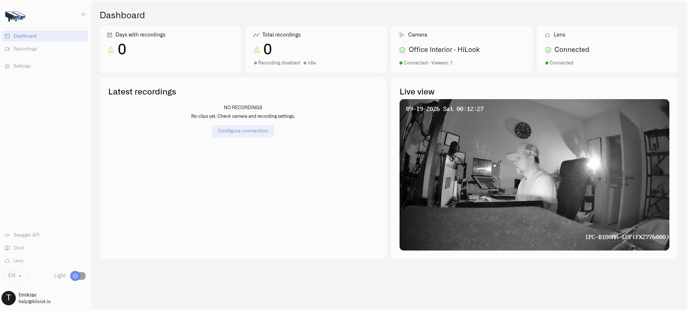

# How do I connect a camera to Kilo Lens?

Connecting a camera has two parts: Twin must reach its local video source, then Lens must associate that Twin with your organization. The camera's password belongs in Twin's camera settings; the Lens connection token is a separate credential used for pairing.

Before starting, [install one Twin for this camera](installing-twin.md), have its stream details available, and select the intended organization in Kilo. You need permission to manage cameras and available device capacity.

For ready-to-adapt stream addresses, see [RTSP Camera URLs](rtsp-camera-urls.md), including Tapo and HiLook/Hikvision examples.

## How do I configure the local camera for Twin?

1. Open Twin and sign in.
2. Open **Settings → Camera Connector**.
3. Enter the camera's RTSP address, including its local credentials, in **Main stream URL**. Select **Test main stream** to check it.
4. If the camera provides a substream, enter it in **Low-resolution stream URL** for lighter preview and motion processing. Leaving this empty uses the main stream.
5. Select **Save**, then verify the picture on the Twin dashboard.
6. For supported movement and preset controls, configure **ONVIF address**, **ONVIF username**, and **ONVIF password** in the ONVIF section. Select **Test ONVIF**, then that section's **Save**. **Discover ONVIF cameras → Scan** can help find cameras on the local network.

Use a name that identifies the camera's location and purpose, such as `Main office entrance`. Copy the **Twin Key** shown by Twin. It is generated for this installation and is not an editable camera serial number.

## How do I pair Twin with Lens?

1. In Kilo, select **Cameras** to enter Lens.
2. Choose **Add camera**.
3. In the **Add camera** dialog, read the note: **Set up the Twin first: it generates the key below and shows it read-only. A camera cannot be added ahead of its Twin.** Enter a **Camera name** and paste the **Twin Key** from the Twin (leading or trailing spaces are trimmed). The second **Add camera** button stays disabled until both fields are filled. Select it.
4. If Lens refuses, a red message under the fields tells you why:
   - **This Twin Key is already registered. If this is a cloned image, generate a new key in the Twin.** The camera already exists; use **Reconnect Twin** instead.
   - **You do not have permission to add cameras in this organization.** Ask an administrator for Edit access to Cameras.
   - **Your subscription plan has no room for another device. Remove one or upgrade the plan.**
   - **The video service is unavailable, so the camera was not created. Try again in a moment.**
   - **The camera could not be added. Try again.**
5. The dialog changes to **Pairing token**. It says **Camera registered. In the Twin's Lens Connector tab, enter the Lens API URL and this one-time connection token, then save**, and shows:
   - **Lens API URL**, with a copy button (**Copy Lens API URL**).
   - **Connection token**, hidden at first. Select the eye icon (**Reveal connection token** or **Hide connection token**) and the copy button (**Copy connection token**).
   - **Expires** and the time. Pair before then.
   - A warning that the token is shown only once and cannot be retrieved later. If it expires or is lost, remove and re-add the camera, or use **Reconnect Twin** on the camera to issue a new one.
6. In Twin, open **Settings → Lens Connector**.
7. Paste the **Lens API URL** and the **Connection token** from the dialog into Twin.
8. Select **Save** in Twin. Allow Twin to apply the connection settings.
9. Back in Lens, select **Done**. **Done** is disabled until you have copied the token; if the browser blocks copying, the dialog says **Copying is unavailable here — select the token above and copy it by hand before closing.** If the address cannot be loaded the dialog says **Lens API URL is not configured. Set it in Lens Settings before pairing a camera.** and offers **Retry**; the button then reads **Close**, and you create a new token with **Reconnect Twin** once the address is available. Then check the camera's connection state.

The **Status** badge in the camera list shows **Waiting for the Twin** or **Pairing window expired** for a camera whose token has not been entered yet, so you can see which cameras still need it. The **Paired** state itself is on the camera's page, under **Details → Lens connection**.

Use the API URL supplied for your Lens environment, not the URL of the platform's ordinary web page. A development token and endpoint belong together; do not mix them with production.

<figure><figcaption>
Check both connection indicators and the camera picture after pairing.
</figcaption></figure>

## How do I check that the camera is connected?

Open the camera and start live video. An online status confirms the connection, while a successful stream confirms that the full viewing path works. Check both before handing the camera over to operators.

The first time you open **Cameras** with no cameras, the page offers **Connect your first camera**: **Lens connects to cameras through Twin. Complete these steps once to start streaming and recording.** Its steps open the Twin install guide and the **Add camera** dialog. Later, **Setup guide** at the top right of **Cameras** reopens the same walkthrough.

Repeat this process for every camera with its own Twin and unique key. If the camera already exists and needs a new pairing token, use **Reconnect Twin** on that camera rather than creating a duplicate. See [Access and Troubleshooting](access-and-troubleshooting.md).
