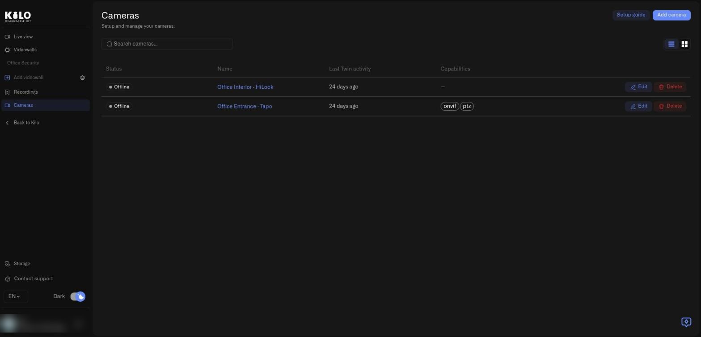
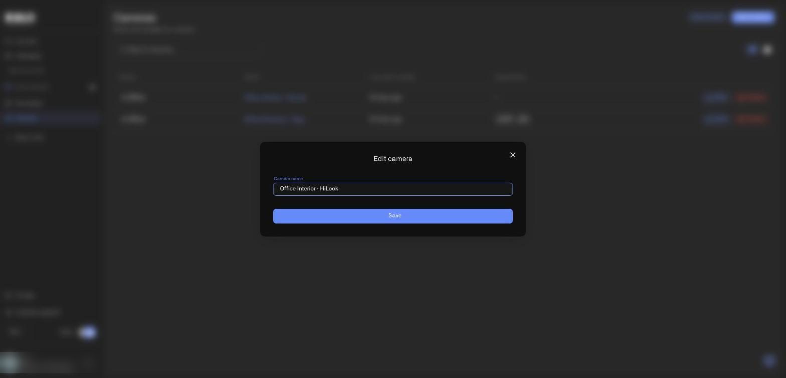
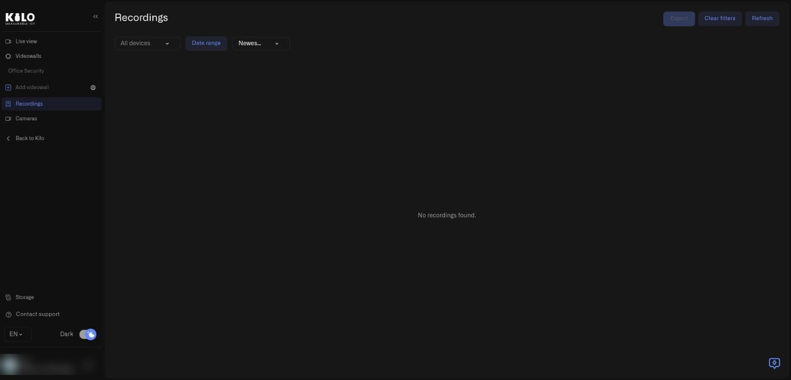
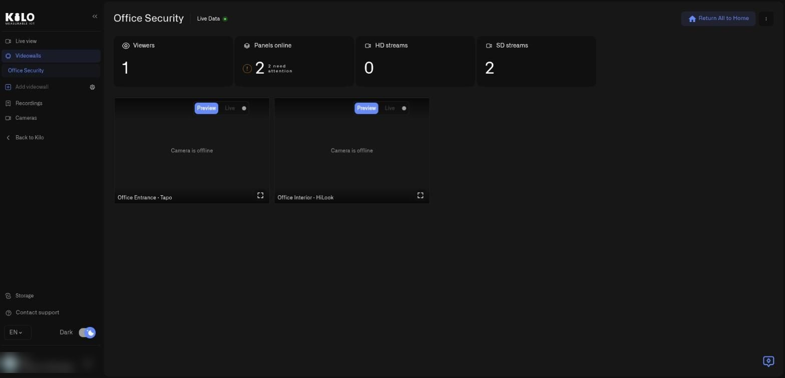

# Lens Workspace Tour: Every Menu and Screen

Lens is the part of Kilo where cameras from every site and brand live together. This page walks through the workspace screen by screen so you know where to click and what each control does before you set anything up. Each screenshot shows the whole platform window.

## How do I open the Lens workspace?

In the main Kilo menu, choose **Cameras**. The main menu is replaced by the Lens menu, and **Back to Kilo** at the bottom of its list takes you to the rest of the platform.

The Lens menu has these entries, from top to bottom:

| Menu entry | What it opens |
|---|---|
| **Live view** | Every camera you can see, with a preview or live picture for each |
| **Videowalls** | Saved layouts of selected cameras. Your saved walls are listed underneath it |
| **Add videowall** | Creates a new wall. A gear icon beside it opens wall settings |
| **Recordings** | Saved recordings from all cameras, local and archived |
| **Cameras** | The inventory of connected cameras and each camera's settings |
| **Storage** (bottom of the menu) | Storage connectors that hold your cloud archive |
| **Contact support**, language, **Dark** switch | Help, interface language, and dark or light theme |

Each Lens area follows your organization's access rules. People with **Edit** access to Cameras can change settings; people with **View** access can watch; people with **No access** do not see the menu entries. Recordings, Cameras, Videowalls, and Storage all need **Edit** access. See [Access and Troubleshooting](access-and-troubleshooting.md).

## What does the Cameras screen show?

Open **Cameras** in the Lens menu to see your inventory.

<figure><figcaption>
The Cameras page in list view. In this demo organization both cameras are offline, which is why their status reads Offline.
</figcaption></figure>

- **Setup guide** (top right) opens a step-by-step guide that walks you through installing Twin, adding the camera, and pairing. It is the quickest route if this is your first camera.
- **Add camera** starts registration of a new camera. You paste the Twin Key shown in the camera's Twin, and Lens registers the camera and gives you a one-time token to enter in the Twin. [Connecting a Camera](connecting-a-camera.md) covers the whole procedure.
- **Search cameras...** filters the list by name. Use it when many sites share one organization.
- The **list** and **grid** buttons beside the search box switch between a compact table and a card layout.
- The table columns are **Status** (Online or Offline), **Name** (a link that opens the camera's detail page), **Last Twin activity** (when the camera's Twin last contacted the platform), and **Capabilities**, which shows tags such as **onvif** and **ptz** when the camera exposes them.
- **Edit** at the end of a row renames the camera. **Delete** removes it from Lens after a confirmation.

<figure><figcaption>
Edit camera lets you change only the name. A name such as Entrance or Loading bay is more useful than the camera model.
</figcaption></figure>

Selecting **Edit** opens a small dialog with one field, **Camera name**, and a **Save** button. Renaming changes the name everywhere the camera appears, including videowalls and rules, and does not require a new Twin or pairing.

## What do I see on the Recordings screen?

Open **Recordings** in the Lens menu to browse saved clips from every camera.

<figure><figcaption>
Recordings with no clips yet. The same screen lists archived recordings once cameras record.
</figcaption></figure>

- **All devices** limits the list to one or more cameras.
- **Date range** limits it to a period.
- The sort menu switches between **Newest first** and **Oldest first**.
- **Export** packages the selected recordings as a ZIP file you can download. It is greyed out until you select recordings.
- **Clear filters** resets every filter, and **Refresh** loads clips recorded since you opened the page.
- Each recording can be played in the platform player, with seeking where your storage supports it, or downloaded. For archived recordings you also see **Delete recording** or **Remove from archive**, and a state label such as **Unreadable**, **Archive disconnected — key erased**, or **Storage period ended**. [Cloud Archive](cloud-archive.md) explains each one.

## What does a videowall look like?

Videowalls show several cameras at once. Select a wall name under **Videowalls** to open it. The top of the page shows tiles for **Viewers**, **Panels online**, **HD streams**, and **SD streams**, and each camera panel has a **Preview** and **Live** switch and a full-screen button. A camera that is offline shows **Camera is offline** in its panel instead of a stale picture.

<figure><figcaption>
A videowall with two panels. Both cameras are offline in this demo, so each panel says Camera is offline.
</figcaption></figure>

**Return All to Home** in the top right returns every panel to its saved position, and the menu with three dots next to it holds the wall's other actions. [Videowalls](videowalls.md) explains how to build and edit walls.

## Where do I configure storage for cloud archive?

Choose **Storage** at the bottom of the Lens menu. The page is titled **Storage connectors**. Until you add one it shows **No storage connectors configured yet** and an **Add storage connector** button. [Storage Connectors](storage-connectors.md) walks through every field, and [Cloud Archive](cloud-archive.md) explains how a connector is used.

## What is the next step?

Open a camera from the list to see its detail page, with the **Details**, **Recording**, **Recording Area**, and **Storage** tabs. [Camera Detail Page: Every Tab Explained](camera-detail-settings.md) covers every setting on those tabs.
