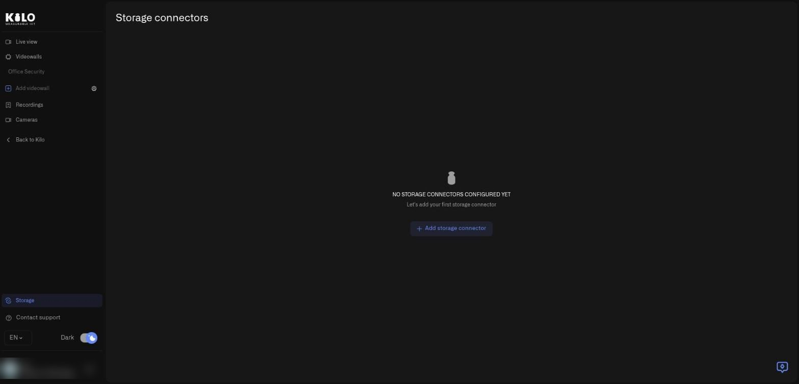
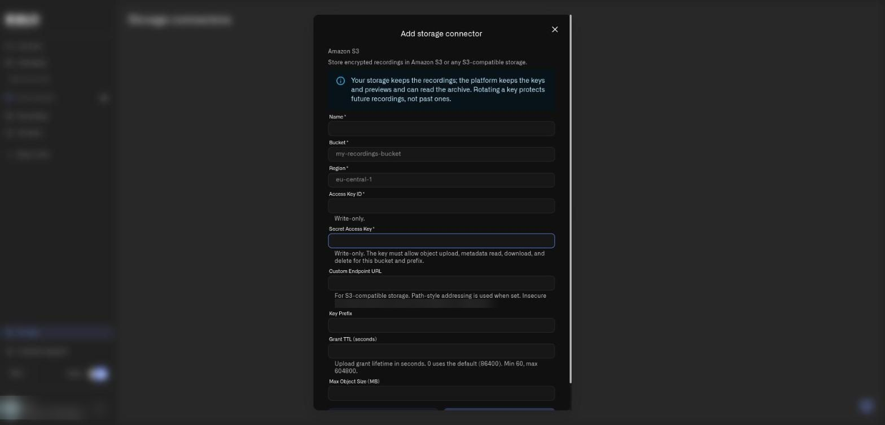
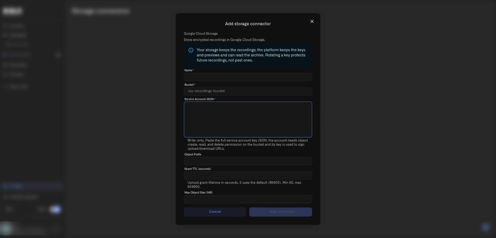
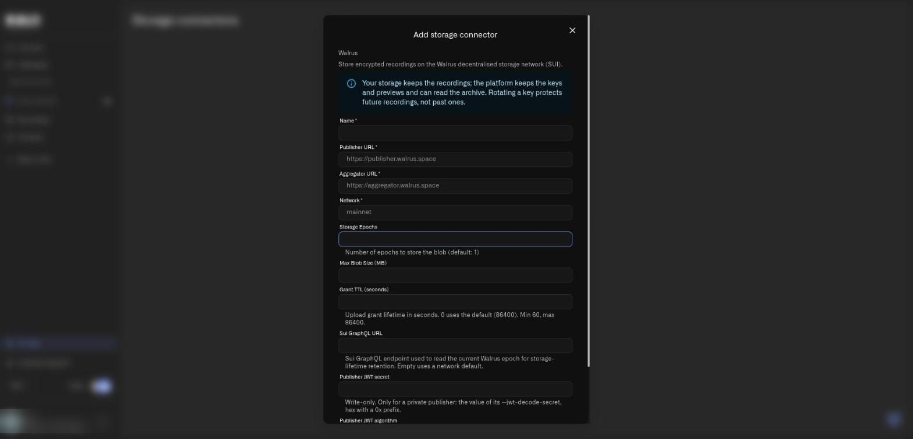

# Storage Connectors for Lens

A **storage connector** tells Lens where to keep your camera recordings. This page walks through the form for each connector type, field by field. For why and how the archive works, start with [Cloud Archive](cloud-archive.md).

## How do I open the Add storage connector form?

1. In the main menu choose **Cameras** to open the Lens workspace.
2. Select **Storage** at the bottom of the Lens menu. The **Storage connectors** page opens.

<figure><figcaption>
The Storage connectors page before any connector exists.
</figcaption></figure>

3. Select **Add storage connector**. In the dialog open **Connector type**, pick **Amazon S3**, **Google Cloud Storage**, or **Walrus**, and select **Next**. **Cancel** closes the dialog without saving.
4. Fill in the fields below and select **Add connector**. The button stays disabled until every required field is filled in.

Every form starts with the same note: **Your storage keeps the recordings; the platform keeps the keys and previews and can read the archive. Rotating a key protects future recordings, not past ones.** Read it before you connect storage you care about.

## How do I add Amazon S3 or S3-compatible storage?

<figure><figcaption>
The Amazon S3 form, shown over the dimmed Storage connectors page. Secret fields are marked write-only.
</figcaption></figure>

| Field | Required | What to enter |
|---|---|---|
| **Name** | Yes | A label you will recognize, such as the site or purpose. You pick this name later under **Backup to** |
| **Bucket** | Yes | The bucket name, for example `my-recordings-bucket` |
| **Region** | Yes | The bucket's region, for example `eu-central-1` |
| **Access Key ID** | Yes | The access key for a user or role that can write to the bucket. It is write-only |
| **Secret Access Key** | Yes | The matching secret. It is write-only. The key must allow object upload, metadata read, download, and delete for this bucket and prefix |
| **Custom Endpoint URL** | No | For S3-compatible storage. Path-style addressing is used when you set it. The address must be secure and public; insecure or private endpoints are refused |
| **Key Prefix** | No | A folder-like prefix inside the bucket, useful for one site or team |
| **Grant TTL (seconds)** | No | How long an upload permission lasts. `0` uses the default of 86400. Minimum 60, maximum 604800 |
| **Max Object Size (MB)** | No | Largest single recording to accept. Empty uses 500 MB |

Use a dedicated key with only those permissions rather than an administrator key.

## How do I add Google Cloud Storage?

<figure><figcaption>
The Google Cloud Storage form. The Service Account JSON box is a multi-line, write-only field.
</figcaption></figure>

| Field | Required | What to enter |
|---|---|---|
| **Name** | Yes | A label you will recognize |
| **Bucket** | Yes | The bucket name |
| **Service Account JSON** | Yes | Paste the full service account key file. It is write-only. The account needs permission to create, read, and delete objects in the bucket, and its key is used to sign upload and download addresses |
| **Object Prefix** | No | A prefix inside the bucket |
| **Grant TTL (seconds)** | No | Upload permission lifetime. `0` uses the default of 86400. Minimum 60, maximum 604800 |
| **Max Object Size (MB)** | No | Largest single recording to accept. Empty uses 500 MB |

Google Cloud Storage support is newly released for Lens. Test it with a short recording before you depend on it.

## How do I add Walrus storage?

<figure><figcaption>
The Walrus form. It continues below the visible area with Publisher JWT algorithm and the Cancel and Add connector buttons; scroll inside the dialog to reach them.
</figcaption></figure>

| Field | Required | What to enter |
|---|---|---|
| **Name** | Yes | A label you will recognize |
| **Publisher URL** | Yes | The Walrus publisher that accepts uploads, for example `https://publisher.walrus.space` |
| **Aggregator URL** | Yes | The Walrus aggregator that serves reads, for example `https://aggregator.walrus.space` |
| **Network** | Yes | The Walrus network, for example `mainnet` |
| **Storage Epochs** | No | How many epochs to pay for. The default is 1 |
| **Max Blob Size (MB)** | No | Largest single recording to accept. Empty uses 500 MB |
| **Grant TTL (seconds)** | No | Upload permission lifetime. `0` uses the default of 86400. Minimum 60, maximum **86400** for Walrus |
| **Sui GraphQL URL** | No | The endpoint used to read the current Walrus epoch for storage-lifetime retention. Empty uses a network default |
| **Publisher JWT secret** | No | Write-only. Only for a private publisher: the value of its `--jwt-decode-secret`, in hex with a `0x` prefix |
| **Publisher JWT algorithm** | No | `HS256` (default), `HS384`, or `HS512`, matching your publisher |

Walrus keeps a recording for the epochs you pay for. Treat that period as a **minimum**: choosing **Remove from archive** removes the recording from Lens but does not delete the file before the paid period ends. The aggregator you use must support byte-range requests, or playback cannot seek.

## What happens to my credentials after I save them?

Secret fields are write-only. After you save, Lens does not show them again. When you edit a connector, leaving a secret field blank keeps the stored value. If you change the endpoint, you must enter the credentials again.

Use dedicated credentials for Lens, keep them out of screenshots and support messages, and rotate them in your provider's console when people who knew them leave. See [Cloud Archive](cloud-archive.md) for what **Mark key as compromised** and **Disconnect storage** do, and for how to point a camera at the connector under **Cloud backup** on its Storage tab.
