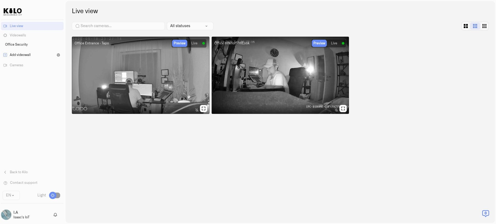

# How do I watch live video in Kilo Lens?

Lens **Live view** lets operators inspect multiple connected cameras in one workspace. It is useful for comparing activity at an entrance, loading area, or remote facility without opening separate manufacturer applications.

<figure><figcaption>
Each camera has its own Preview and Live controls.
</figcaption></figure>

## How do I open live camera feeds?

1. Select **Cameras** in Kilo's main navigation to open Lens.
2. Open **Live view**.
3. Type in **Search cameras...** to find a camera by name, and open **All statuses** to show only cameras in one state, such as **Online** or **Offline**. With no match the page says **No cameras available.** Use the page numbers under the grid when you have many cameras.
4. Choose a two-, three-, or four-column layout with the column buttons at the right of the filters (*N* **columns**). The default is three.
5. Start live video on each camera you want to watch.

A preview image and an active live stream are different viewing states. Start the stream when you need continuous video rather than assuming a preview is already live. Each tile has its own viewing controls, so two cameras can be watched together.

Select **Toggle fullscreen** on a tile when you need to examine one camera more closely. Return to the grid to compare views. Larger layouts and more simultaneous live streams require more network and viewing-device capacity.

## What controls do the live camera tiles have?

Available controls depend on the connected camera:

- **Audio:** the speaker button (tooltip **Listen**) unmutes or mutes camera sound when an audio stream is available.
- **Talkback:** the microphone button (tooltip **Hold to talk**) speaks through a compatible camera when two-way audio is available and configured. See below for how to use it.

Live tiles carry only the audio and talkback controls. Moving a camera and using presets happens on the camera's own page: open **Cameras**, select the camera, and use **Details → Camera controls** (see [Move a camera and save useful positions](#how-do-i-move-a-camera-and-save-presets)).

A camera without a supported capability will not gain physical movement or audio hardware through Lens. States such as **Needs setup** or **Not supported** help distinguish configuration from device capability.

| State | Where you see it | What it means |
|---|---|---|
| **Available** | Camera page, **Media capabilities** | The control works now |
| **Not supported** | **Live audio** or **Talkback** | This camera or its source type cannot do it. Optional detail: **Not supported by this camera type** or **No two-way audio detected on this camera** |
| **Needs setup** | **Talkback** | The camera can do it but setup is missing. On the live tile a crossed-out microphone shows **Two-way audio needs setup.** Detail may add **Camera cloud password required**. Finish setup in Twin |
| **Not available** | **Live audio** or **Talkback** | It is supported but unusable right now. Detail may say **No audio track detected**, **Audio codec not supported in the browser** or **Audio transport failed** |

A line such as **Talkback: Needs setup** appears on the tile when talkback is the problem; otherwise **Live audio** states are shown the same way.

### What does the live-stream statistics popup show?

Hover over the small colored status dot beside the **Preview** and **Live** switch in a live tile's top-right corner while a live stream plays. A popup lists the stream's technical values: **Resolution**, **FPS**, **Codec**, **Bitrate** (in kbps), **Total Data**, **Connection** type, **RTT** and **Jitter** (in ms), **Packets Lost**, **Frames Dropped**, and **Key Frames**. Move the pointer away to close it. Use it when video stutters: high **RTT**, **Jitter** or **Packets Lost** point to the network between your browser and the camera. The dot does not react while the tile shows a preview image. If the live connection cannot start, Lens reports **Live connection failed**; check the network path and try **Live** again.

<figure><figcaption>
Lens displays the images supplied by each camera, including its nighttime view.
</figcaption></figure>

## What do the camera connection states mean?

For a camera reported offline, Lens removes the previous preview snapshot and displays **Camera is offline**. Treat **No preview available** as a missing preview, not as proof of disconnection; inspect the camera's reported state before diagnosing the cause. These messages describe preview availability and do not guarantee immediate detection of every live-stream failure.

An offline camera cannot provide a current live feed. Check power, the local network, and Twin before treating a missing stream as an empty scene. If the camera is online but playback fails, inspect its video settings and the network path using [Access and Troubleshooting](access-and-troubleshooting.md).

For automated attention to a specific area, continue with [Motion Zones](motion-zones.md).

For a saved arrangement of selected feeds, create a [videowall](videowalls.md). Resize its panels to suit the monitoring task, and use [Return All to Home](videowalls.md#how-do-i-return-all-cameras-to-home-after-an-incident) to restore supported cameras after tracking activity.

## How do I listen and speak through a camera?

Start the live stream and use its audio control to unmute or mute supported camera audio. For two-way audio, use the talkback control: allow microphone access when your browser asks, then press and hold the microphone button (**Hold to talk**) while you speak. Release the button, or move the pointer off it, to stop transmitting; the microphone icon is highlighted while you are talking. A microphone permission denial, an unsupported camera, or incomplete camera audio setup prevents talkback. Check the displayed capability state before troubleshooting the microphone.

## How do I move a camera and save presets?

**PTZ** means pan, tilt, and zoom. Open **Cameras**, select a PTZ-capable camera, and stay on the **Details** tab. A camera that reports pan/tilt or zoom shows an overlay on its picture with **Pan up**, **Pan left**, **Pan right**, **Pan down**, **Zoom in**, and **Zoom out**. Below the picture, the **Camera controls** card lists the camera's presets and the **Return Home** button; it appears only for a camera that supports PTZ. Save positions you will revisit:

1. Use the overlay to move the camera to the required view.
2. Under **Presets** (the card says **No presets saved** until you add one), enter **Preset name** and select **Create preset**.
3. If **Preset update pending - refresh manually** appears, refresh after the camera has applied the update.
4. Use **Go to** beside a saved preset to recall that position.
5. Select its star, **Set as default**, to mark the normal monitoring position. The preset receives a **Default** label. **Clear default** removes that designation.

Use **Delete** beside a preset and confirm with **Yes, delete** (the dialog asks **Are you sure you want to delete "name" preset?** and adds **Once deleted, this action cannot be undone.**) when a position is no longer needed. **Return Home** moves this one camera to its default preset. It is grayed out with the tooltip **Set a default preset to enable Return Home** until a default exists, so choose another default after deleting the old one before relying on it. Recheck motion zones after changing a camera's view.

The [videowall return-home workflow](videowalls.md#how-do-i-return-all-cameras-to-home-after-an-incident) restores normal coverage after an operator follows activity with one or several cameras.
